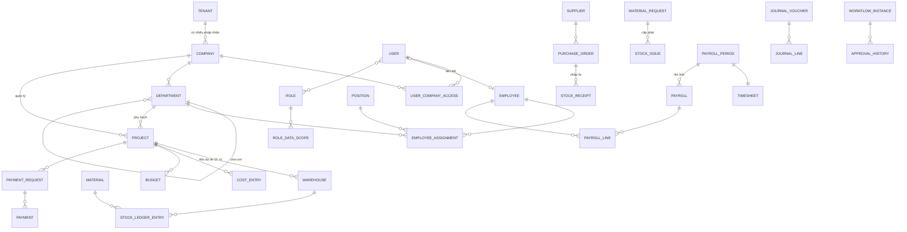

# 03 — Data Model cấp logic

Mô hình **logic**, chưa phải thiết kế bảng. Tên bảng, kiểu cột, index chỉ chốt ở bước "Thiết kế kỹ thuật" của từng chức năng (`feature-workflow.md` §2).

## 1. Thuộc tính chung của mọi entity nghiệp vụ

| Thuộc tính | Nguồn | Ghi chú |
|---|---|---|
| `id` (uuid) | **[C]** BuildingBlocks `EntityBase` | |
| `tenant_id` | **[C]** `ITenantEntity`, tự gán bởi interceptor | Không nhận từ client |
| `created_at/by`, `updated_at/by` | **[C]** `EntityAuditBase` + `AuditableEntityInterceptor` | |
| `is_deleted` | **[C]** xóa mềm, global filter | Dữ liệu đã được tham chiếu không xóa cứng |
| `row_version` | **[P]** chống ghi đè khi 2 người cùng sửa | PostgreSQL `xmin` qua EF concurrency token |
| `company_id` | **[C]** Chỉ entity cấp công ty (`ICompanyEntity`). Lấy từ token, tự gán và tự lọc như `tenant_id` | Phân loại cấp tenant / cấp công ty: ADR-0002 §2. Danh mục dùng chung **không** có `company_id` (DEC-008) |
| `code` | **[P]** mã nghiệp vụ, unique theo `(tenant_id, code)` | Danh mục: nhập tay; chứng từ: tự sinh (CMN-04) |
| `status` | **[P]** chứng từ có vòng đời | Xem §5 |

## 2. Đối tượng dùng chung và nguồn chủ quản

Mỗi đối tượng chỉ có **một** module chủ quản. Module khác chỉ tham chiếu bằng ID và đọc qua query mà module chủ công khai **[C]** (`project-architecture.md`).

| Đối tượng | Module chủ | Dùng bởi | Ghi chú |
|---|---|---|---|
| Tenant | nền tảng (platform) | Tất cả | Đã có ở BuildingBlocks |
| Company (pháp nhân) | `admin` | Tất cả | **[C]** DEC-003. Thuộc tenant, không có `company_id` |
| User | `admin` | Tất cả | Cấp tenant, username unique toàn nền tảng (DEC-005). Liên kết Employee |
| UserCompanyAccess | `admin` | Tất cả | User được vào công ty nào; vai trò gán theo từng công ty |
| Role, Permission, RoleDataScope | `admin` | Tất cả | Permission là hằng số trong code, không phải bảng sửa được **[C]** |
| CatalogItem (danh mục chung) | `admin` | Tất cả | Một bảng có `catalog_type` **[P]**, xem §4.1 |
| WorkflowDefinition / Instance / ApprovalHistory | `admin` | PAY, FIN, WH | |
| Notification | `admin` | Tất cả | |
| AuditLog, LoginHistory | `admin` | — | Chỉ ghi thêm, không sửa |
| DocumentNumberSequence | `admin` | Tất cả | CMN-04 |
| Attachment | `admin` | Tất cả | Metadata; file ở object storage |
| AccountingPeriod / PeriodLock | `accounting` | PAY, WH | **[U]** kỳ lương và kỳ kế toán có chung không → `Q-FIN-07` |
| Department | `hrm` | ADM (data scope), PAY, FIN, WH, PRJ | |
| Position | `hrm` | PAY | |
| Employee | `hrm` | ADM, PAY, FIN (tạm ứng), WH (thủ kho), PRJ | |
| Project | `projects` | Tất cả | |
| Supplier (nhà cung cấp) | `inventory` **[P]** | FIN | `Q-WH-05` |
| Customer (khách hàng / chủ đầu tư) | `accounting` **[P]** | FIN-07, FIN-09 | Master prompt chưa nêu; cần cho phải thu / doanh thu → `Q-FIN-08` |
| Material, Warehouse | `inventory` | FIN, PRJ | |
| CostCategory (khoản mục chi phí) | `accounting` **[P]** | FIN, WH | Khác "Nhóm chi phí" ở ADM-05? → `Q-FIN-09` |

## 3. Entity theo module

### `admin`

| Entity | Thuộc tính chính | Quan hệ |
|---|---|---|
| User | username, họ tên, email, điện thoại, status (Active/Locked), last_login_at, must_change_password | N–N Role; 0..1 Employee |
| Role | code, name, description, status | N–N Permission (lưu mã quyền); 1–N RoleDataScope |
| Company | code, name, tax_code, address, logo, parent_company_id?, status | |
| UserCompanyAccess | user_id, company_id, is_default | |
| UserRole | user_id, company_id, role_id | Vai trò gán theo công ty **[P]** |
| RoleDataScope | role_id, module, scope_type, scope_ref_ids | **[P]** xem [04](04-permission-matrix.md) §3 |
| UserDataScopeOverride | user_id, module, scope_type, scope_ref_ids | **[U]** có cho gán scope trực tiếp user không → `Q-ADM-03` |
| SystemSetting | key, value (jsonb), scope | |
| CatalogItem | catalog_type, code, name, parent_id, sort_order, is_active | |
| WorkflowDefinition | code, document_type, version, is_active, steps (jsonb hoặc bảng con) | 1–N WorkflowStep |
| WorkflowStep | order, name, approver_type (role/user/manager-of), condition (jsonb) | |
| WorkflowInstance | definition_id + version, document_type, document_id, current_step, status | 1–N ApprovalHistory |
| ApprovalHistory | instance_id, step, actor_id, action (submit/approve/reject/recall), comment, at | |
| Notification | recipient_user_id, type, title, body, link (document_type + id), read_at | |
| AuditLog | at, user_id, action, entity_type, entity_id, before/after (jsonb, đã che dữ liệu nhạy cảm), result, source (ui/api/import/job) | |
| LoginHistory | user_id, at, ip, user_agent, result | |
| Attachment | owner_type, owner_id, file_name, size, content_type, storage_key, category | |
| DocumentNumberSequence | document_type, prefix, period, next_value | |

### `hrm`

| Entity | Thuộc tính chính | Quan hệ |
|---|---|---|
| Department | code, name, parent_id, type (CatalogItem), manager_employee_id, effective_from/to, status | Cây; materialized path để truy vấn "đơn vị + cấp dưới" **[P]** |
| Position | code, name, kind (vị trí/chức danh **[U]**), level, applies_to_department_id, status | |
| Employee | code, họ tên, ngày sinh, giới tính, quốc tịch, định danh, địa chỉ, liên hệ, liên hệ khẩn cấp | |
| EmployeeAssignment | employee_id, department_id, position_id, employee_type, effective_from/to | **[P]** lưu lịch sử điều chuyển trong cùng công ty; bảng lương kỳ cũ đọc đơn vị **theo ngày hiệu lực**. Nhân viên thuộc một công ty (DEC-009) |
| EmployeeBankAccount | employee_id, bank, account_no (mã hóa **[P]**), account_holder | Quyền riêng |
| EmployeeStatusHistory | employee_id, status (đang làm/tạm nghỉ/nghỉ việc), effective_from | |
| EmployeeProject | employee_id, project_id, from/to, role_in_project | **[U]** có cần không → `Q-HRM-03` |

### `payroll`

| Entity | Thuộc tính chính |
|---|---|
| Shift | code, name, start, end, break_minutes, is_overnight |
| WorkSchedule | employee_id hoặc department_id, shift_id, date (hoặc pattern), version |
| AttendanceRecord | employee_id, work_date, check_in, check_out, shift_id, project_id?, source (manual/import/device), status |
| AttendanceAdjustment | record_id, old/new value, reason, workflow_instance_id |
| PayrollPeriod | year, month, from/to, scope (company/department), status (Open/Locked) |
| Timesheet | period_id, status, version |
| TimesheetLine | timesheet_id, employee_id, department_snapshot, day_values (jsonb 1–31), regular, overtime, holiday, other_totals |
| PayComponent | code, name, kind (thu nhập/khấu trừ), formula_ref, taxable, insurable, is_active | **[U]** `Q-PAY-03` |
| EmployeePayProfile | employee_id, component_id, amount/rate, effective_from/to |
| Payroll | period_id, status, run_no |
| PayrollLine | payroll_id, employee_id, component values (jsonb hoặc bảng con), gross, deductions, net, calc_trace (jsonb) |
| Payslip | payroll_line_id, published_at, status |
| PayrollSettlement | period_id, payable, paid, advance_deducted, adjustments, remaining, status |

### `accounting`

| Entity | Thuộc tính chính |
|---|---|
| Budget | code, year/period, company, department?, project?, version, status | 1–N BudgetLine (cost_category, period, planned, adjusted) |
| CostEntry | cost_type (material/labor/machine/general), period, project?, department?, cost_category, amount, source_type, source_id | **[P]** một bảng chi phí chung cho FIN-02…05, phân biệt `cost_type` |
| CostAllocation | cost_entry_id, target (project/department), basis, amount | `Q-FIN-04` |
| MachineCostDetail | cost_entry_id, machine_name, unit (ca/giờ), quantity, unit_price, provider | |
| PaymentRequest | code, date, requester, department, project, payee (type + id), content, amount, tax, due_date, bank info, approval_status, payment_status | 1–N PaymentRequestLine, 1–N Payment |
| Payment | payment_request_id?, date, amount, method, bank_account, reference |
| Advance | code, requester_employee_id, project, purpose, amount, expected_return_date, status | 1–N AdvanceSettlement |
| DebtLedgerEntry | party_type, party_id, direction (receivable/payable), project?, source_type, source_id, amount, due_date | Số dư = tổng phát sinh, không lưu cột "còn lại" cứng **[P]** |
| Revenue | period, project, revenue_type, amount, tax, source document, recognition_status |
| CashFlowPlan | period, project?, direction, category, planned_amount |
| ChartOfAccount | account_no, name, parent, type, is_active | Cấp tenant, dùng chung (DEC-017); danh sách tài khoản theo `Q-FIN-01` |
| JournalVoucher | voucher_no, voucher_date, posting_date, description, source_type, source_id, status | 1–N JournalLine (account, debit, credit, party, cost_category, project) |
| AccountingPeriod | year, month, status (Open/Closed) |

### `inventory`

| Entity | Thuộc tính chính |
|---|---|
| Material | code, name, group (CatalogItem), spec, base_uom, manufacturer, status | 1–N MaterialUomConversion |
| Warehouse | code, name, type, location, project_id?, keeper_employee_id, status |
| Supplier | code, name, tax_code, address, contact, bank, status |
| MaterialRequest | code, date, requester, department, project, warehouse, needed_by, purpose, status | 1–N line: requested, approved, issued (tính từ phiếu xuất) |
| PurchaseRequest | code, project, warehouse, status | lines liên kết MaterialRequestLine? |
| PurchaseOrder | code, supplier, project, warehouse, expected_date, tax, total, status | lines: qty, unit_price, received_qty (tính) |
| StockReceipt | code, type (purchase/transfer/return/adjust), date, warehouse, source_type/id, status | lines: material, qty, uom, unit_price |
| StockIssue | code, type, date, warehouse, project, receiver, source_type/id, status | lines |
| StockTransfer | code, from_wh, to_wh, status, dispatched_at, received_at | lines: qty_sent, qty_received |
| StockLedgerEntry | material, warehouse, date, direction (+/-), qty_base_uom, value?, source_type, source_id | **Nguồn duy nhất của tồn kho** **[P]**; chỉ ghi khi phiếu được xác nhận |
| StockReservation | material, warehouse, qty, source (material request), expires? | `Q-WH-03` |
| Stocktake | code, warehouse, cut_off_at, status | lines: system_qty, counted_qty, diff, reason, resolution |

### `projects`

| Entity | Thuộc tính chính |
|---|---|
| Project | code, name, short_name, project_type, construction_type?, location, company_id, department_id, manager_employee_id, start_date, expected_end_date, description, status |

## 4. Quyết định mô hình đáng chú ý

### 4.1 Danh mục dùng chung
**[P]** Một bảng `CatalogItem` + `catalog_type` cho danh mục đơn giản (mã, tên, cha, thứ tự). Danh mục có thuộc tính riêng (vật tư, kho, nhà cung cấp, tài khoản kế toán) là entity riêng ở module chủ. Lý do: tránh 10 bảng giống hệt nhau (KISS), vẫn có FK được.

### 4.2 Số liệu tổng hợp không lưu trùng
**[P]** Tồn kho, công nợ còn lại, số đã cấp phát, số đã nhận của đơn mua, ngân sách còn lại đều **tính từ sổ giao dịch** (`StockLedgerEntry`, `DebtLedgerEntry`, phiếu xuất…). Nếu cần hiệu năng thì thêm bảng snapshot theo kỳ, có job đối soát với sổ gốc.

### 4.3 Dữ liệu lịch sử
**[P]** Chứng từ lưu **snapshot** những thuộc tính có thể đổi về sau và ảnh hưởng ý nghĩa chứng từ (tên/đơn vị của nhân viên trên bảng lương, đơn giá trên phiếu nhập). Đổi danh mục không làm thay đổi chứng từ cũ (BR-GEN-05).

### 4.4 Liên kết chứng từ nguồn
**[P]** Mọi bản ghi sinh từ phân hệ khác có cặp `source_type` + `source_id` và unique `(tenant_id, source_type, source_id, ...)` để chống ghi nhận trùng khi đồng bộ lại.

## 5. Vòng đời trạng thái chuẩn

**[P]** Áp cho chứng từ có duyệt (W). Từng chức năng có thể thêm trạng thái riêng.

```text
Draft ──submit──► Submitted ──(bước 1 nhận)──► InReview ──approve(bước cuối)──► Approved
  ▲                   │                            │
  └──recall───────────┘                            ├──reject──► Rejected ──sửa & submit lại──► Submitted
                                                    └──cancel──► Cancelled
Approved ──(nghiệp vụ tiếp theo)──► trạng thái riêng (Paid, Fulfilled, Received, Locked…)
```

**[U]** Thu hồi sau khi bước 1 đã duyệt, ủy quyền, duyệt song song → `Q-ADM-05…07`.

| Chứng từ | Trạng thái nghiệp vụ riêng sau Approved |
|---|---|
| Đề nghị thanh toán | `payment_status`: Unpaid → PartiallyPaid → Paid (trục riêng, không trộn với duyệt) |
| Yêu cầu vật tư | PartiallyFulfilled → Fulfilled · Closed |
| Đơn mua | PartiallyReceived → Received · Closed |
| Phiếu nhập / xuất | Draft → Confirmed → Reversed (đảo bằng chứng từ ngược) |
| Phiếu chuyển kho | Approved → Dispatched → Received / PartiallyReceived → DiscrepancyResolved |
| Bảng công, bảng lương | Draft → Calculated → Submitted → Approved → Locked |
| Kiểm kê | Draft → Counting → Counted → Approved (ghi điều chỉnh tồn) |

## 6. Sơ đồ quan hệ chính


