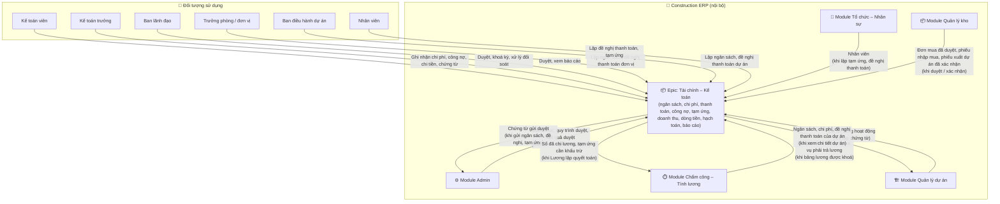
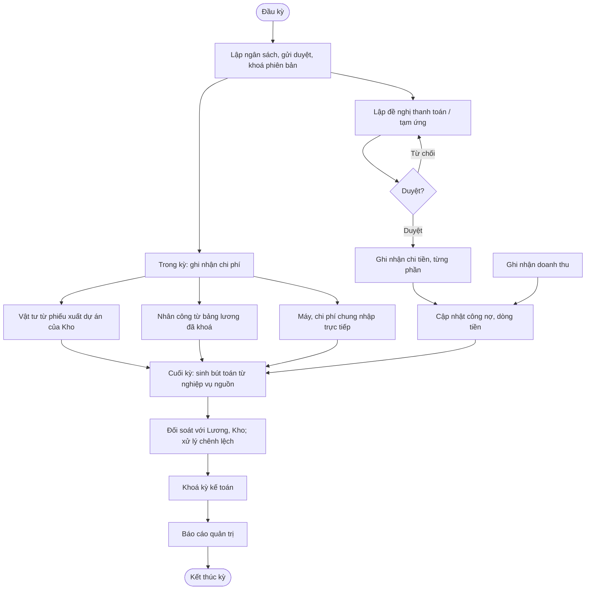
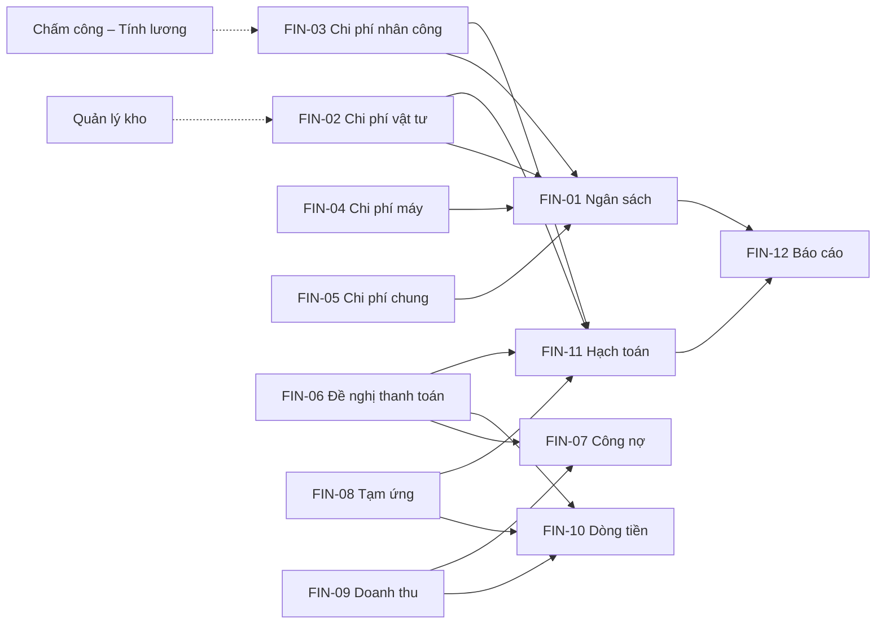
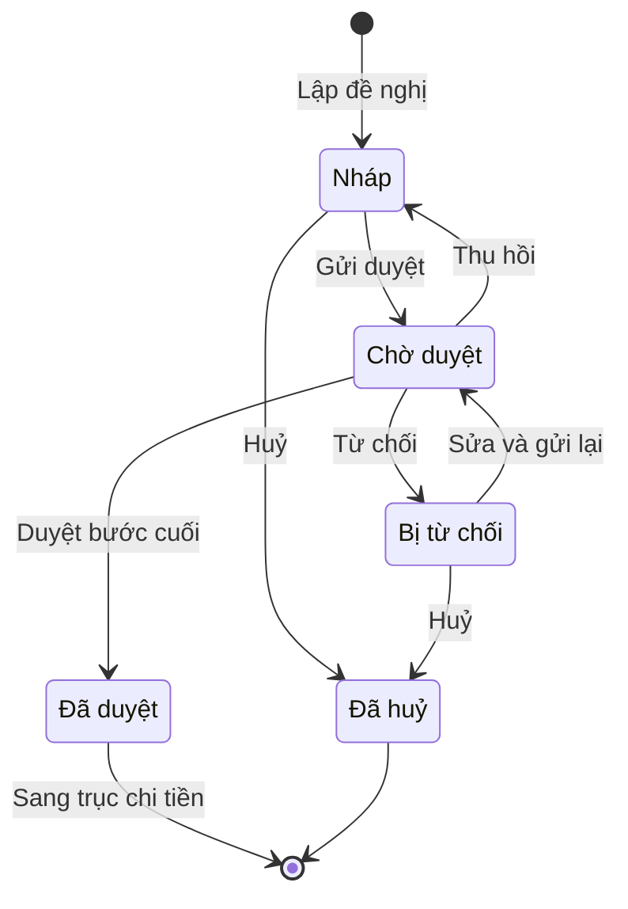
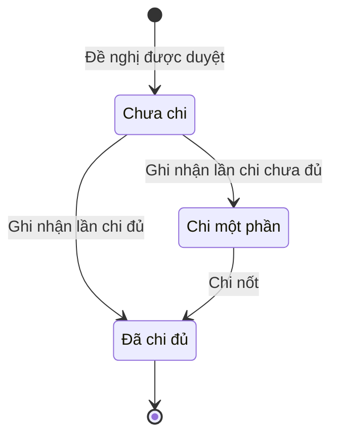
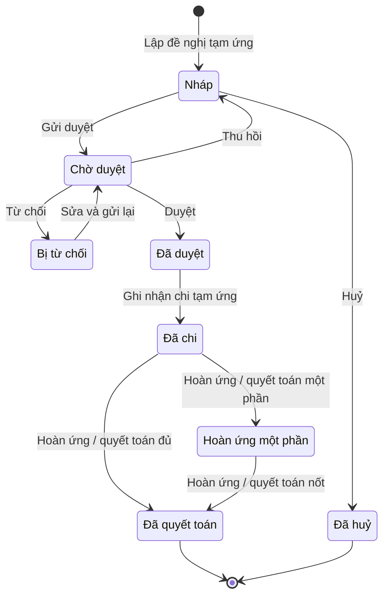
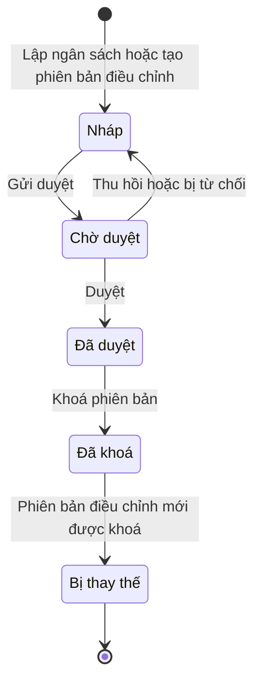
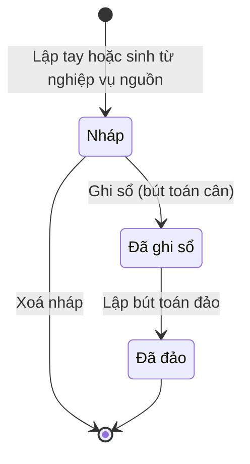
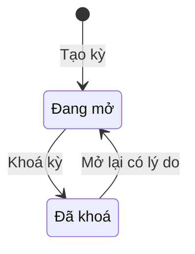
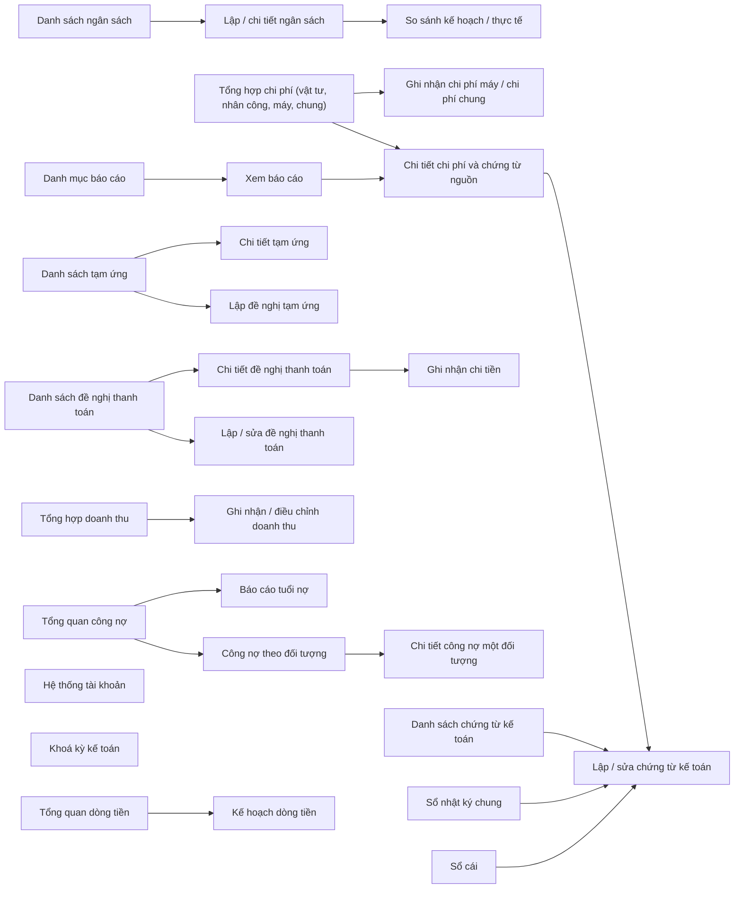

# EPIC OVERVIEW DOCUMENT (Level 1–2) — Tài chính – Kế toán

# 📑 Mục lục
- [Thông tin quản lý](#-thông-tin-quản-lý)
- [Level 1 – Product Overview](#level-1--product-overview)
- [Level 2 – Epic / Module](#level-2--epic--module)

---

## 📋 THÔNG TIN QUẢN LÝ
- **Epic ID & Name:** `EPIC_FIN` - Tài chính – Kế toán
- **Module / Phân hệ:** Tài chính – Kế toán (`accounting`)
- **Author (BA):** doanpt-vci
- **PM / Owner:** (để trống, bổ sung sau)
- **Status:** 🏷️ Nháp
- **Target Release / Sprint:** (để trống, bổ sung sau)
- **Created:** 30/10/2026
- **Last Updated:** 30/10/2026
- **Phạm vi tài liệu:** Level 1–2 (tổng quan cấp Epic). Đặc tả chi tiết từng feature con nằm ở spec riêng do skill `ba-skill` (Đặc tả chức năng) sinh.

### 🔄 Lịch sử thay đổi (Changelog)
| Ngày | Người thay đổi | Nội dung cập nhật | Version |
|------|----------------|-------------------|---------|
| 30/10/2026 | doanpt-vci | Tạo mới Epic Overview | 1.0 |
| 30/10/2026 | doanpt-vci | Cập nhật theo trả lời của PO: PM / Sprint để trống, bổ sung sau | 1.1 |

### 📋 CHANGE REQUEST LOG
| CR # | Ngày | Nguồn | Mô tả thay đổi | Before → After | Impact | Status |
|------|------|-------|-----------------|----------------|--------|--------|
| (Trống nếu chưa có CR) | | | | | | |

### 📎 TÀI LIỆU THAM CHIẾU (Reference Documents)
| STT | Tên tài liệu | Nguồn | Link tài liệu |
|-----|--------------|-------|---------------|
| 1 | Feature Matrix | docs/analysis/ | [Mở tài liệu](../../analysis/01-feature-matrix.md) |
| 2 | Sitemap, menu, danh sách màn hình | docs/analysis/ | [Mở tài liệu](../../analysis/02-sitemap-menu-screens.md) |
| 3 | Data model cấp logic | docs/analysis/ | [Mở tài liệu](../../analysis/03-data-model.md) |
| 4 | Ma trận phân quyền sơ bộ | docs/analysis/ | [Mở tài liệu](../../analysis/04-permission-matrix.md) |
| 5 | Ma trận tích hợp và đối soát | docs/analysis/ | [Mở tài liệu](../../analysis/05-integration-matrix.md) |
| 6 | Business rules quan trọng | docs/analysis/ | [Mở tài liệu](../../analysis/06-business-rules.md) |
| 7 | Câu hỏi mở và Decision Log | docs/analysis/ | [Mở tài liệu](../../analysis/07-open-questions.md) |
| 8 | Kế hoạch prototype (tham số mẫu cho hạch toán) | docs/analysis/ | [Mở tài liệu](../../analysis/08-prototype-plan.md) |
| 9 | ADR-0002 Nhiều công ty trong một khách hàng | docs/architecture/ | [Mở tài liệu](../../architecture/adr-0002-multi-company-within-tenant.md) |
| 10 | Epic Admin (quy trình duyệt, thông báo duyệt) | docs/features/admin/ | [Mở tài liệu](../admin/0_epic-overview.md) |
| 11 | Epic Chấm công – Tính lương | docs/features/payroll/ | [Mở tài liệu](../payroll/0_epic-overview.md) |
| 12 | Epic Quản lý kho | docs/features/inventory/ | [Mở tài liệu](../inventory/0_epic-overview.md) |
| 13 | Epic Quản lý dự án | docs/features/projects/ | [Mở tài liệu](../projects/0_epic-overview.md) |

### ❓ CÂU HỎI CÒN MỞ
| Mã | Câu hỏi | Ảnh hưởng tới | Người chốt |
|----|---------|---------------|------------|
| Q03 | Chế độ kế toán áp dụng (Thông tư 200 hay 133) và danh sách tài khoản chi tiết? Hệ thống tài khoản đã chốt là dùng chung mọi công ty (Q-FIN-01) | FIN-11, FIN-12 | Kế toán trưởng |
| Q04 | Bảng định khoản tự động cho từng nghiệp vụ nguồn: nhập mua, xuất cho dự án, lương, chi tiền, tạm ứng (Q-FIN-02) | FIN-11 | Kế toán trưởng |
| Q05 | Xuất kho cho dự án ghi nhận chi phí ngay (vd. TK 621 / 154) hay chỉ khi có xác nhận tiêu hao? (Q-FIN-03) | FIN-02 | Kế toán trưởng |
| Q06 | Phương pháp phân bổ chi phí chung: theo doanh thu, theo chi phí trực tiếp, tỷ lệ cố định…? (Q-FIN-04) | FIN-05 | Kế toán trưởng |
| Q07 | Quy tắc ghi nhận doanh thu: theo hoá đơn, theo nghiệm thu, theo tiến độ hợp đồng? Ai nhập? (Q-FIN-05) | FIN-09 | Kế toán trưởng |
| Q08 | Công nợ phải trả nhà cung cấp ghi theo phiếu nhập hay theo hoá đơn? Có đối chiếu đơn mua – phiếu nhập – hoá đơn không? (Q-FIN-06) | FIN-07 | Kế toán trưởng |
| Q09 | Kỳ lương và kỳ kế toán có dùng chung một khái niệm kỳ và khoá kỳ không? (Q-FIN-07) | FIN-11 | Kế toán trưởng |
| Q10 | Danh mục khách hàng / chủ đầu tư thuộc Epic này hay danh mục dùng chung của Admin? Có dùng chung "đối tượng công nợ" với nhà cung cấp không? (Q-FIN-08) | FIN-07, FIN-09 | Khách hàng |
| Q11 | "Nhóm chi phí" (danh mục Admin) và "khoản mục chi phí" là một hay hai danh mục? (Q-FIN-09) | FIN-01…05 | Kế toán trưởng |
| Q12 | Làm tròn tiền: đến đồng hay đến nghìn, ở bước nào? (Q-FIN-10) | Tất cả | Kế toán trưởng |
| Q13 | Vượt ngân sách khi lập đề nghị / đơn mua: chặn, cảnh báo, hay cảnh báo và thêm cấp duyệt? (Q-FIN-11) | BR_EPIC_06 | Khách hàng |
| Q14 | Tuổi nợ tính từ ngày chứng từ hay hạn thanh toán? Các mốc tuổi nợ? Đề xuất: từ hạn thanh toán (Q-FIN-12) | FIN-07 | Kế toán trưởng |
| Q15 | Hạn mức duyệt theo số tiền cho đề nghị thanh toán / tạm ứng (Q-FIN-13) | FIN-06, FIN-08 | Khách hàng |
| Q16 | Có nhiều đơn vị tiền tệ không? Đề xuất: chỉ VND (Q-FIN-14) | Tất cả | Khách hàng |
| Q17 | Lương nhận từ Chấm công – Tính lương dưới dạng một đề nghị chi lương tổng hay công nợ phải trả từng nhân viên? (Q-PAY-08) | FIN-03, FIN-07 | Khách hàng |
| Q18 | Phương pháp tính giá xuất kho (quyết định giá trị chi phí vật tư và tồn kho)? (Q-WH-01) | FIN-02, FIN-12 | Kế toán trưởng |
| Q19 | Có kết nối ngân hàng, hoá đơn điện tử, hay phần mềm kế toán bên ngoài không? Hiện chưa có hệ thống ngoài nào được xác nhận | 1.3 | Khách hàng |
| Q20 | Nhắc tạm ứng / công nợ: trước hạn bao nhiêu ngày, gửi lúc mấy giờ? Kiểm tra lệch đối soát chạy lúc nào? | TB_EPIC_FIN_02…05 | Kế toán trưởng |

---

## LEVEL 1 – PRODUCT OVERVIEW

### 1.1. Overview (Mục tiêu)
* **Bài toán:** Chi phí dự án đến từ nhiều nguồn (vật tư, nhân công, máy, chi phí chung); đề nghị thanh toán, tạm ứng, công nợ, doanh thu và dòng tiền theo dõi ở các bảng Excel rời nhau. Ban lãnh đạo không xem được ngân sách so với thực tế theo dự án, và kế toán phải chép tay số liệu từ kho và lương.
* **Giá trị mang lại:**
  * Chi phí nhân công và vật tư tự chuyển sang từ Chấm công – Tính lương và Quản lý kho, không chép tay, không ghi trùng.
  * Đề nghị thanh toán và tạm ứng có quy trình duyệt, theo dõi chi từng phần, cảnh báo tồn đọng.
  * Ngân sách so với thực tế, công nợ, dòng tiền, báo cáo quản trị theo dự án và theo công ty; truy về được chứng từ nguồn.
* **Scope:**
  * **IN scope:** Ngân sách (lập, phiên bản điều chỉnh, so kế hoạch / thực tế); chi phí vật tư, nhân công, máy móc, chi phí chung; đề nghị thanh toán; công nợ phải thu / phải trả; tạm ứng; doanh thu; dòng tiền; hạch toán (hệ thống tài khoản dùng chung, chứng từ kế toán, sổ nhật ký, sổ cái, khoá kỳ); báo cáo quản trị và đối soát với Lương, Kho. Prototype: phần hạch toán dùng **tham số mẫu** ghi rõ "chưa duyệt" cho đến khi có chính sách kế toán (DEC-004).
  * **OUT of scope:** Báo cáo hợp nhất theo chuẩn kế toán (chế độ Tất cả công ty chỉ cộng gộp, không loại trừ giao dịch nội bộ); tự sinh chứng từ đối ứng giữa các công ty; quản lý tài sản, khấu hao chi tiết, bảo dưỡng máy; thanh toán hợp đồng xây dựng; kết nối ngân hàng, hoá đơn điện tử (chờ Q19).

### 1.2. User Personas
| Role | Tên vai trò | Quyền hạn chính | Tần suất sử dụng |
|------|------------|-----------------|-------------------|
| `accountant` | Kế toán viên | Lập ngân sách, ghi nhận chi phí, công nợ, doanh thu, dòng tiền, chứng từ kế toán; ghi nhận chi tiền | Hàng ngày |
| `chief_accountant` | Kế toán trưởng | Duyệt ngân sách, chi tiền, chứng từ; khoá kỳ kế toán; xử lý lệch đối soát | Hàng ngày |
| `leadership` | Ban lãnh đạo | Duyệt đề nghị thanh toán, tạm ứng, ngân sách theo quy trình; xem báo cáo | Hàng tuần |
| `dept_head` | Trưởng phòng / đơn vị | Lập ngân sách đơn vị, lập và duyệt đề nghị thanh toán, tạm ứng của đơn vị | Hàng tuần |
| `project_manager` | Ban điều hành dự án | Lập ngân sách dự án; lập và duyệt đề nghị thanh toán, tạm ứng của dự án; xem báo cáo dự án | Hàng tuần |
| `employee` | Nhân viên (đại diện người lập đề nghị) | Lập đề nghị thanh toán, đề nghị tạm ứng của mình | Thỉnh thoảng |

> Các vai trò Chuyên viên nhân sự, Chuyên viên tiền lương, Nhân viên mua hàng, Thủ kho lập đề nghị thanh toán như `employee` theo ma trận sơ bộ ở tài liệu tham chiếu 4.

### 1.3. Product Context Model (Mô hình tổng quan Epic)

*Mô tả: Tài chính – Kế toán nhận số liệu đã chốt từ Lương và Kho, dùng dự án và nhân viên làm đối tượng tập hợp, đi qua quy trình duyệt dùng chung của Admin, và cấp số liệu ngược cho quyết toán lương và màn chi tiết dự án. Chưa có hệ thống ngoài được xác nhận (Q19).*

* **Thực thể dữ liệu chính:** Ngân sách (phiên bản, dòng theo khoản mục × kỳ) · Chi phí (vật tư / nhân công / máy / chung, kèm chứng từ nguồn) · Phân bổ chi phí · Đề nghị thanh toán · Lần chi tiền · Tạm ứng · Hoàn ứng / quyết toán tạm ứng · Sổ công nợ · Khách hàng / chủ đầu tư · Doanh thu · Kế hoạch dòng tiền · Hệ thống tài khoản (dùng chung) · Chứng từ kế toán (bút toán) · Kỳ kế toán.

#### 1.3.1. Chú giải thành phần & luồng dữ liệu qua lại
| Tên thành phần | Loại | Ý nghĩa / Vai trò | Chiều dữ liệu | Dữ liệu trao đổi | Sự kiện kích hoạt | Mức phụ thuộc |
|----------------|------|-------------------|---------------|------------------|-------------------|---------------|
| Kế toán viên | 👤 Đối tượng sử dụng | Người vận hành chính | Người dùng → Epic | Ngân sách, chi phí, công nợ, doanh thu, kế hoạch dòng tiền, lần chi, chứng từ kế toán | Hàng ngày | — |
| Kế toán trưởng | 👤 Đối tượng sử dụng | Kiểm soát, duyệt, khoá kỳ | Người dùng → Epic | Quyết định duyệt, khoá kỳ, xử lý chênh lệch | Hàng ngày, cuối kỳ | — |
| Ban lãnh đạo | 👤 Đối tượng sử dụng | Duyệt và theo dõi | Hai chiều | → Epic: quyết định duyệt. Epic →: báo cáo | Hàng tuần | — |
| Trưởng phòng / đơn vị | 👤 Đối tượng sử dụng | Ngân sách và đề nghị của đơn vị | Người dùng → Epic | Ngân sách đơn vị, đề nghị, quyết định duyệt | Khi cần | — |
| Ban điều hành dự án | 👤 Đối tượng sử dụng | Ngân sách và đề nghị của dự án | Người dùng → Epic | Ngân sách dự án, đề nghị, quyết định duyệt | Khi cần | — |
| Nhân viên | 👤 Đối tượng sử dụng | Người lập đề nghị, người tạm ứng | Người dùng → Epic | Đề nghị thanh toán, đề nghị tạm ứng, hoàn ứng | Khi cần | — |
| Module Admin | 🏢 Module cùng hệ thống | Danh mục, quy trình duyệt, quyền | Hai chiều | → Epic: danh mục (nhóm chi phí, hình thức thanh toán, loại chứng từ), kết quả duyệt. Epic →: chứng từ gửi duyệt | Khi lập chứng từ; khi gửi duyệt / có kết quả | 🔴 Chặn |
| Module Tổ chức – Nhân sự | 🏢 Module cùng hệ thống | Nhân viên làm người đề nghị, người tạm ứng | → Epic | Nhân viên đang làm việc của công ty | Khi lập tạm ứng, đề nghị | 🟡 Ảnh hưởng |
| Module Chấm công – Tính lương | 🏢 Module cùng hệ thống | Nguồn chi phí nhân công; nhận lại số đã chi | Hai chiều | → Epic: chi phí nhân công theo đơn vị / dự án / thành phần, nghĩa vụ phải trả lương — **chỉ bảng lương đã khoá** (hình thức chờ Q17). Epic →: số đã chi lương, tạm ứng cần khấu trừ | Khi bảng lương được khoá; khi Lương lập quyết toán | 🔴 Chặn |
| Module Quản lý kho | 🏢 Module cùng hệ thống | Nguồn cam kết chi, phải trả nhà cung cấp, chi phí vật tư | → Epic | Đơn mua đã duyệt; phiếu nhập mua **đã xác nhận**; phiếu xuất cho dự án **đã xác nhận**; tồn kho. Phiếu nháp không được chuyển | Khi duyệt đơn mua; khi xác nhận phiếu; khi lập báo cáo | 🔴 Chặn |
| Module Quản lý dự án | 🏢 Module cùng hệ thống | Đối tượng tập hợp chi phí, ngân sách, doanh thu; hiển thị số liệu dự án | Hai chiều | → Epic: dự án đang hoạt động. Epic →: ngân sách, chi phí, đề nghị thanh toán của dự án | Khi lập chứng từ; khi xem chi tiết dự án | 🔴 Chặn |

* **Ghi chú phụ thuộc:** Cần quy trình duyệt (Admin) và dự án trước khi vận hành đề nghị thanh toán, tạm ứng, ngân sách. Chi phí nhân công cần Lương khoá bảng lương; chi phí vật tư và giá trị tồn cần Q05, Q18. Hạch toán (FIN-11) và báo cáo phụ thuộc Q03, Q04 — trước đó chỉ chạy tham số mẫu.

### 1.4. Glossary / Từ điển nghiệp vụ
| Thuật ngữ | Định nghĩa | Thuật ngữ EN |
|-----------|-----------|-------------|
| Ngân sách / phiên bản ngân sách | Kế hoạch chi theo khoản mục và kỳ; mỗi lần điều chỉnh sau khi khoá tạo phiên bản mới | Budget / budget version |
| Khoản mục chi phí | Phân loại chi phí để lập ngân sách và tổng hợp (quan hệ với nhóm chi phí chờ Q11) | Cost category |
| Chi phí ghi nhận | Chi phí được Tài chính ghi cho một kỳ / dự án; khác giá trị mua, giá trị nhập kho, giá trị xuất kho, tiêu hao | Recognized cost |
| Phân bổ chi phí | Chia một chi phí chung cho các dự án / đơn vị theo một tiêu thức | Cost allocation |
| Đề nghị thanh toán | Chứng từ xin chi tiền cho một đối tượng; trạng thái duyệt và trạng thái chi tách riêng | Payment request |
| Lần chi | Một lần chi tiền thực tế cho một đề nghị; một đề nghị có thể chi nhiều lần | Payment |
| Tạm ứng / hoàn ứng | Tiền ứng trước cho người lao động / đơn vị / tiền trả lại hoặc quyết toán bằng chứng từ | Advance / settlement |
| Công nợ phải thu / phải trả | Số tiền đối tượng nợ công ty / công ty nợ đối tượng; tính từ sổ phát sinh | Receivable / payable |
| Tuổi nợ | Số ngày một khoản nợ đã quá hạn | Debt aging |
| Dòng tiền | Thu, chi, số dư theo kỳ; kế hoạch so với thực tế | Cash flow |
| Hệ thống tài khoản | Danh mục tài khoản kế toán, dùng chung mọi công ty | Chart of accounts |
| Chứng từ kế toán / bút toán | Chứng từ ghi sổ gồm các dòng Nợ / Có | Journal voucher / entry |
| Bút toán đảo | Bút toán ngược để huỷ tác động của bút toán đã ghi | Reversing entry |
| Khoá kỳ kế toán | Chốt kỳ, không ghi / sửa bút toán trong kỳ nữa | Period close |
| Đối soát | So số liệu giữa hai nguồn (Lương – Tài chính, Kho – Tài chính) để phát hiện chênh lệch | Reconciliation |

---

## LEVEL 2 – EPIC / MODULE

### 2.1. Quy trình nghiệp vụ End-to-End của Epic
* **Tên phân hệ:** Tài chính – Kế toán
* **Mô tả luồng:** Đầu năm / kỳ, kế toán và đơn vị / dự án lập ngân sách, gửi duyệt và khoá phiên bản. Trong kỳ, chi phí đi vào từ ba nguồn: Kho (vật tư), Lương (nhân công), và nhập trực tiếp (máy, chi phí chung). Nhu cầu chi tiền đi qua đề nghị thanh toán hoặc tạm ứng: duyệt theo quy trình, kế toán ghi nhận chi từng lần, công nợ và dòng tiền cập nhật. Doanh thu được ghi nhận riêng. Cuối kỳ, hệ thống sinh bút toán từ nghiệp vụ nguồn, kế toán trưởng xử lý lệch đối soát, khoá kỳ và lập báo cáo.

### 2.2. Feature Matrix (phạm vi, ảnh hưởng & trạng thái đặc tả)
| Feature ID | Tên feature | Mục đích | Actor chính | Dependencies | Risk | Spec chi tiết | Trạng thái spec |
|-----------|-------------|---------|-------------|-------------|------|---------------|-----------------|
| FIN-01 | Ngân sách | Lập, nhập Excel, phân bổ kỳ, duyệt, điều chỉnh có phiên bản, so kế hoạch / thực tế | `accountant` | Module Quản lý dự án, Module Admin, Q11 | TB | — | ⬜ Chưa có |
| FIN-02 | Chi phí vật tư | Tổng hợp chi phí vật tư theo dự án / vật tư / kỳ, truy chứng từ nguồn | `accountant` | Module Quản lý kho, Q05, Q18 | Cao | — | ⬜ Chưa có |
| FIN-03 | Chi phí nhân công | Nhận chi phí từ bảng lương đã khoá, phân bổ, đối chiếu | `accountant` | Module Chấm công – Tính lương, Q17 | Cao | — | ⬜ Chưa có |
| FIN-04 | Chi phí máy móc | Ghi nhận chi phí thuê máy, nhiên liệu, vận hành, sửa chữa… theo dự án / kỳ | `accountant` | Module Quản lý dự án | Thấp | — | ⬜ Chưa có |
| FIN-05 | Chi phí chung | Khai báo chi phí chung, gắn chứng từ, phân bổ | `accountant` | Module Quản lý dự án, Q06 | TB | — | ⬜ Chưa có |
| FIN-06 | Đề nghị thanh toán | Lập, duyệt, chi tiền từng phần, theo dõi, in / xuất | Mọi người lập, `accountant` | Module Admin, Module Quản lý dự án | Cao | — | ⬜ Chưa có |
| FIN-07 | Công nợ | Phải thu / phải trả theo đối tượng, đối chiếu, tuổi nợ, cảnh báo | `accountant` | FIN-06, Module Quản lý kho, Q08, Q10, Q14 | Cao | — | ⬜ Chưa có |
| FIN-08 | Tạm ứng | Đề nghị, duyệt, chi, hoàn ứng, quyết toán, cảnh báo tồn đọng | `employee`, `accountant` | Module Admin, Module Tổ chức – Nhân sự | TB | — | ⬜ Chưa có |
| FIN-09 | Doanh thu | Ghi nhận, điều chỉnh, tổng hợp doanh thu theo dự án / kỳ | `accountant` | Module Quản lý dự án, Q07 | Cao | — | ⬜ Chưa có |
| FIN-10 | Dòng tiền | Kế hoạch thu chi, thực thu / chi, so sánh, dự báo | `accountant` | FIN-06, FIN-08, FIN-09 | TB | — | ⬜ Chưa có |
| FIN-11 | Hạch toán | Hệ thống tài khoản, chứng từ kế toán, sổ nhật ký, sổ cái, khoá kỳ | `accountant`, `chief_accountant` | FIN-02…FIN-10, Q03, Q04, Q09 | Cao | — | ⬜ Chưa có |
| FIN-12 | Báo cáo quản trị | 14 báo cáo quản trị có lọc, nhiều cấp, biểu đồ, xem chi tiết, xuất | `leadership`, `chief_accountant` | FIN-01…FIN-11 | TB | — | ⬜ Chưa có |

### 2.3. State Machine — Vòng đời trạng thái thực thể chính

> Gửi duyệt, duyệt, từ chối, thu hồi đi theo vòng đời "Phiên duyệt chứng từ" của Epic Admin.

#### Thực thể: Đề nghị thanh toán — trục duyệt

| Trạng thái | Ý nghĩa nghiệp vụ | Feature tạo ra trạng thái này | Feature đưa trạng thái đi tiếp |
|-----------|-------------------|-------------------------------|--------------------------------|
| Nháp | Đang lập | FIN-06 | FIN-06 |
| Chờ duyệt | Trong phiên duyệt | FIN-06 | FIN-06 |
| Bị từ chối | Không được duyệt | FIN-06 | FIN-06 |
| Đã duyệt | Được phép chi; **chưa phải đã chi** | FIN-06 | FIN-06 (trục chi tiền) |
| Đã huỷ | Kết thúc | FIN-06 | — (kết thúc) |

#### Thực thể: Đề nghị thanh toán — trục chi tiền

| Trạng thái | Ý nghĩa nghiệp vụ | Feature tạo ra trạng thái này | Feature đưa trạng thái đi tiếp |
|-----------|-------------------|-------------------------------|--------------------------------|
| Chưa chi | Đã duyệt, chưa có lần chi nào | FIN-06 | FIN-06 |
| Chi một phần | Tổng đã chi nhỏ hơn số được duyệt | FIN-06 | FIN-06 |
| Đã chi đủ | Tổng đã chi bằng số được duyệt | FIN-06 | — (kết thúc) |

#### Thực thể: Tạm ứng

| Trạng thái | Ý nghĩa nghiệp vụ | Feature tạo ra trạng thái này | Feature đưa trạng thái đi tiếp |
|-----------|-------------------|-------------------------------|--------------------------------|
| Nháp | Đang lập | FIN-08 | FIN-08 |
| Chờ duyệt | Trong phiên duyệt | FIN-08 | FIN-08 |
| Bị từ chối | Không được duyệt | FIN-08 | FIN-08 |
| Đã duyệt | Được phép chi tạm ứng | FIN-08 | FIN-08 |
| Đã chi | Người tạm ứng đã nhận tiền; bắt đầu tính hạn hoàn ứng | FIN-08 | FIN-08 |
| Hoàn ứng một phần | Còn số chưa hoàn / chưa quyết toán | FIN-08 | FIN-08 |
| Đã quyết toán | Đã hoàn / quyết toán đủ | FIN-08 | — (kết thúc) |
| Đã huỷ | Huỷ trước khi duyệt | FIN-08 | — (kết thúc) |

#### Thực thể: Ngân sách (phiên bản)

| Trạng thái | Ý nghĩa nghiệp vụ | Feature tạo ra trạng thái này | Feature đưa trạng thái đi tiếp |
|-----------|-------------------|-------------------------------|--------------------------------|
| Nháp | Đang lập / điều chỉnh | FIN-01 | FIN-01 |
| Chờ duyệt | Trong phiên duyệt | FIN-01 | FIN-01 |
| Đã duyệt | Duyệt xong, chưa khoá | FIN-01 | FIN-01 |
| Đã khoá | Phiên bản hiện hành, dùng để so với thực tế | FIN-01 | FIN-01 |
| Bị thay thế | Phiên bản cũ, giữ lịch sử | FIN-01 | — (kết thúc) |

#### Thực thể: Chứng từ kế toán

| Trạng thái | Ý nghĩa nghiệp vụ | Feature tạo ra trạng thái này | Feature đưa trạng thái đi tiếp |
|-----------|-------------------|-------------------------------|--------------------------------|
| Nháp | Chưa vào sổ | FIN-11 | FIN-11 |
| Đã ghi sổ | Vào sổ nhật ký, sổ cái; không sửa trực tiếp | FIN-11 | FIN-11 |
| Đã đảo | Đã bị huỷ tác động bằng bút toán đảo | FIN-11 | — (kết thúc) |

#### Thực thể: Kỳ kế toán

| Trạng thái | Ý nghĩa nghiệp vụ | Feature tạo ra trạng thái này | Feature đưa trạng thái đi tiếp |
|-----------|-------------------|-------------------------------|--------------------------------|
| Đang mở | Ghi / sửa bút toán được | FIN-11 | FIN-11 |
| Đã khoá | Không ghi / sửa bút toán trong kỳ | FIN-11 | FIN-11 |

### 2.4. Ma trận phân quyền Epic / Module
| Tên thao tác | Feature liên quan | `accountant` | `chief_accountant` | `leadership` | `dept_head` | `project_manager` | `employee` |
|--------------|-------------------|---|---|---|---|---|---|
| Lập, sửa, nhập Excel ngân sách; gửi duyệt | FIN-01 | ✅ | ✅ | ❌ | ✅ (đơn vị mình) | ✅ (dự án được gán) | ❌ |
| Duyệt / từ chối, khoá phiên bản ngân sách | FIN-01 | ❌ | ✅ (khi là người duyệt của bước) | ✅ (khi là người duyệt của bước) | ❌ | ❌ | ❌ |
| Xem chi phí vật tư, nhân công; xuất | FIN-02, FIN-03 | ✅ | ✅ | 👁️ | 👁️ (đơn vị mình) | 👁️ (dự án được gán) | ❌ |
| Ghi nhận, sửa, nhập Excel chi phí máy, chi phí chung | FIN-04, FIN-05 | ✅ | ✅ | 👁️ | 👁️ (đơn vị mình) | 👁️ (dự án được gán) | ❌ |
| Chạy phân bổ chi phí chung | FIN-05 | ✅ | ✅ | ❌ | ❌ | ❌ | ❌ |
| Lập, sửa, gửi duyệt đề nghị thanh toán | FIN-06 | ✅ | ❌ | ❌ | ✅ (đơn vị mình) | ✅ (dự án được gán) | ✅ (của mình) |
| Duyệt / từ chối đề nghị thanh toán | FIN-06 | ❌ | ✅ (khi là người duyệt của bước) | ✅ (khi là người duyệt của bước) | ✅ (khi là người duyệt của bước) | ✅ (khi là người duyệt của bước) | ❌ |
| Ghi nhận lần chi tiền | FIN-06, FIN-08 | ✅ | ✅ | ❌ | ❌ | ❌ | ❌ |
| Xem, đối chiếu, điều chỉnh công nợ; xuất | FIN-07 | ✅ | ✅ | 👁️ | ❌ | ❌ | ❌ |
| Lập, gửi duyệt đề nghị tạm ứng; hoàn ứng | FIN-08 | ✅ | ❌ | ❌ | ✅ (đơn vị mình) | ✅ (dự án được gán) | ✅ (của mình) |
| Duyệt / từ chối tạm ứng | FIN-08 | ❌ | ✅ (khi là người duyệt của bước) | ✅ (khi là người duyệt của bước) | ✅ (khi là người duyệt của bước) | ✅ (khi là người duyệt của bước) | ❌ |
| Ghi nhận, điều chỉnh doanh thu | FIN-09 | ✅ | ✅ | 👁️ | ❌ | ❌ | ❌ |
| Lập kế hoạch dòng tiền; xem thực tế | FIN-10 | ✅ | ✅ | 👁️ | ❌ | ❌ | ❌ |
| Quản lý hệ thống tài khoản | FIN-11 | ❌ | ✅ | ❌ | ❌ | ❌ | ❌ |
| Lập, ghi sổ, nhập Excel chứng từ kế toán | FIN-11 | ✅ | ✅ | ❌ | ❌ | ❌ | ❌ |
| Đảo bút toán; khoá / mở kỳ kế toán | FIN-11 | ❌ | ✅ | ❌ | ❌ | ❌ | ❌ |
| Xem sổ nhật ký, sổ cái | FIN-11 | ✅ | ✅ | 👁️ | ❌ | ❌ | ❌ |
| Xem, xuất báo cáo quản trị | FIN-12 | ✅ | ✅ | ✅ | 👁️ (đơn vị mình) | ✅ (dự án được gán) | ❌ |

**Chú giải:** ✅ Được phép · ✅ (điều kiện) Được phép kèm giới hạn phạm vi · 👁️ Chỉ xem, không thay đổi dữ liệu · ❌ Không được phép

* **Quy tắc phạm vi dữ liệu:** Mọi chứng từ thuộc công ty đang làm việc; hệ thống tài khoản và danh mục dùng chung tập đoàn. Kế toán viên có thể giới hạn theo "dự án được gán" hoặc toàn công ty tuỳ vai trò khách hàng cấu hình. Trưởng phòng "phòng ban và đơn vị cấp dưới"; Ban điều hành dự án "dự án được gán"; Nhân viên "của mình". Bản ghi có cả dự án và phòng ban hiện với người khớp một trong hai. Ban lãnh đạo ở chế độ Tất cả công ty xem báo cáo cộng gộp, chỉ đọc.

### 2.5. Screen Flow Diagram (toàn Epic)

| Màn hình | Feature sở hữu | Mục đích | Role truy cập |
|----------|----------------|---------|---------------|
| Danh sách ngân sách | FIN-01 | Tra cứu ngân sách, phiên bản | Theo 2.4 |
| Lập / chi tiết ngân sách | FIN-01 | Lưới khoản mục × kỳ, duyệt, phiên bản | Theo 2.4 |
| So sánh kế hoạch / thực tế | FIN-01 | Chênh lệch ngân sách và thực hiện | Theo 2.4 |
| Tổng hợp chi phí (vật tư, nhân công, máy, chung) | FIN-02, FIN-03, FIN-04, FIN-05 | Chi phí theo loại, dự án, kỳ | Theo 2.4 |
| Chi tiết chi phí và chứng từ nguồn | FIN-02, FIN-03, FIN-04, FIN-05 | Xem chi tiết, truy về phiếu kho / bảng lương | Theo 2.4 |
| Ghi nhận chi phí máy / chi phí chung | FIN-04, FIN-05 | Nhập chi phí, phân bổ | `accountant`, `chief_accountant` |
| Danh sách đề nghị thanh toán | FIN-06 | Tra cứu, lọc theo trạng thái duyệt / chi | Theo 2.4 |
| Lập / sửa đề nghị thanh toán | FIN-06 | Nhập đề nghị, đính kèm chứng từ | Theo 2.4 |
| Chi tiết đề nghị thanh toán | FIN-06 | Lịch sử duyệt, các lần chi, duyệt / từ chối | Theo 2.4 |
| Ghi nhận chi tiền | FIN-06, FIN-08 | Ghi một lần chi | `accountant`, `chief_accountant` |
| Danh sách tạm ứng | FIN-08 | Tra cứu tạm ứng, tồn đọng | Theo 2.4 |
| Lập đề nghị tạm ứng | FIN-08 | Nhập đề nghị tạm ứng | Theo 2.4 |
| Chi tiết tạm ứng | FIN-08 | Duyệt, chi, hoàn ứng, quyết toán | Theo 2.4 |
| Tổng quan công nợ | FIN-07 | Số liệu phải thu / phải trả, quá hạn | `accountant`, `chief_accountant`, `leadership` |
| Công nợ theo đối tượng | FIN-07 | Danh sách theo đối tượng | Như trên |
| Chi tiết công nợ một đối tượng | FIN-07 | Phát sinh, thanh toán, đối chiếu | Như trên |
| Báo cáo tuổi nợ | FIN-07 | Nợ theo mốc quá hạn | Như trên |
| Tổng hợp doanh thu | FIN-09 | Doanh thu theo dự án / kỳ | `accountant`, `chief_accountant`, `leadership` |
| Ghi nhận / điều chỉnh doanh thu | FIN-09 | Nhập doanh thu | `accountant`, `chief_accountant` |
| Tổng quan dòng tiền | FIN-10 | Đầu kỳ, thu, chi, cuối kỳ, kế hoạch / thực tế | `accountant`, `chief_accountant`, `leadership` |
| Kế hoạch dòng tiền | FIN-10 | Lưới kế hoạch thu chi theo kỳ | `accountant`, `chief_accountant` |
| Hệ thống tài khoản | FIN-11 | Danh mục tài khoản dùng chung | `chief_accountant`; người khác xem |
| Danh sách chứng từ kế toán | FIN-11 | Tra cứu chứng từ | `accountant`, `chief_accountant` |
| Lập / sửa chứng từ kế toán | FIN-11 | Nhập bút toán, ghi sổ, đảo | `accountant`, `chief_accountant` |
| Sổ nhật ký chung | FIN-11 | Xem bút toán theo thời gian | `accountant`, `chief_accountant`, `leadership` |
| Sổ cái | FIN-11 | Xem phát sinh theo tài khoản | `accountant`, `chief_accountant`, `leadership` |
| Khoá kỳ kế toán | FIN-11 | Khoá / mở kỳ | `chief_accountant` |
| Danh mục báo cáo | FIN-12 | Chọn báo cáo | Theo 2.4 |
| Xem báo cáo | FIN-12 | Lọc, bảng nhiều cấp, biểu đồ, xem chi tiết, xuất | Theo 2.4 |

### 2.6. Business Rules (mức tổng quan — toàn Epic)
| Rule ID | Tên Rule | Mô tả điều kiện (VI) | Feature áp dụng |
|---------|---------|---------------------|-----------------|
| BR_EPIC_01 | Dữ liệu theo công ty | Ngân sách, chi phí, đề nghị thanh toán, tạm ứng, công nợ, doanh thu, dòng tiền, chứng từ kế toán, kỳ kế toán thuộc công ty đang làm việc. Hệ thống tài khoản và danh mục dùng chung tập đoàn (ADR-0002, DEC-017). | Tất cả |
| BR_EPIC_02 | Tách các loại giá trị | Giá trị mua, giá trị nhập kho, giá trị xuất kho, tiêu hao và chi phí ghi nhận là các con số khác nhau; không lấy số này thay số kia (BR-FIN-09). | FIN-02, FIN-12 |
| BR_EPIC_03 | Chỉ nhận số liệu đã chốt | Chi phí nhân công chỉ nhận từ bảng lương đã khoá; chi phí vật tư và công nợ nhà cung cấp chỉ nhận từ phiếu kho đã xác nhận. Mỗi nghiệp vụ nguồn chỉ được ghi nhận một lần; nguồn bị đảo / tính lại thì ghi bút đảo và ghi mới, không sửa đè (INT-03, INT-04). | FIN-02, FIN-03, FIN-07 |
| BR_EPIC_04 | Duyệt khác chi | Đề nghị thanh toán có hai trạng thái riêng: duyệt và chi tiền. Đã duyệt không có nghĩa đã chi. Tổng các lần chi không vượt số được duyệt (BR-FIN-01, BR-FIN-02). | FIN-06 |
| BR_EPIC_05 | Ngân sách có phiên bản | Ngân sách đã khoá chỉ thay đổi bằng phiên bản điều chỉnh có duyệt; giữ lịch sử phiên bản; so sánh kế hoạch / thực tế dùng phiên bản đang khoá (BR-FIN-03). | FIN-01 |
| BR_EPIC_06 | Vượt ngân sách | Khi đề nghị thanh toán / đơn mua làm vượt ngân sách còn lại, hệ thống xử lý theo Q13 [⚠️ CẦN XÁC NHẬN] (BR-FIN-04). | FIN-01, FIN-06 |
| BR_EPIC_07 | Bút toán cân và không trùng | Mỗi chứng từ kế toán có tổng Nợ bằng tổng Có. Một nghiệp vụ nguồn chỉ có một bộ bút toán hiệu lực (BR-FIN-05, BR-FIN-06). | FIN-11 |
| BR_EPIC_08 | Kỳ đã khoá | Không ghi, sửa hay đảo bút toán thuộc kỳ kế toán đã khoá; mở lại kỳ cần quyền khoá kỳ và lý do, có ghi nhật ký (BR-FIN-07, BR-GEN-07). | FIN-11 |
| BR_EPIC_09 | Doanh thu nhập riêng | Doanh thu không tự suy ra từ sản lượng hay số tiền đã thu (BR-FIN-08). | FIN-09 |
| BR_EPIC_10 | Tạm ứng | Số đã hoàn ứng cộng số đã quyết toán không vượt số đã chi tạm ứng; tạm ứng quá ngày dự kiến hoàn ứng được nhắc (BR-FIN-10). | FIN-08 |
| BR_EPIC_11 | Số dư tính từ phát sinh | Công nợ còn lại, ngân sách còn lại, số đã chi tính từ các phát sinh, không nhập tay (BR-GEN-10). | FIN-01, FIN-06, FIN-07 |
| BR_EPIC_12 | Báo cáo ghi rõ căn cứ | Mọi báo cáo ghi rõ nguồn dữ liệu, đơn vị tiền, kỳ, phương pháp tính và trạng thái chốt. Báo cáo ở chế độ Tất cả công ty chỉ cộng gộp, ghi rõ là chưa loại trừ giao dịch nội bộ (BR-FIN-12, ADR-0002). | FIN-12 |
| BR_EPIC_13 | Đối soát không tự sửa | Hệ thống so Lương – Tài chính và Kho – Tài chính; chênh lệch được hiển thị để người có quyền xử lý bằng chứng từ điều chỉnh, hệ thống không tự sửa số (REC-01…REC-04). | FIN-02, FIN-03, FIN-07 |
| BR_EPIC_14 | Tham số mẫu | Khi chính sách kế toán chưa được duyệt, bút toán sinh tự động và báo cáo dựa trên bút toán ghi rõ "chưa duyệt" (DEC-004). | FIN-11, FIN-12 |
| BR_EPIC_15 | Giao dịch giữa các công ty | Giao dịch giữa hai công ty trong tập đoàn: mỗi công ty tự lập chứng từ của mình; hệ thống không tự sinh chứng từ đối ứng (ADR-0002). | FIN-06, FIN-07, FIN-09 |

### 2.7. Thông báo quả chuông (toàn Epic)

> Thông báo gửi duyệt, đã duyệt, bị từ chối, nhắc chờ duyệt cho ngân sách, đề nghị thanh toán, tạm ứng dùng **TB_EPIC_ADM_01 → TB_EPIC_ADM_04** của Epic Admin. Bảng dưới chỉ gồm thông báo riêng của Epic này.

| Mã | Sự kiện / Lịch nhắc | Người nhận | Loại | Tiêu đề | Nội dung | Mở tới |
|----|---------------------|------------|------------|---------|----------|--------|
| TB_EPIC_FIN_01 | Kế toán ghi nhận một lần chi cho đề nghị thanh toán | Người lập đề nghị | Thông báo | Đề nghị thanh toán {mã} đã được chi | {Kế toán} đã chi {số tiền}, còn lại {số tiền} | Chi tiết đề nghị thanh toán |
| TB_EPIC_FIN_02 | Tạm ứng đã chi, chưa quyết toán đủ, còn ≤ {n} ngày tới ngày dự kiến hoàn ứng [⚠️ CẦN XÁC NHẬN] · {giờ} hằng ngày [⚠️ CẦN XÁC NHẬN] · dừng khi đã quyết toán | Người tạm ứng | Nhắc nhở | Tạm ứng {mã} sắp đến hạn hoàn ứng | Hạn {dd/MM/yyyy}, còn {n} ngày | Chi tiết tạm ứng |
| TB_EPIC_FIN_03 | Tạm ứng quá ngày dự kiến hoàn ứng, chưa quyết toán đủ · {giờ} hằng ngày [⚠️ CẦN XÁC NHẬN] · dừng khi đã quyết toán | Người tạm ứng; `accountant` của công ty | Nhắc nhở | Tạm ứng {mã} quá hạn hoàn ứng {n} ngày | Hạn {dd/MM/yyyy}, còn phải hoàn {số tiền} | Chi tiết tạm ứng |
| TB_EPIC_FIN_04 | Khoản công nợ còn số dư và còn ≤ {n} ngày tới hạn thanh toán [⚠️ CẦN XÁC NHẬN] · {giờ} hằng ngày [⚠️ CẦN XÁC NHẬN] · dừng khi đã thanh toán đủ | `accountant` của công ty | Nhắc nhở | Khoản nợ {mã chứng từ} sắp đến hạn | {Đối tượng}, hạn {dd/MM/yyyy}, còn {số tiền} | Chi tiết công nợ một đối tượng |
| TB_EPIC_FIN_05 | Lần đối soát định kỳ phát hiện chênh lệch Lương – Tài chính hoặc Kho – Tài chính · {lịch chạy} [⚠️ CẦN XÁC NHẬN] · dừng khi chênh lệch đã xử lý | `chief_accountant` của công ty | Nhắc nhở | Lệch đối soát {tên đối soát} tháng {MM/yyyy} | Chênh lệch {số tiền} giữa {nguồn} và Tài chính | Tổng hợp chi phí (vật tư, nhân công, máy, chung) |

> Đặc tả chi tiết từng feature con — xem spec riêng của feature (skill `ba-skill` (Đặc tả chức năng)).
