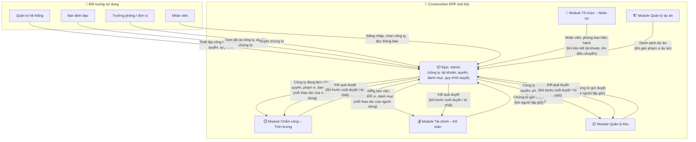
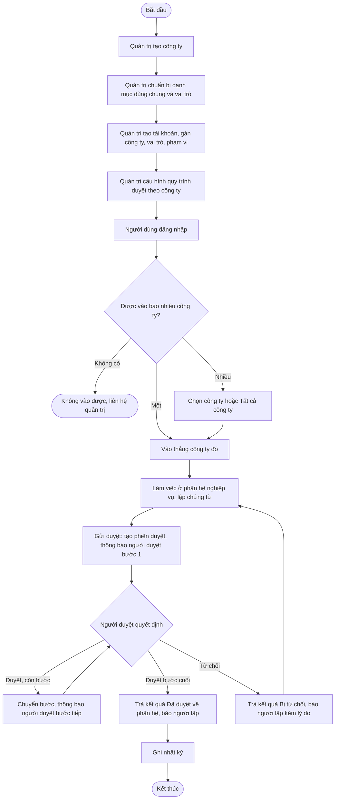
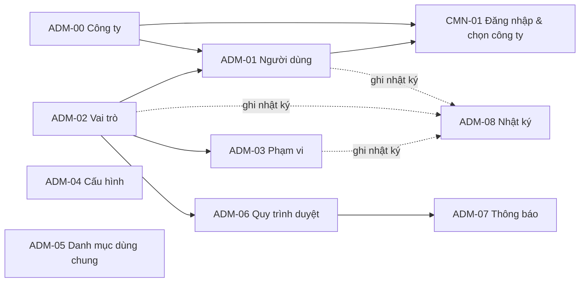
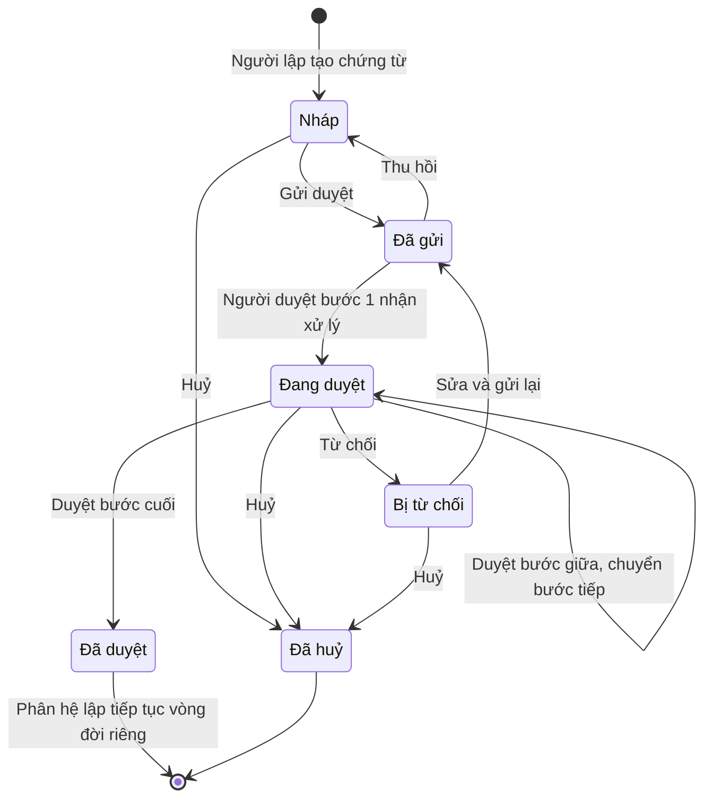
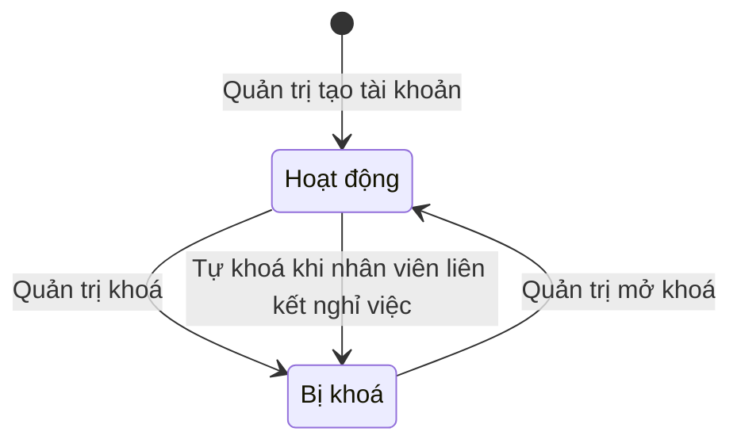
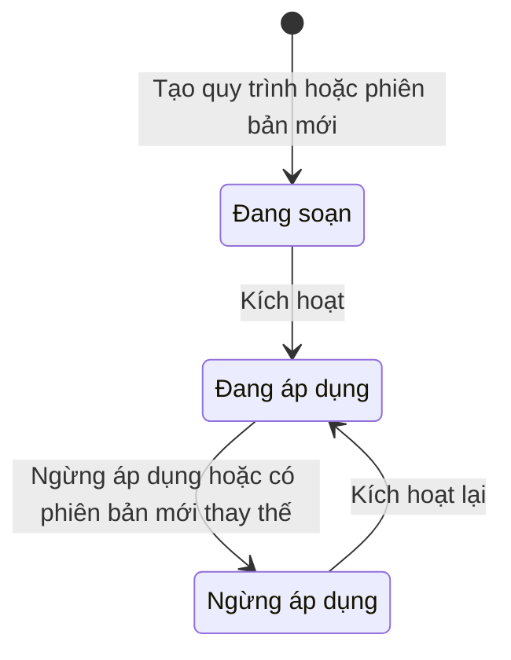
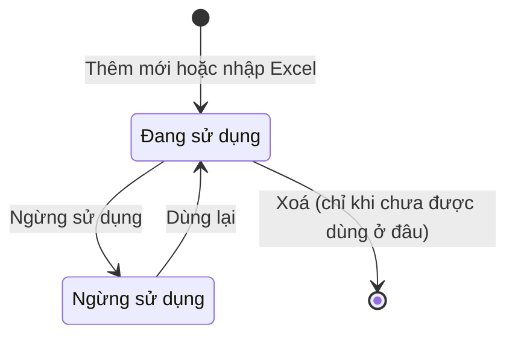
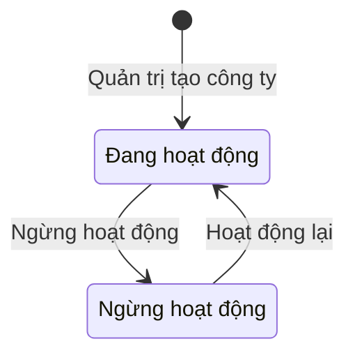
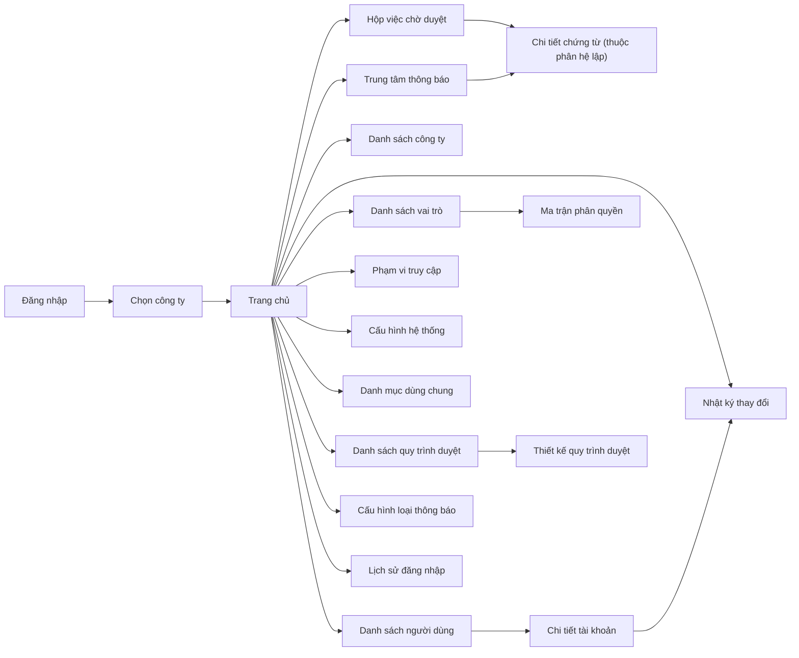

# EPIC OVERVIEW DOCUMENT (Level 1–2) — Admin

# 📑 Mục lục
- [Thông tin quản lý](#-thông-tin-quản-lý)
- [Level 1 – Product Overview](#level-1--product-overview)
- [Level 2 – Epic / Module](#level-2--epic--module)

---

## 📋 THÔNG TIN QUẢN LÝ
- **Epic ID & Name:** `EPIC_ADM` - Admin (quản trị hệ thống)
- **Module / Phân hệ:** Quản trị hệ thống (`admin`)
- **Author (BA):** doanpt-vci
- **PM / Owner:** (để trống, bổ sung sau)
- **Status:** 🏷️ Nháp
- **Target Release / Sprint:** (để trống, bổ sung sau)
- **Created:** 30/10/2026
- **Last Updated:** 30/10/2026
- **Phạm vi tài liệu:** Level 1–2 (tổng quan cấp Epic). Đặc tả chi tiết từng feature con nằm ở spec riêng do skill `ba-skill` (Đặc tả chức năng) sinh.

### 🔄 Lịch sử thay đổi (Changelog)
| Ngày | Người thay đổi | Nội dung cập nhật | Version |
|------|----------------|-------------------|---------|
| 30/10/2026 | doanpt-vci | Tạo mới Epic Overview | 1.0 |
| 30/10/2026 | doanpt-vci | Cập nhật theo trả lời của PO: từ chối bắt buộc lý do; nhắc chờ duyệt 08:00 hằng ngày; công ty có trạng thái Ngừng hoạt động; tài khoản tự khoá khi nhân viên nghỉ việc; PM / Sprint để trống | 1.1 |
| 30/10/2026 | doanpt-vci | Chốt Q16: công ty Ngừng hoạt động không chọn được để làm việc, Ban lãnh đạo vẫn xem ở chế độ Tất cả công ty | 1.2 |
| 30/10/2026 | doanpt-vci | Chốt Q15 nhập Excel danh mục: áp dụng BR-GEN-11 (người dùng chọn ghi dòng hợp lệ hoặc huỷ, tải được chi tiết lỗi) | 1.3 |

### 📋 CHANGE REQUEST LOG
| CR # | Ngày | Nguồn | Mô tả thay đổi | Before → After | Impact | Status |
|------|------|-------|-----------------|----------------|--------|--------|
| (Trống nếu chưa có CR) | | | | | | |

### 📎 TÀI LIỆU THAM CHIẾU (Reference Documents)
| STT | Tên tài liệu | Nguồn | Link tài liệu |
|-----|--------------|-------|---------------|
| 1 | Phân tích Giai đoạn 1 — tổng quan | docs/analysis/ | [Mở tài liệu](../../analysis/README.md) |
| 2 | Feature Matrix | docs/analysis/ | [Mở tài liệu](../../analysis/01-feature-matrix.md) |
| 3 | Sitemap, menu, danh sách màn hình | docs/analysis/ | [Mở tài liệu](../../analysis/02-sitemap-menu-screens.md) |
| 4 | Data model cấp logic | docs/analysis/ | [Mở tài liệu](../../analysis/03-data-model.md) |
| 5 | Ma trận phân quyền sơ bộ | docs/analysis/ | [Mở tài liệu](../../analysis/04-permission-matrix.md) |
| 6 | Ma trận tích hợp giữa phân hệ | docs/analysis/ | [Mở tài liệu](../../analysis/05-integration-matrix.md) |
| 7 | Business rules quan trọng | docs/analysis/ | [Mở tài liệu](../../analysis/06-business-rules.md) |
| 8 | Câu hỏi mở và Decision Log | docs/analysis/ | [Mở tài liệu](../../analysis/07-open-questions.md) |
| 9 | ADR-0001 Công nghệ và mô hình multi-tenant | docs/architecture/ | [Mở tài liệu](../../architecture/adr-0001-tech-stack-and-multi-tenancy.md) |
| 10 | ADR-0002 Nhiều công ty trong một khách hàng | docs/architecture/ | [Mở tài liệu](../../architecture/adr-0002-multi-company-within-tenant.md) |

### ❓ CÂU HỎI CÒN MỞ
| Mã | Câu hỏi | Ảnh hưởng tới | Người chốt |
|----|---------|---------------|------------|
| Q03 | Danh sách vai trò mẫu và quyền mặc định khi tạo khách hàng mới có đúng thực tế doanh nghiệp không? (Q-ADM-01) | 1.2, 2.4, ADM-02 | Khách hàng |
| Q04 | Có cho gán phạm vi dữ liệu trực tiếp cho từng người dùng (ngoài vai trò) không? (Q-ADM-03) | BR_EPIC_07, ADM-03 | Khách hàng |
| Q05 | Người gửi có được thu hồi chứng từ sau khi bước 1 đã duyệt không? Phương án: (a) chỉ thu hồi khi chưa ai duyệt · (b) thu hồi bất kỳ lúc nào trước bước cuối (Q-ADM-05) | 2.3 Phiên duyệt, ADM-06 | Khách hàng |
| Q06 | Có ủy quyền duyệt khi người duyệt vắng mặt không? (Q-ADM-06) | ADM-06 | Khách hàng |
| Q07 | Có duyệt song song (nhiều người cùng một bước) không? Nếu có: cần tất cả hay một người là đủ? (Q-ADM-07) | ADM-06 | Khách hàng |
| Q08 | Người lập có được tự duyệt chứng từ của mình không (vd. giám đốc tự lập đề nghị)? Mặc định đề xuất: không (Q-ADM-08) | BR_EPIC_19 | Khách hàng |
| Q09 | Chính sách mật khẩu, thời gian hết phiên, số lần nhập sai thì khoá tài khoản? (Q-ADM-09) | CMN-01, ADM-04 | Khách hàng |
| Q10 | Thông báo chỉ trong ứng dụng hay gửi thêm email / Zalo? Nếu có thì Epic có thêm hệ thống ngoài (Q-ADM-10) | 1.3, 2.7 | Khách hàng |
| Q11 | Đăng nhập chỉ bằng tên đăng nhập + mật khẩu, hay cần đăng nhập một lần (SSO) / mã OTP? Đề xuất: tên đăng nhập + mật khẩu trước (Q-ARC-09) | CMN-01 | Khách hàng |
| Q14 | Quy trình duyệt có điều kiện theo số tiền (vd. trên 500 triệu cần Tổng giám đốc) không? Các mức cụ thể? (Q-FIN-13) | ADM-06 | Khách hàng |

---

## LEVEL 1 – PRODUCT OVERVIEW

### 1.1. Overview (Mục tiêu)
* **Bài toán:** Một khách hàng (nhóm công ty xây dựng) có nhiều pháp nhân dùng chung hệ thống. Cần một nơi quản lý công ty, tài khoản, vai trò, phạm vi dữ liệu, danh mục dùng chung và quy trình duyệt, để mọi phân hệ nghiệp vụ dùng thống nhất và mỗi người chỉ thấy, chỉ làm được đúng phần việc của mình.
* **Giá trị mang lại:**
  * Một bộ tài khoản, vai trò, quy trình duyệt dùng chung cho 5 phân hệ nghiệp vụ — không phân hệ nào tự quản lý người dùng riêng.
  * Dữ liệu tách theo công ty, Ban lãnh đạo vẫn xem được toàn tập đoàn.
  * Truy được ai đã thay đổi gì, khi nào.
* **Scope:**
  * **IN scope:**
    * Đăng nhập, chọn công ty làm việc, đổi công ty; chế độ "Tất cả công ty" (chỉ đọc) cho Ban lãnh đạo.
    * Quản lý công ty (pháp nhân) trong khách hàng.
    * Quản lý tài khoản: tạo, sửa, khoá / mở khoá, đặt lại mật khẩu, liên kết nhân viên, gán công ty được vào và vai trò tại từng công ty.
    * Vai trò và ma trận quyền; phạm vi dữ liệu; xem quyền hiệu lực.
    * Cấu hình hệ thống (thông tin doanh nghiệp, định dạng, tiền tệ, múi giờ, phiên làm việc, tệp đính kèm, thông báo).
    * Danh mục dùng chung cả tập đoàn.
    * Quy trình duyệt chứng từ dùng chung cho mọi phân hệ, hộp việc chờ duyệt.
    * Thông báo trong ứng dụng; nhật ký thay đổi dữ liệu và lịch sử đăng nhập.
  * **OUT of scope:**
    * Quản trị nền tảng (tạo khách hàng, gói dịch vụ) — do Quản trị nền tảng thực hiện ngoài phạm vi khách hàng.
    * Nghiệp vụ của từng phân hệ (nhân sự, lương, kế toán, kho, dự án) — Epic này chỉ cung cấp nền dùng chung.
    * Gửi thông báo qua email / Zalo, đăng nhập một lần (chờ Q10, Q11).
    * Báo cáo hợp nhất theo chuẩn kế toán (chế độ "Tất cả công ty" chỉ cộng gộp để xem).

### 1.2. User Personas
| Role | Tên vai trò | Quyền hạn chính | Tần suất sử dụng |
|------|------------|-----------------|-------------------|
| `tenant_admin` | Quản trị hệ thống | Quản lý công ty, tài khoản, vai trò, phạm vi dữ liệu, danh mục, quy trình duyệt, cấu hình; xem nhật ký | Hàng tuần |
| `leadership` | Ban lãnh đạo | Xem dữ liệu mọi công ty (chỉ đọc); duyệt chứng từ khi là người duyệt của bước; xem nhật ký | Hàng ngày |
| `dept_head` | Trưởng phòng / đơn vị | Duyệt chứng từ khi là người duyệt của bước; xem danh mục | Hàng ngày |
| `employee` | Nhân viên (đại diện mọi người dùng) | Đăng nhập, chọn công ty, nhận thông báo, xem việc chờ mình duyệt | Hàng ngày |

> Các vai trò nghiệp vụ khác (Chuyên viên nhân sự, Kế toán, Thủ kho…) dùng Epic này như `employee` (đăng nhập, thông báo, duyệt); quyền nghiệp vụ của họ mô tả ở Epic của từng phân hệ.

### 1.3. Product Context Model (Mô hình tổng quan Epic)

*Mô tả: Admin là nền dùng chung. Tổ chức – Nhân sự và Quản lý dự án cấp dữ liệu để xác định phạm vi; ba phân hệ có chứng từ cần duyệt gửi chứng từ vào quy trình duyệt và nhận lại kết quả. Mọi phân hệ đọc công ty đang làm việc, quyền, phạm vi và danh mục từ Admin. Chưa có hệ thống ngoài được xác nhận (xem Q10, Q11).*

* **Thực thể dữ liệu chính:** Công ty · Tài khoản người dùng · Quyền vào công ty · Vai trò · Phạm vi dữ liệu · Cấu hình hệ thống · Mục danh mục dùng chung · Quy trình duyệt (phiên bản, bước) · Phiên duyệt chứng từ · Lịch sử duyệt · Thông báo · Nhật ký thay đổi · Lịch sử đăng nhập.

#### 1.3.1. Chú giải thành phần & luồng dữ liệu qua lại
| Tên thành phần | Loại | Ý nghĩa / Vai trò | Chiều dữ liệu | Dữ liệu trao đổi | Sự kiện kích hoạt | Mức phụ thuộc |
|----------------|------|-------------------|---------------|------------------|-------------------|---------------|
| Quản trị hệ thống | 👤 Đối tượng sử dụng | Thiết lập toàn bộ nền dùng chung cho khách hàng | Người dùng → Epic | Công ty, tài khoản, vai trò, phạm vi, danh mục, quy trình duyệt, cấu hình | Khi khởi tạo khách hàng và khi có thay đổi tổ chức | — |
| Ban lãnh đạo | 👤 Đối tượng sử dụng | Xem dữ liệu mọi công ty; duyệt chứng từ | Người dùng → Epic | Lựa chọn công ty / "Tất cả công ty", quyết định duyệt | Hàng ngày | — |
| Trưởng phòng / đơn vị | 👤 Đối tượng sử dụng | Người duyệt các bước được giao | Người dùng → Epic | Quyết định duyệt / từ chối, lý do | Khi có chứng từ tới bước của mình | — |
| Nhân viên | 👤 Đối tượng sử dụng | Mọi người dùng: đăng nhập, chọn công ty, đọc thông báo | Người dùng → Epic | Tên đăng nhập, mật khẩu, công ty chọn | Mỗi lần vào hệ thống | — |
| Module Tổ chức – Nhân sự | 🏢 Module cùng hệ thống | Chủ quản nhân viên và cơ cấu phòng ban | → Epic | Nhân viên (để liên kết tài khoản); phòng ban hiện hành của nhân viên (để tính phạm vi phòng ban); nhân viên nghỉ việc | Khi gán liên kết; khi nhân viên đổi phòng ban; khi nghỉ việc | 🔴 Chặn (phạm vi phòng ban) |
| Module Quản lý dự án | 🏢 Module cùng hệ thống | Chủ quản danh mục dự án | → Epic | Danh sách dự án đang hoạt động của công ty | Khi gán phạm vi theo dự án | 🟡 Ảnh hưởng |
| Module Chấm công – Tính lương | 🏢 Module cùng hệ thống | Có chứng từ cần duyệt (điều chỉnh công, bảng công, bảng lương, quyết toán) | Hai chiều | → Epic: chứng từ gửi duyệt. Epic →: kết quả duyệt; công ty đang làm việc, quyền, phạm vi, danh mục | Khi gửi duyệt; khi bước cuối duyệt / từ chối; mỗi thao tác | 🔴 Chặn |
| Module Tài chính – Kế toán | 🏢 Module cùng hệ thống | Có chứng từ cần duyệt (ngân sách, đề nghị thanh toán, tạm ứng…) | Hai chiều | Như dòng trên | Như dòng trên | 🔴 Chặn |
| Module Quản lý kho | 🏢 Module cùng hệ thống | Có chứng từ cần duyệt (yêu cầu vật tư, mua hàng, chuyển kho, kiểm kê) | Hai chiều | Như dòng trên | Như dòng trên | 🔴 Chặn |

* **Ghi chú phụ thuộc:** Epic này phải vận hành trước mọi phân hệ khác (không có tài khoản, công ty, quyền thì không phân hệ nào dùng được). Phạm vi dữ liệu theo phòng ban cần Module Tổ chức – Nhân sự; theo dự án cần Module Quản lý dự án. Đổi cách tính phạm vi hay vòng đời duyệt ở Epic này ảnh hưởng toàn bộ phân hệ.

### 1.4. Glossary / Từ điển nghiệp vụ
| Thuật ngữ | Định nghĩa | Thuật ngữ EN |
|-----------|-----------|-------------|
| Khách hàng | Một doanh nghiệp / nhóm công ty thuê hệ thống; dữ liệu của các khách hàng cách ly tuyệt đối | Tenant |
| Công ty | Một pháp nhân thuộc khách hàng; dữ liệu nghiệp vụ tách theo công ty | Company |
| Công ty đang làm việc | Công ty người dùng đã chọn sau khi đăng nhập; mọi dữ liệu xem / ghi đều thuộc công ty này | Active company |
| Chế độ "Tất cả công ty" | Chế độ chỉ đọc cho Ban lãnh đạo, xem gộp dữ liệu các công ty mình được vào | All-companies view |
| Vai trò | Tập quyền đặt tên do khách hàng tự định nghĩa; gán cho người dùng theo từng công ty | Role |
| Quyền | Được làm một thao tác trên một loại dữ liệu (xem, tạo, sửa, xoá, gửi duyệt, duyệt, nhập Excel, xuất, khoá kỳ, xem thông tin nhạy cảm) | Permission |
| Phạm vi dữ liệu | Giới hạn bản ghi người dùng thấy trong công ty: toàn công ty / phòng ban / phòng ban và đơn vị cấp dưới / dự án được gán / của mình | Data scope |
| Quyền hiệu lực | Tổng hợp quyền và phạm vi của mọi vai trò người dùng có tại công ty đang làm việc | Effective permission |
| Thông tin nhạy cảm | Số định danh, tài khoản ngân hàng, số tiền lương | Sensitive data |
| Danh mục dùng chung | Danh mục dùng cho cả tập đoàn: đơn vị tính, loại vật tư, nhóm chi phí, loại dự án… | Shared catalog |
| Quy trình duyệt | Cấu hình các bước duyệt, người duyệt, điều kiện cho một loại chứng từ tại một công ty; có phiên bản | Approval workflow |
| Phiên duyệt | Một lần chạy quy trình duyệt cho một chứng từ cụ thể | Workflow instance |
| Hộp việc chờ duyệt | Danh sách chứng từ đang ở bước mà người dùng là người duyệt, gom từ mọi phân hệ | Approval inbox |
| Nhật ký thay đổi | Ghi nhận ai, khi nào, thay đổi bản ghi nào, giá trị trước / sau; không ai sửa được | Audit log |

---

## LEVEL 2 – EPIC / MODULE

### 2.1. Quy trình nghiệp vụ End-to-End của Epic
* **Tên phân hệ:** Quản trị hệ thống
* **Mô tả luồng:** Quản trị hệ thống tạo các công ty, chuẩn bị danh mục dùng chung và vai trò, rồi tạo tài khoản, gán công ty được vào, vai trò và phạm vi tại từng công ty. Quản trị cấu hình quy trình duyệt cho từng loại chứng từ của từng công ty. Người dùng đăng nhập, chọn công ty và làm việc trong phân hệ nghiệp vụ; khi gửi chứng từ đi duyệt, Epic này tạo phiên duyệt, thông báo người duyệt từng bước và trả kết quả về phân hệ lập. Mọi thay đổi dữ liệu quan trọng được ghi nhật ký.

### 2.2. Feature Matrix (phạm vi, ảnh hưởng & trạng thái đặc tả)
| Feature ID | Tên feature | Mục đích | Actor chính | Dependencies | Risk | Spec chi tiết | Trạng thái spec |
|-----------|-------------|---------|-------------|-------------|------|---------------|-----------------|
| CMN-01 | Đăng nhập & chọn công ty | Đăng nhập, chọn / đổi công ty làm việc, chế độ Tất cả công ty, đổi mật khẩu | Mọi người dùng | ADM-00, ADM-01, ADM-02 | Cao | — | ⬜ Chưa có |
| ADM-00 | Quản lý công ty | Tạo, sửa, xem danh sách công ty trong khách hàng | `tenant_admin` | — | TB | — | ⬜ Chưa có |
| ADM-01 | Quản lý người dùng | Tài khoản, khoá / mở khoá, đặt lại mật khẩu, liên kết nhân viên, gán công ty và vai trò | `tenant_admin` | ADM-00, ADM-02, Module Tổ chức – Nhân sự | Cao | — | ⬜ Chưa có |
| ADM-02 | Vai trò và phân quyền | Định nghĩa vai trò, ma trận quyền, xem quyền hiệu lực | `tenant_admin` | — | Cao | — | ⬜ Chưa có |
| ADM-03 | Phạm vi truy cập | Gán phạm vi dữ liệu cho vai trò theo từng phân hệ, xem trước dữ liệu được phép | `tenant_admin` | ADM-02, Module Tổ chức – Nhân sự, Module Quản lý dự án | Cao | — | ⬜ Chưa có |
| ADM-04 | Cấu hình hệ thống | Thông tin doanh nghiệp, định dạng, tiền tệ, múi giờ, phiên làm việc, tệp đính kèm | `tenant_admin` | — | Thấp | — | ⬜ Chưa có |
| ADM-05 | Danh mục dùng chung | Danh mục dùng cho cả tập đoàn; nhập / xuất Excel; ngừng sử dụng | `tenant_admin` | — | TB | — | ⬜ Chưa có |
| ADM-06 | Quy trình duyệt & hộp việc chờ duyệt | Cấu hình quy trình theo công ty; chạy phiên duyệt cho mọi phân hệ; duyệt / từ chối | `tenant_admin`, người duyệt | ADM-02, ADM-07, Module Tổ chức – Nhân sự | Cao | — | ⬜ Chưa có |
| ADM-07 | Thông báo | Trung tâm thông báo của người dùng; cấu hình loại thông báo | Mọi người dùng | ADM-06 | TB | — | ⬜ Chưa có |
| ADM-08 | Nhật ký hệ thống | Xem nhật ký thay đổi dữ liệu và lịch sử đăng nhập | `tenant_admin`, `leadership` | — | TB | — | ⬜ Chưa có |

### 2.3. State Machine — Vòng đời trạng thái thực thể chính

#### Thực thể: Phiên duyệt chứng từ (dùng chung cho mọi phân hệ)

| Trạng thái | Ý nghĩa nghiệp vụ | Feature tạo ra trạng thái này | Feature đưa trạng thái đi tiếp |
|-----------|-------------------|-------------------------------|--------------------------------|
| Nháp | Chứng từ vừa lập hoặc vừa thu hồi, chưa gửi duyệt | Feature lập chứng từ của phân hệ | ADM-06 (gửi duyệt) |
| Đã gửi | Đã gửi, chưa người duyệt nào xử lý | ADM-06 | ADM-06 |
| Đang duyệt | Đang ở một bước duyệt; người duyệt bước hiện tại được thông báo | ADM-06 | ADM-06 |
| Đã duyệt | Bước cuối đã duyệt; phân hệ lập tiếp tục vòng đời riêng (chi tiền, cấp phát, khoá…) | ADM-06 | Feature tiếp theo của phân hệ |
| Bị từ chối | Một bước đã từ chối; người lập sửa và gửi lại hoặc huỷ | ADM-06 | ADM-06 |
| Đã huỷ | Kết thúc, không xử lý tiếp | ADM-06 / feature của phân hệ | — (kết thúc) |

> Thu hồi khi đã có bước duyệt, ủy quyền, duyệt song song: chờ Q05–Q07. Phân hệ có thể thêm trạng thái riêng sau "Đã duyệt"; tập trạng thái trên giữ thống nhất toàn hệ thống.

#### Thực thể: Tài khoản người dùng

| Trạng thái | Ý nghĩa nghiệp vụ | Feature tạo ra trạng thái này | Feature đưa trạng thái đi tiếp |
|-----------|-------------------|-------------------------------|--------------------------------|
| Hoạt động | Đăng nhập được vào các công ty được gán | ADM-01 | ADM-01 |
| Bị khoá | Không đăng nhập mới được; phiên đang mở bị chấm dứt | ADM-01, Module Tổ chức – Nhân sự (nhân viên liên kết nghỉ việc) | ADM-01 |

#### Thực thể: Quy trình duyệt (phiên bản)

| Trạng thái | Ý nghĩa nghiệp vụ | Feature tạo ra trạng thái này | Feature đưa trạng thái đi tiếp |
|-----------|-------------------|-------------------------------|--------------------------------|
| Đang soạn | Đang cấu hình bước, người duyệt, điều kiện; chưa dùng cho chứng từ mới | ADM-06 | ADM-06 |
| Đang áp dụng | Chứng từ gửi mới đi theo phiên bản này | ADM-06 | ADM-06 |
| Ngừng áp dụng | Không nhận chứng từ mới; phiên duyệt đang chạy vẫn đi hết theo phiên bản này | ADM-06 | ADM-06 |

#### Thực thể: Mục danh mục dùng chung

| Trạng thái | Ý nghĩa nghiệp vụ | Feature tạo ra trạng thái này | Feature đưa trạng thái đi tiếp |
|-----------|-------------------|-------------------------------|--------------------------------|
| Đang sử dụng | Chọn được khi lập dữ liệu mới ở mọi công ty | ADM-05 | ADM-05 |
| Ngừng sử dụng | Không chọn được cho dữ liệu mới; vẫn hiển thị đúng trên chứng từ cũ | ADM-05 | ADM-05 |

#### Thực thể: Công ty

| Trạng thái | Ý nghĩa nghiệp vụ | Feature tạo ra trạng thái này | Feature đưa trạng thái đi tiếp |
|-----------|-------------------|-------------------------------|--------------------------------|
| Đang hoạt động | Người dùng chọn được để làm việc | ADM-00 | ADM-00 |
| Ngừng hoạt động | Không chọn được để làm việc, không nhận dữ liệu mới; dữ liệu cũ giữ nguyên. Ban lãnh đạo vẫn xem dữ liệu cũ ở chế độ Tất cả công ty | ADM-00 | ADM-00 |

### 2.4. Ma trận phân quyền Epic / Module
| Tên thao tác | Feature liên quan | `tenant_admin` | `leadership` | `dept_head` | `employee` |
|--------------|-------------------|-----------|-----------|-----------|---------|
| Đăng nhập, chọn / đổi công ty, đổi mật khẩu | CMN-01 | ✅ | ✅ | ✅ | ✅ |
| Xem chế độ Tất cả công ty | CMN-01 | ❌ | ✅ (chỉ đọc) | ❌ | ❌ |
| Tạo, sửa công ty | ADM-00 | ✅ | 👁️ | ❌ | ❌ |
| Tạo, sửa tài khoản; khoá / mở khoá; đặt lại mật khẩu | ADM-01 | ✅ | ❌ | ❌ | ❌ |
| Gán công ty được vào, vai trò tại từng công ty, liên kết nhân viên | ADM-01 | ✅ | ❌ | ❌ | ❌ |
| Xuất danh sách tài khoản | ADM-01 | ✅ | 👁️ | ❌ | ❌ |
| Tạo, sửa, xoá vai trò; cấu hình ma trận quyền | ADM-02 | ✅ | ❌ | ❌ | ❌ |
| Xem quyền hiệu lực của một người dùng | ADM-02 | ✅ | ❌ | ❌ | ❌ |
| Gán phạm vi dữ liệu; xem trước dữ liệu được phép | ADM-03 | ✅ | ❌ | ❌ | ❌ |
| Sửa cấu hình hệ thống | ADM-04 | ✅ | ❌ | ❌ | ❌ |
| Thêm, sửa, ngừng sử dụng, nhập / xuất danh mục dùng chung | ADM-05 | ✅ | 👁️ | 👁️ | 👁️ |
| Tạo, sửa, kích hoạt quy trình duyệt | ADM-06 | ✅ | ❌ | ❌ | ❌ |
| Duyệt / từ chối chứng từ trong hộp việc chờ duyệt | ADM-06 | ✅ (khi là người duyệt của bước) | ✅ (khi là người duyệt của bước) | ✅ (khi là người duyệt của bước) | ✅ (khi là người duyệt của bước) |
| Xem, đánh dấu đã đọc thông báo của mình | ADM-07 | ✅ | ✅ | ✅ | ✅ |
| Cấu hình loại thông báo | ADM-07 | ✅ | ❌ | ❌ | ❌ |
| Xem nhật ký thay đổi, lịch sử đăng nhập | ADM-08 | ✅ | 👁️ | ❌ | ❌ |
| Xuất nhật ký | ADM-08 | ✅ | ❌ | ❌ | ❌ |

**Chú giải:** ✅ Được phép · ✅ (điều kiện) Được phép kèm giới hạn phạm vi · 👁️ Chỉ xem, không thay đổi dữ liệu · ❌ Không được phép

* **Quy tắc phạm vi dữ liệu:** Đây là vai trò mẫu (chờ Q03); khách hàng tự sửa ma trận. Kế toán trưởng có quyền quản lý danh mục và xem nhật ký theo ma trận sơ bộ ở tài liệu tham chiếu 5. Quản trị thao tác trên tài khoản, vai trò, danh mục của **toàn khách hàng**; quy trình duyệt cấu hình riêng cho **từng công ty**. Ban lãnh đạo ở chế độ Tất cả công ty chỉ thấy các công ty mình được vào.

### 2.5. Screen Flow Diagram (toàn Epic)

| Màn hình | Feature sở hữu | Mục đích | Role truy cập |
|----------|----------------|---------|---------------|
| Đăng nhập | CMN-01 | Xác thực người dùng | Mọi người dùng |
| Chọn công ty | CMN-01 | Chọn công ty làm việc hoặc Tất cả công ty | Mọi người dùng (Tất cả công ty: `leadership`) |
| Trang chủ | CMN-01 | Điểm vào sau khi chọn công ty | Mọi người dùng |
| Hộp việc chờ duyệt | ADM-06 | Chứng từ đang chờ người dùng duyệt, từ mọi phân hệ | Mọi người dùng |
| Trung tâm thông báo | ADM-07 | Thông báo của người dùng | Mọi người dùng |
| Chi tiết chứng từ (thuộc phân hệ lập) | ADM-06 (điểm đến) | Xem và duyệt / từ chối một chứng từ; màn thuộc phân hệ lập chứng từ | Người duyệt của bước, người lập |
| Danh sách công ty | ADM-00 | Quản lý công ty | `tenant_admin`, `leadership` (xem) |
| Danh sách người dùng | ADM-01 | Quản lý tài khoản | `tenant_admin` |
| Chi tiết tài khoản | ADM-01 | Thông tin, công ty, vai trò, quyền hiệu lực, lịch sử đăng nhập | `tenant_admin` |
| Danh sách vai trò | ADM-02 | Quản lý vai trò | `tenant_admin` |
| Ma trận phân quyền | ADM-02 | Bật / tắt quyền theo phân hệ, chức năng, thao tác | `tenant_admin` |
| Phạm vi truy cập | ADM-03 | Gán phạm vi dữ liệu, xem trước dữ liệu được phép | `tenant_admin` |
| Cấu hình hệ thống | ADM-04 | Tham số dùng chung | `tenant_admin` |
| Danh mục dùng chung | ADM-05 | Quản lý danh mục theo loại | `tenant_admin`; người khác xem |
| Danh sách quy trình duyệt | ADM-06 | Quy trình theo loại chứng từ và công ty | `tenant_admin` |
| Thiết kế quy trình duyệt | ADM-06 | Bước, người duyệt, điều kiện, xem trước luồng, lịch sử phiên bản | `tenant_admin` |
| Cấu hình loại thông báo | ADM-07 | Bật / tắt loại thông báo | `tenant_admin` |
| Nhật ký thay đổi | ADM-08 | Tra cứu thay đổi dữ liệu, giá trị trước / sau | `tenant_admin`, `leadership` (xem) |
| Lịch sử đăng nhập | ADM-08 | Tra cứu lần đăng nhập | `tenant_admin`, `leadership` (xem) |

### 2.6. Business Rules (mức tổng quan — toàn Epic)
| Rule ID | Tên Rule | Mô tả điều kiện (VI) | Feature áp dụng |
|---------|---------|---------------------|-----------------|
| BR_EPIC_01 | Cách ly khách hàng | Không có thao tác nào xem hay ghi được dữ liệu của khách hàng khác (BR-GEN-01). | Tất cả |
| BR_EPIC_02 | Dữ liệu theo công ty đang làm việc | Mọi dữ liệu nghiệp vụ người dùng xem và ghi thuộc công ty đang làm việc. Công ty đang làm việc do hệ thống ghi nhận khi người dùng chọn, không lấy từ thông tin người dùng tự gửi lên (BR-GEN-01b). | CMN-01, Tất cả phân hệ |
| BR_EPIC_03 | Tất cả công ty chỉ đọc | Chỉ người có quyền xem tất cả công ty (mặc định Ban lãnh đạo) mới chọn được "Tất cả công ty". Ở chế độ này chỉ xem và xuất; muốn tạo, sửa, gửi duyệt hay duyệt thì phải chọn lại một công ty cụ thể. Chỉ gồm các công ty người dùng được vào. | CMN-01 |
| BR_EPIC_04 | Tên đăng nhập duy nhất | Tên đăng nhập không trùng trên toàn hệ thống (kể cả giữa các khách hàng), vì khi đăng nhập không nhập mã công ty (BR-ADM-01). | ADM-01, CMN-01 |
| BR_EPIC_05 | Chọn công ty sau đăng nhập | Sau đăng nhập: nếu người dùng được vào đúng một công ty thì vào thẳng; nhiều công ty thì phải chọn; không có công ty nào thì không vào được và được báo liên hệ quản trị. Đổi công ty thì hệ thống kiểm tra lại quyền trước khi cho đổi (BR-ADM-01b). | CMN-01 |
| BR_EPIC_06 | Đổi công ty khi đang nhập dở | Khi người dùng đổi công ty trong lúc đang có dữ liệu chưa lưu, hệ thống báo trước rằng dữ liệu chưa lưu sẽ bị bỏ; đồng ý thì tải lại màn hình theo công ty mới. | CMN-01 |
| BR_EPIC_07 | Vai trò theo công ty và phạm vi dữ liệu | Vai trò gán cho người dùng theo từng công ty; quyền hiệu lực là hợp các vai trò của người dùng tại công ty đang làm việc. Phạm vi dữ liệu gán theo từng phân hệ, gồm: toàn công ty, phòng ban, phòng ban và đơn vị cấp dưới, dự án được gán, của mình. Bản ghi thuộc phạm vi nếu khớp **một** trong các thuộc tính phạm vi có trên bản ghi (phòng ban, dự án, người lập / phụ trách). Nhiều vai trò thì lấy hợp các phạm vi. Phòng ban của người dùng lấy theo phân công hiện hành của nhân viên liên kết; tài khoản chưa liên kết nhân viên thì phạm vi theo phòng ban không thấy bản ghi nào. | ADM-02, ADM-03 |
| BR_EPIC_08 | Kiểm tra quyền ở hệ thống | Mọi thao tác được hệ thống kiểm tra quyền và phạm vi, không chỉ ẩn nút trên màn hình. Danh sách, chi tiết, xuất file, báo cáo áp cùng một quy tắc (BR-GEN-12). | Tất cả |
| BR_EPIC_09 | Thông tin nhạy cảm | Số định danh, tài khoản ngân hàng, số tiền lương chỉ được hệ thống trả về cho người có quyền xem thông tin nhạy cảm, kể cả khi xuất file (BR-SEC-04). | ADM-02, Tất cả phân hệ |
| BR_EPIC_10 | Giữ quản trị cuối cùng | Không gỡ vai trò quản trị khỏi, và không khoá, người quản trị cuối cùng của khách hàng (BR-ADM-02). | ADM-01, ADM-02 |
| BR_EPIC_11 | Không tự nâng quyền | Người dùng không tự gán cho mình quyền hoặc phạm vi rộng hơn quyền đang có (BR-ADM-03). | ADM-01, ADM-02, ADM-03 |
| BR_EPIC_12 | Khoá tài khoản | Tài khoản bị khoá không đăng nhập mới được; các phiên đang mở bị chấm dứt ở lần làm mới phiên kế tiếp (BR-SEC-07). | ADM-01, CMN-01 |
| BR_EPIC_13 | Quyền đổi theo tổ chức | Khi nhân viên đổi phòng ban hoặc được gán / gỡ khỏi dự án, quyền hiệu lực tính lại muộn nhất 1 phút sau (BR-SEC-06). | ADM-03 |
| BR_EPIC_14 | Không xoá vai trò đang dùng | Không xoá vai trò còn người dùng được gán (BR-ADM-05). | ADM-02 |
| BR_EPIC_15 | Danh mục dùng chung | Danh mục dùng chung cả tập đoàn: mã không trùng trong khách hàng; mục đã được dùng ở bất kỳ công ty nào chỉ được ngừng sử dụng, không xoá; mục ngừng sử dụng không chọn được cho dữ liệu mới nhưng vẫn hiển thị đúng trên chứng từ cũ. Sửa danh mục ảnh hưởng mọi công ty nên chỉ người có quyền quản lý danh mục được sửa (BR-ADM-07, BR-GEN-03, BR-GEN-04). | ADM-05 |
| BR_EPIC_16 | Quy trình duyệt theo công ty và phiên bản | Quy trình duyệt cấu hình riêng cho từng công ty và từng loại chứng từ; tại một thời điểm mỗi loại chứng từ có tối đa một quy trình đang áp dụng cho cùng điều kiện. Sửa quy trình tạo phiên bản mới; phiên duyệt đang chạy đi hết theo phiên bản cũ (BR-ADM-04). | ADM-06 |
| BR_EPIC_17 | Một phiên duyệt mở cho một chứng từ | Mỗi chứng từ có tối đa một phiên duyệt chưa kết thúc. | ADM-06 |
| BR_EPIC_18 | Đúng người duyệt | Chỉ người (hoặc người có vai trò) được cấu hình cho bước hiện tại mới duyệt / từ chối được; người được duyệt thì cũng được từ chối ở bước đó. Từ chối bắt buộc nhập lý do. | ADM-06 |
| BR_EPIC_19 | Không tự duyệt | Người lập không duyệt chứng từ của chính mình [⚠️ CẦN XÁC NHẬN] (BR-SEC-03). | ADM-06 |
| BR_EPIC_20 | Nhật ký chỉ ghi thêm | Nhật ký thay đổi chỉ ghi thêm, không ai sửa hay xoá được qua ứng dụng. Mọi thay đổi vai trò, quyền, phạm vi, gán người dùng – vai trò – công ty đều được ghi. Giá trị trước / sau của thông tin nhạy cảm được che (BR-ADM-06, BR-SEC-05). | ADM-08, ADM-01, ADM-02, ADM-03 |

### 2.7. Thông báo quả chuông (toàn Epic)

> TB_EPIC_ADM_01 → 04 là thông báo duyệt **dùng chung cho mọi phân hệ**. Epic của phân hệ khác trỏ tới các mã này, không định nghĩa lại. `{loại chứng từ}` là tên loại chứng từ theo phân hệ (vd. Đề nghị thanh toán, Bảng công); `{mã}` là mã chứng từ.

| Mã | Sự kiện / Lịch nhắc | Người nhận | Loại | Tiêu đề | Nội dung | Mở tới |
|----|---------------------|------------|------------|---------|----------|--------|
| TB_EPIC_ADM_01 | Người lập gửi duyệt, hoặc bước trước duyệt xong và chứng từ chuyển tới bước kế tiếp | Người duyệt của bước hiện tại (bất kỳ role nào ở 1.2) | Thông báo | {Loại chứng từ} {mã} cần bạn duyệt | {Người gửi} đã gửi {loại chứng từ} {mã} tới bạn | Chi tiết chứng từ (thuộc phân hệ lập) |
| TB_EPIC_ADM_02 | Người duyệt bước cuối phê duyệt | Người lập chứng từ | Thông báo | {Loại chứng từ} {mã} đã được phê duyệt | {Người duyệt} đã phê duyệt {loại chứng từ} {mã} | Chi tiết chứng từ (thuộc phân hệ lập) |
| TB_EPIC_ADM_03 | Người duyệt một bước từ chối | Người lập chứng từ | Thông báo | {Loại chứng từ} {mã} đã bị từ chối | {Người duyệt} đã từ chối {loại chứng từ} {mã}. Lý do: {lý do, cắt 40 ký tự + …} | Chi tiết chứng từ (thuộc phân hệ lập) |
| TB_EPIC_ADM_04 | Chứng từ đang chờ ở bước hiện tại · 08:00 hằng ngày, bắt đầu từ ngày kế tiếp sau ngày chứng từ tới bước · dừng khi đã duyệt / từ chối / thu hồi / huỷ | Người duyệt của bước hiện tại | Nhắc nhở | {Loại chứng từ} {mã} đang chờ bạn duyệt | Đã chờ {n} ngày, từ {dd/MM/yyyy} | Chi tiết chứng từ (thuộc phân hệ lập) |

> Đặc tả chi tiết từng feature con — xem spec riêng của feature (skill `ba-skill` (Đặc tả chức năng)).
