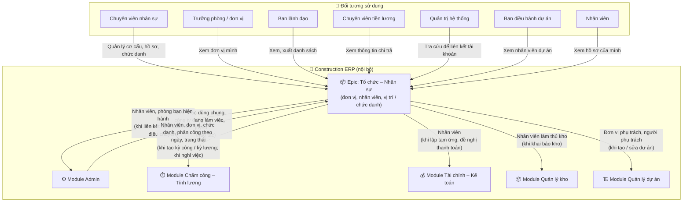
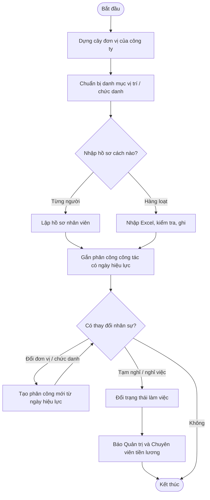
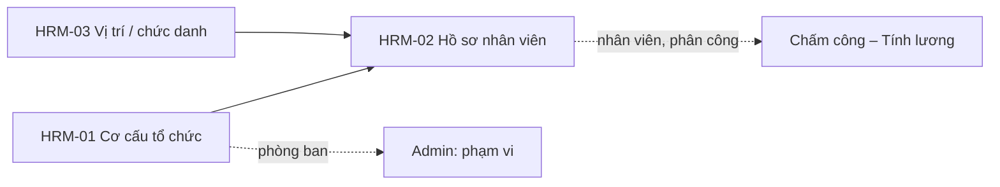
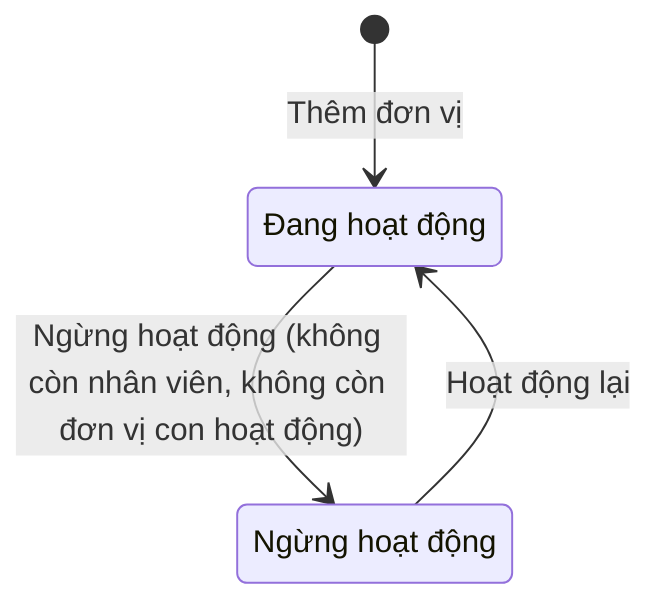
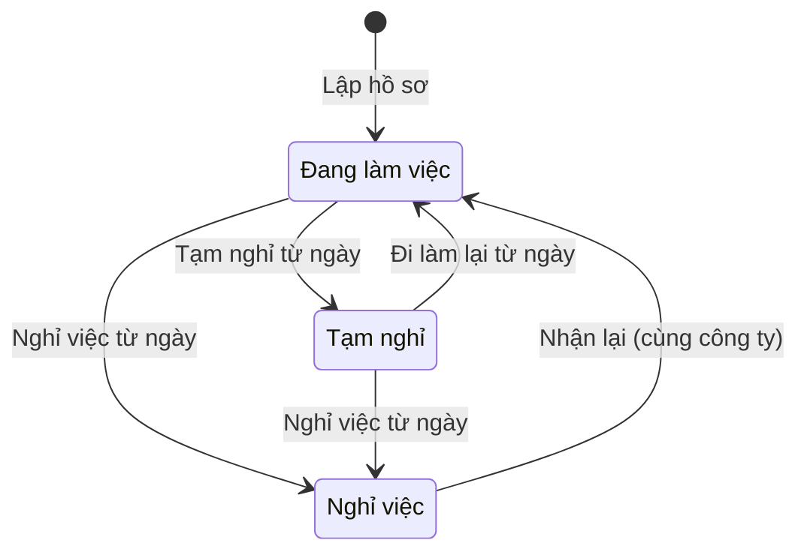
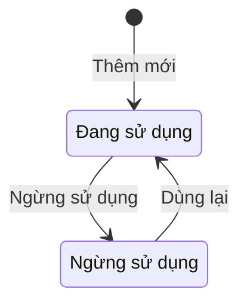
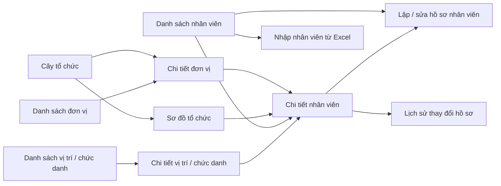

# EPIC OVERVIEW DOCUMENT (Level 1–2) — Tổ chức – Nhân sự

# 📑 Mục lục
- [Thông tin quản lý](#-thông-tin-quản-lý)
- [Level 1 – Product Overview](#level-1--product-overview)
- [Level 2 – Epic / Module](#level-2--epic--module)

---

## 📋 THÔNG TIN QUẢN LÝ
- **Epic ID & Name:** `EPIC_HRM` - Tổ chức – Nhân sự
- **Module / Phân hệ:** Tổ chức – Nhân sự (`hrm`)
- **Author (BA):** doanpt-vci
- **PM / Owner:** (để trống, bổ sung sau)
- **Status:** 🏷️ Nháp
- **Target Release / Sprint:** (để trống, bổ sung sau)
- **Created:** 30/10/2026
- **Last Updated:** 30/10/2026
- **Phạm vi tài liệu:** Level 1–2 (tổng quan cấp Epic). Đặc tả chi tiết từng feature con nằm ở spec riêng do skill `ba-skill` (Đặc tả chức năng) sinh.

### 🔄 Lịch sử thay đổi (Changelog)
| Ngày | Người thay đổi | Nội dung cập nhật | Version |
|------|----------------|-------------------|---------|
| 30/10/2026 | doanpt-vci | Tạo mới Epic Overview | 1.0 |
| 30/10/2026 | doanpt-vci | Cập nhật theo trả lời của PO: tài khoản tự khoá khi nghỉ việc; nhân viên xem được thông tin nhạy cảm của chính mình; PM / Sprint để trống | 1.1 |
| 30/10/2026 | doanpt-vci | Chốt Q09: không gửi thông báo khi nhân viên nghỉ việc (bỏ TB_EPIC_HRM_01, TB_EPIC_HRM_02) | 1.2 |
| 30/10/2026 | doanpt-vci | Chốt Q12 nhập Excel: người dùng chọn ghi dòng hợp lệ hoặc huỷ, tải được chi tiết lỗi | 1.3 |

### 📋 CHANGE REQUEST LOG
| CR # | Ngày | Nguồn | Mô tả thay đổi | Before → After | Impact | Status |
|------|------|-------|-----------------|----------------|--------|--------|
| (Trống nếu chưa có CR) | | | | | | |

### 📎 TÀI LIỆU THAM CHIẾU (Reference Documents)
| STT | Tên tài liệu | Nguồn | Link tài liệu |
|-----|--------------|-------|---------------|
| 1 | Feature Matrix | docs/analysis/ | [Mở tài liệu](../../analysis/01-feature-matrix.md) |
| 2 | Sitemap, menu, danh sách màn hình | docs/analysis/ | [Mở tài liệu](../../analysis/02-sitemap-menu-screens.md) |
| 3 | Data model cấp logic | docs/analysis/ | [Mở tài liệu](../../analysis/03-data-model.md) |
| 4 | Ma trận phân quyền sơ bộ | docs/analysis/ | [Mở tài liệu](../../analysis/04-permission-matrix.md) |
| 5 | Ma trận tích hợp giữa phân hệ | docs/analysis/ | [Mở tài liệu](../../analysis/05-integration-matrix.md) |
| 6 | Business rules quan trọng | docs/analysis/ | [Mở tài liệu](../../analysis/06-business-rules.md) |
| 7 | Câu hỏi mở và Decision Log | docs/analysis/ | [Mở tài liệu](../../analysis/07-open-questions.md) |
| 8 | ADR-0002 Nhiều công ty trong một khách hàng | docs/architecture/ | [Mở tài liệu](../../architecture/adr-0002-multi-company-within-tenant.md) |
| 9 | Epic Admin (tài khoản, quyền, danh mục) | docs/features/admin/ | [Mở tài liệu](../admin/0_epic-overview.md) |

### ❓ CÂU HỎI CÒN MỞ
| Mã | Câu hỏi | Ảnh hưởng tới | Người chốt |
|----|---------|---------------|------------|
| Q03 | Vị trí công việc và chức danh là một danh mục hay hai? Một nhân viên có một hay nhiều chức danh? (Q-HRM-01) | HRM-03, 1.4 | Khách hàng |
| Q04 | Các loại đơn vị cần có (Khối, Phòng, Ban, Đội, Ban điều hành dự án, Công trường…)? (Q-HRM-02) | HRM-01 | Khách hàng |
| Q05 | Có cần ghi nhân viên thuộc dự án nào không? Ghi ở hồ sơ nhân viên hay theo từng ngày công ở Chấm công? (Q-HRM-03) | HRM-02, Module Chấm công – Tính lương | Khách hàng |
| Q06 | Các loại nhân sự (chính thức, thời vụ, khoán, công nhân thuê ngoài theo tổ đội)? Công nhân thuê ngoài có hồ sơ nhân viên không? (Q-HRM-04) | HRM-02 | Khách hàng |
| Q07 | Trường định danh nào bắt buộc (CCCD, mã số thuế cá nhân, số sổ bảo hiểm)? (Q-HRM-05) | HRM-02 | Khách hàng |
| Q08 | Mã nhân viên do người dùng nhập hay hệ thống tự sinh theo mẫu? | BR_EPIC_04 | Khách hàng |
| Q10 | Đơn vị có ngày hiệu lực: đơn vị "hết hiệu lực" có tự chuyển Ngừng hoạt động không? | 2.3 Đơn vị | Khách hàng |

---

## LEVEL 1 – PRODUCT OVERVIEW

### 1.1. Overview (Mục tiêu)
* **Bài toán:** Mỗi công ty trong tập đoàn cần một cơ cấu tổ chức và một bộ hồ sơ nhân viên thống nhất, làm gốc cho phân quyền theo phòng ban, chấm công, tính lương, tạm ứng và phân công thủ kho. Hiện dữ liệu nhân sự nằm rải rác trong Excel.
* **Giá trị mang lại:**
  * Một nguồn duy nhất về nhân viên và phòng ban cho mọi phân hệ — Chấm công – Tính lương không tạo nhân viên riêng.
  * Lịch sử phân công có ngày hiệu lực, nên bảng lương kỳ cũ vẫn đúng đơn vị lúc đó.
  * Thông tin nhạy cảm chỉ người có quyền mới thấy.
* **Scope:**
  * **IN scope:**
    * Cơ cấu tổ chức từng công ty: cây đơn vị, sơ đồ tổ chức, thêm / sửa / đổi đơn vị cha / ngừng hoạt động đơn vị.
    * Hồ sơ nhân viên 5 nhóm thông tin (cá nhân, liên hệ, công việc, phục vụ chi trả, hồ sơ đính kèm); nhập / xuất Excel; lịch sử thay đổi; đổi trạng thái làm việc.
    * Danh mục vị trí / chức danh dùng chung cả tập đoàn.
  * **OUT of scope:**
    * Hợp đồng lao động, tuyển dụng, đào tạo, nghỉ phép độc lập (ngoài phạm vi dự án).
    * Điều chuyển nhân viên giữa các công ty (không có nghiệp vụ này — DEC-016).
    * Tạo tài khoản đăng nhập (thuộc Epic Admin).

### 1.2. User Personas
| Role | Tên vai trò | Quyền hạn chính | Tần suất sử dụng |
|------|------------|-----------------|-------------------|
| `hr_officer` | Chuyên viên nhân sự | Quản lý cơ cấu tổ chức, hồ sơ nhân viên, vị trí / chức danh; xem thông tin nhạy cảm | Hàng ngày |
| `dept_head` | Trưởng phòng / đơn vị | Xem cơ cấu và nhân viên trong phạm vi đơn vị mình | Hàng tuần |
| `leadership` | Ban lãnh đạo | Xem toàn bộ, xuất danh sách | Hàng tuần |
| `payroll_officer` | Chuyên viên tiền lương | Xem nhân viên kèm thông tin phục vụ chi trả | Hàng tháng |
| `tenant_admin` | Quản trị hệ thống | Xem cơ cấu và nhân viên để liên kết tài khoản, gán phạm vi | Khi cần |
| `project_manager` | Ban điều hành dự án | Xem nhân viên trong phạm vi dự án | Hàng tuần |
| `employee` | Nhân viên | Xem hồ sơ của chính mình | Thỉnh thoảng |

### 1.3. Product Context Model (Mô hình tổng quan Epic)

*Mô tả: Tổ chức – Nhân sự là nguồn chủ quản của nhân viên và cơ cấu đơn vị; các phân hệ khác chỉ đọc. Danh mục dùng chung (loại đơn vị, ngân hàng…) lấy từ Admin. Không có hệ thống ngoài.*

* **Thực thể dữ liệu chính:** Đơn vị (cây, theo công ty) · Nhân viên (theo công ty) · Phân công công tác (đơn vị, vị trí / chức danh, loại nhân sự, ngày hiệu lực) · Lịch sử trạng thái làm việc · Tài khoản nhận lương · Hồ sơ đính kèm · Vị trí / chức danh (dùng chung tập đoàn).

#### 1.3.1. Chú giải thành phần & luồng dữ liệu qua lại
| Tên thành phần | Loại | Ý nghĩa / Vai trò | Chiều dữ liệu | Dữ liệu trao đổi | Sự kiện kích hoạt | Mức phụ thuộc |
|----------------|------|-------------------|---------------|------------------|-------------------|---------------|
| Chuyên viên nhân sự | 👤 Đối tượng sử dụng | Người duy trì dữ liệu tổ chức và nhân sự | Người dùng → Epic | Đơn vị, hồ sơ, phân công, trạng thái, chức danh, tệp nhập Excel | Khi có thay đổi nhân sự / tổ chức | — |
| Trưởng phòng / đơn vị | 👤 Đối tượng sử dụng | Tra cứu nhân sự đơn vị mình | Epic → Người dùng | Cơ cấu, danh sách nhân viên | Khi cần | — |
| Ban lãnh đạo | 👤 Đối tượng sử dụng | Nắm cơ cấu và quân số | Epic → Người dùng | Sơ đồ tổ chức, danh sách, tệp xuất | Khi cần | — |
| Chuyên viên tiền lương | 👤 Đối tượng sử dụng | Tra cứu thông tin phục vụ tính và chi lương | Epic → Người dùng | Hồ sơ kèm tài khoản nhận lương | Hàng tháng | — |
| Quản trị hệ thống | 👤 Đối tượng sử dụng | Tra cứu nhân viên để liên kết tài khoản, gán phạm vi | Epic → Người dùng | Nhân viên, đơn vị | Khi tạo tài khoản | — |
| Ban điều hành dự án | 👤 Đối tượng sử dụng | Tra cứu nhân viên trong dự án mình | Epic → Người dùng | Danh sách nhân viên | Khi cần | — |
| Nhân viên | 👤 Đối tượng sử dụng | Xem hồ sơ của chính mình | Epic → Người dùng | Hồ sơ cá nhân | Thỉnh thoảng | — |
| Module Admin | 🏢 Module cùng hệ thống | Cấp danh mục, công ty đang làm việc, quyền; nhận nhân viên để liên kết tài khoản và tính phạm vi phòng ban | Hai chiều | → Epic: danh mục dùng chung, quyền. Epic →: nhân viên, phòng ban hiện hành | Mỗi thao tác; khi gán liên kết; khi điều chuyển | 🔴 Chặn |
| Module Chấm công – Tính lương | 🏢 Module cùng hệ thống | Dùng nhân viên để lập lịch, chấm công, tính lương | Epic → | Nhân viên, đơn vị, chức danh, phân công theo ngày hiệu lực, trạng thái làm việc; sự kiện nghỉ việc | Khi tạo kỳ công / kỳ lương; khi nhân viên nghỉ việc | 🔴 Chặn |
| Module Tài chính – Kế toán | 🏢 Module cùng hệ thống | Dùng nhân viên làm người đề nghị / người tạm ứng | Epic → | Nhân viên đang làm việc | Khi lập tạm ứng, đề nghị thanh toán | 🟡 Ảnh hưởng |
| Module Quản lý kho | 🏢 Module cùng hệ thống | Dùng nhân viên làm thủ kho | Epic → | Nhân viên đang làm việc | Khi khai báo kho | 🟢 Tham khảo |
| Module Quản lý dự án | 🏢 Module cùng hệ thống | Dùng đơn vị và nhân viên làm đơn vị / người phụ trách dự án | Epic → | Đơn vị đang hoạt động, nhân viên đang làm việc | Khi tạo / sửa dự án | 🟡 Ảnh hưởng |

* **Ghi chú phụ thuộc:** Epic cần danh mục dùng chung của Admin trước khi vận hành. Chấm công – Tính lương và phạm vi phòng ban ở Admin không hoạt động được nếu chưa có dữ liệu Epic này. Đổi cách lưu phân công (ngày hiệu lực) ảnh hưởng trực tiếp bảng lương.

### 1.4. Glossary / Từ điển nghiệp vụ
| Thuật ngữ | Định nghĩa | Thuật ngữ EN |
|-----------|-----------|-------------|
| Đơn vị | Một nút trong cơ cấu tổ chức của một công ty (khối, phòng, ban, đội…) | Department / Org unit |
| Đơn vị cấp dưới | Mọi đơn vị nằm dưới một đơn vị trong cây, ở mọi cấp | Descendant unit |
| Nhân viên | Người lao động thuộc đúng một công ty | Employee |
| Phân công công tác | Bản ghi nhân viên thuộc đơn vị nào, vị trí / chức danh gì, loại nhân sự gì, từ ngày nào đến ngày nào | Assignment |
| Phân công hiện hành | Phân công có hiệu lực tại ngày hôm nay | Current assignment |
| Trạng thái làm việc | Đang làm việc / Tạm nghỉ / Nghỉ việc | Employment status |
| Vị trí / chức danh | Danh mục dùng chung tập đoàn mô tả vai trò công việc (phân biệt hai khái niệm chờ Q03) | Position / Title |
| Thông tin nhạy cảm | Số định danh, tài khoản ngân hàng, thông tin lương | Sensitive data |

---

## LEVEL 2 – EPIC / MODULE

### 2.1. Quy trình nghiệp vụ End-to-End của Epic
* **Tên phân hệ:** Tổ chức – Nhân sự
* **Mô tả luồng:** Chuyên viên nhân sự dựng cây đơn vị của công ty và chuẩn bị danh mục vị trí / chức danh. Sau đó lập hồ sơ nhân viên (nhập tay hoặc nhập Excel), gắn phân công công tác có ngày hiệu lực. Khi nhân viên đổi đơn vị hay chức danh, nhân sự tạo phân công mới thay vì sửa phân công cũ. Khi nhân viên tạm nghỉ hoặc nghỉ việc, nhân sự đổi trạng thái; hệ thống báo cho Quản trị và Chuyên viên tiền lương.

### 2.2. Feature Matrix (phạm vi, ảnh hưởng & trạng thái đặc tả)
| Feature ID | Tên feature | Mục đích | Actor chính | Dependencies | Risk | Spec chi tiết | Trạng thái spec |
|-----------|-------------|---------|-------------|-------------|------|---------------|-----------------|
| HRM-01 | Cơ cấu tổ chức | Cây đơn vị, sơ đồ tổ chức, thêm / sửa / đổi cha / ngừng hoạt động đơn vị, nhập / xuất | `hr_officer` | Module Admin (danh mục loại đơn vị) | TB | — | ⬜ Chưa có |
| HRM-02 | Hồ sơ nhân viên | Lập, sửa, xem hồ sơ 5 nhóm thông tin, phân công, trạng thái, nhập / xuất, lịch sử | `hr_officer` | HRM-01, HRM-03 | Cao | — | ⬜ Chưa có |
| HRM-03 | Vị trí và chức danh | Danh mục dùng chung tập đoàn; gán cho nhân viên; ngừng sử dụng | `hr_officer` | — | Thấp | — | ⬜ Chưa có |

### 2.3. State Machine — Vòng đời trạng thái thực thể chính

#### Thực thể: Đơn vị

| Trạng thái | Ý nghĩa nghiệp vụ | Feature tạo ra trạng thái này | Feature đưa trạng thái đi tiếp |
|-----------|-------------------|-------------------------------|--------------------------------|
| Đang hoạt động | Chọn được khi phân công nhân viên, gán phạm vi, gán đơn vị phụ trách dự án | HRM-01 | HRM-01 |
| Ngừng hoạt động | Không chọn được cho dữ liệu mới; vẫn hiển thị đúng trên dữ liệu cũ | HRM-01 | HRM-01 |

#### Thực thể: Nhân viên (trạng thái làm việc)

| Trạng thái | Ý nghĩa nghiệp vụ | Feature tạo ra trạng thái này | Feature đưa trạng thái đi tiếp |
|-----------|-------------------|-------------------------------|--------------------------------|
| Đang làm việc | Được lập lịch, chấm công, tính lương, chọn làm người phụ trách | HRM-02 | HRM-02 |
| Tạm nghỉ | Còn thuộc công ty; việc chấm công và tính lương trong thời gian tạm nghỉ do Chấm công – Tính lương quyết định | HRM-02 | HRM-02 |
| Nghỉ việc | Không chọn được cho dữ liệu mới; hồ sơ và lịch sử giữ nguyên | HRM-02 | HRM-02 |

#### Thực thể: Vị trí / chức danh

| Trạng thái | Ý nghĩa nghiệp vụ | Feature tạo ra trạng thái này | Feature đưa trạng thái đi tiếp |
|-----------|-------------------|-------------------------------|--------------------------------|
| Đang sử dụng | Gán được cho phân công mới ở mọi công ty | HRM-03 | HRM-03 |
| Ngừng sử dụng | Không gán cho phân công mới; phân công cũ giữ nguyên | HRM-03 | HRM-03 |

### 2.4. Ma trận phân quyền Epic / Module
| Tên thao tác | Feature liên quan | `hr_officer` | `dept_head` | `leadership` | `payroll_officer` | `tenant_admin` | `project_manager` | `employee` |
|--------------|-------------------|---|---|---|---|---|---|---|
| Xem cây đơn vị, sơ đồ tổ chức | HRM-01 | ✅ | 👁️ | 👁️ | 👁️ | 👁️ | 👁️ | 👁️ |
| Thêm, sửa, đổi đơn vị cha, ngừng hoạt động đơn vị | HRM-01 | ✅ | ❌ | ❌ | ❌ | ❌ | ❌ | ❌ |
| Nhập / xuất danh sách đơn vị | HRM-01 | ✅ | ❌ | ❌ | ❌ | ❌ | ❌ | ❌ |
| Xem danh sách, hồ sơ nhân viên (không gồm thông tin nhạy cảm) | HRM-02 | ✅ | ✅ (đơn vị mình và cấp dưới) | ✅ | ✅ | ✅ | ✅ (dự án được gán) | ✅ (chỉ hồ sơ của mình) |
| Xem thông tin nhạy cảm của nhân viên | HRM-02 | ✅ | ❌ | ❌ | ✅ | ❌ | ❌ | ✅ (của mình) |
| Lập, sửa hồ sơ; tạo phân công; đổi trạng thái làm việc | HRM-02 | ✅ | ❌ | ❌ | ❌ | ❌ | ❌ | ❌ |
| Nhập hồ sơ từ Excel | HRM-02 | ✅ | ❌ | ❌ | ❌ | ❌ | ❌ | ❌ |
| Xuất danh sách nhân viên | HRM-02 | ✅ | ❌ | ✅ | ❌ | ❌ | ❌ | ❌ |
| Xem lịch sử thay đổi hồ sơ | HRM-02 | ✅ | ❌ | 👁️ | ❌ | ❌ | ❌ | ❌ |
| Xem danh mục vị trí / chức danh | HRM-03 | ✅ | 👁️ | 👁️ | 👁️ | 👁️ | ❌ | ❌ |
| Thêm, sửa, ngừng sử dụng, nhập / xuất vị trí / chức danh | HRM-03 | ✅ | ❌ | ❌ | ❌ | ❌ | ❌ | ❌ |

**Chú giải:** ✅ Được phép · ✅ (điều kiện) Được phép kèm giới hạn phạm vi · 👁️ Chỉ xem, không thay đổi dữ liệu · ❌ Không được phép

* **Quy tắc phạm vi dữ liệu:** Đơn vị và nhân viên thuộc công ty đang làm việc. Trưởng phòng mặc định phạm vi "phòng ban và đơn vị cấp dưới"; Ban điều hành dự án phạm vi "dự án được gán" — chỉ áp dụng được khi có quan hệ nhân viên – dự án (Q05); Nhân viên phạm vi "của mình". Vị trí / chức danh là danh mục dùng chung, mọi công ty thấy như nhau. Ban lãnh đạo ở chế độ Tất cả công ty xem gộp nhưng không thấy thông tin nhạy cảm.

### 2.5. Screen Flow Diagram (toàn Epic)

| Màn hình | Feature sở hữu | Mục đích | Role truy cập |
|----------|----------------|---------|---------------|
| Cây tổ chức | HRM-01 | Xem, tìm, thêm đơn vị con, đổi đơn vị cha | `hr_officer`; người khác xem |
| Sơ đồ tổ chức | HRM-01 | Xem cơ cấu dạng sơ đồ, mở nhân viên | Mọi role ở 2.4 có quyền xem đơn vị |
| Danh sách đơn vị | HRM-01 | Tra cứu, nhập / xuất đơn vị | `hr_officer`; người khác xem |
| Chi tiết đơn vị | HRM-01 | Thông tin đơn vị, nhân sự trực thuộc, đơn vị con | Mọi role ở 2.4 có quyền xem đơn vị |
| Danh sách nhân viên | HRM-02 | Tìm, lọc, xuất nhân viên | Theo 2.4 |
| Lập / sửa hồ sơ nhân viên | HRM-02 | Nhập 5 nhóm thông tin, phân công | `hr_officer` |
| Chi tiết nhân viên | HRM-02 | Xem hồ sơ, phân công, trạng thái, tệp đính kèm | Theo 2.4 |
| Nhập nhân viên từ Excel | HRM-02 | Tải mẫu, kiểm tra, xem lỗi, ghi | `hr_officer` |
| Lịch sử thay đổi hồ sơ | HRM-02 | Ai đổi gì, khi nào | `hr_officer`, `leadership` |
| Danh sách vị trí / chức danh | HRM-03 | Quản lý danh mục | `hr_officer`; người khác xem |
| Chi tiết vị trí / chức danh | HRM-03 | Thông tin và nhân viên đang giữ | `hr_officer`; người khác xem |

### 2.6. Business Rules (mức tổng quan — toàn Epic)
| Rule ID | Tên Rule | Mô tả điều kiện (VI) | Feature áp dụng |
|---------|---------|---------------------|-----------------|
| BR_EPIC_01 | Cơ cấu theo công ty | Mỗi công ty có cây đơn vị riêng; đơn vị chỉ có cha cùng công ty. | HRM-01 |
| BR_EPIC_02 | Không vòng lặp | Một đơn vị không được làm cha của chính nó hoặc của bất kỳ đơn vị nào đang là cấp trên của nó (BR-HRM-01). | HRM-01 |
| BR_EPIC_03 | Ngừng đơn vị | Không ngừng hoạt động hay xoá đơn vị còn nhân viên đang công tác hoặc còn đơn vị con đang hoạt động. Trước khi đổi đơn vị cha, hệ thống cho biết số nhân viên và số tài khoản có phạm vi "phòng ban và đơn vị cấp dưới" bị ảnh hưởng (BR-HRM-02, BR-HRM-03). | HRM-01 |
| BR_EPIC_04 | Mã nhân viên | Mã nhân viên không trùng trong khách hàng (BR-HRM-04). Cách đặt mã chờ Q08. | HRM-02 |
| BR_EPIC_05 | Một công ty, không điều chuyển | Nhân viên thuộc đúng một công ty từ khi lập hồ sơ; không có thao tác chuyển nhân viên sang công ty khác (DEC-009, DEC-016). | HRM-02 |
| BR_EPIC_06 | Một trạng thái, một phân công chính | Tại một thời điểm mỗi nhân viên có đúng một trạng thái làm việc và một phân công chính đang hiệu lực (BR-HRM-05). | HRM-02 |
| BR_EPIC_07 | Điều chuyển bằng phân công mới | Đổi đơn vị, vị trí / chức danh hay loại nhân sự thì tạo phân công mới có ngày hiệu lực; phân công cũ kết thúc vào ngày liền trước, không bị sửa đè. Bảng công, bảng lương của kỳ cũ đọc đơn vị theo ngày hiệu lực (BR-HRM-06). | HRM-02 |
| BR_EPIC_08 | Không xoá hồ sơ đã dùng | Không xoá hồ sơ nhân viên đã có chấm công, bảng lương, tạm ứng hoặc chứng từ kế toán; chỉ đổi trạng thái (BR-HRM-07). | HRM-02 |
| BR_EPIC_09 | Thông tin nhạy cảm | Số định danh, tài khoản ngân hàng chỉ hiện với người có quyền xem thông tin nhạy cảm, kể cả trong tệp xuất (BR-SEC-04). | HRM-02 |
| BR_EPIC_10 | Nghỉ việc | Nhân viên chuyển sang Nghỉ việc thì không chọn được cho dữ liệu mới ở mọi phân hệ; không gửi thông báo. Tài khoản đăng nhập liên kết với nhân viên tự khoá vào ngày nghỉ việc có hiệu lực; riêng tài khoản là quản trị cuối cùng của khách hàng thì không khoá (BR_EPIC_10 của Admin). | HRM-02 |
| BR_EPIC_11 | Chức danh dùng chung | Vị trí / chức danh dùng chung cả tập đoàn, mã không trùng trong khách hàng; đã được gán thì chỉ ngừng sử dụng, không xoá (BR-GEN-03). | HRM-03 |
| BR_EPIC_12 | Nhập Excel | Kiểm tra toàn bộ tệp trước khi ghi. Nếu có dòng lỗi, hệ thống báo số dòng hợp lệ / lỗi và để người dùng chọn: ghi các dòng hợp lệ, hoặc huỷ không ghi dòng nào. Người dùng tải được tệp chi tiết lỗi (từng dòng, từng lỗi) về máy (BR-GEN-11). | HRM-01, HRM-02, HRM-03 |

### 2.7. Thông báo quả chuông (toàn Epic)

> Epic không dùng quy trình duyệt và không gửi thông báo quả chuông. Khi nhân viên nghỉ việc, hệ thống không gửi thông báo cho Quản trị hay Chuyên viên tính lương.

> Đặc tả chi tiết từng feature con — xem spec riêng của feature (skill `ba-skill` (Đặc tả chức năng)).
