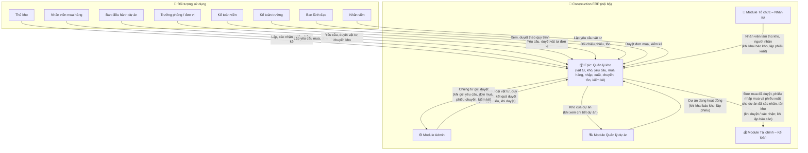
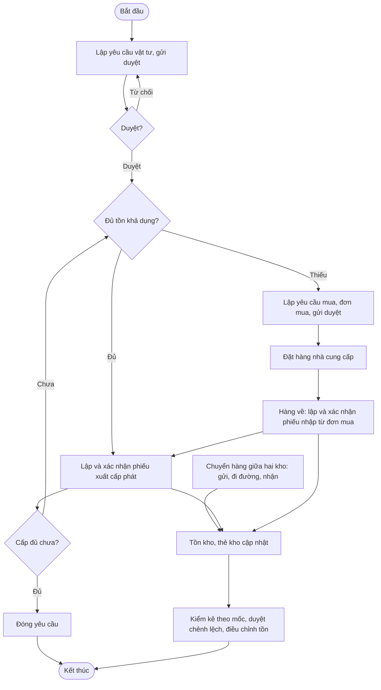
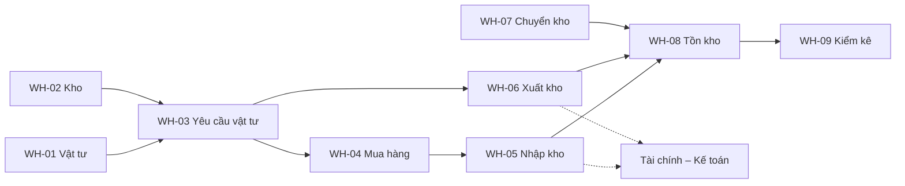
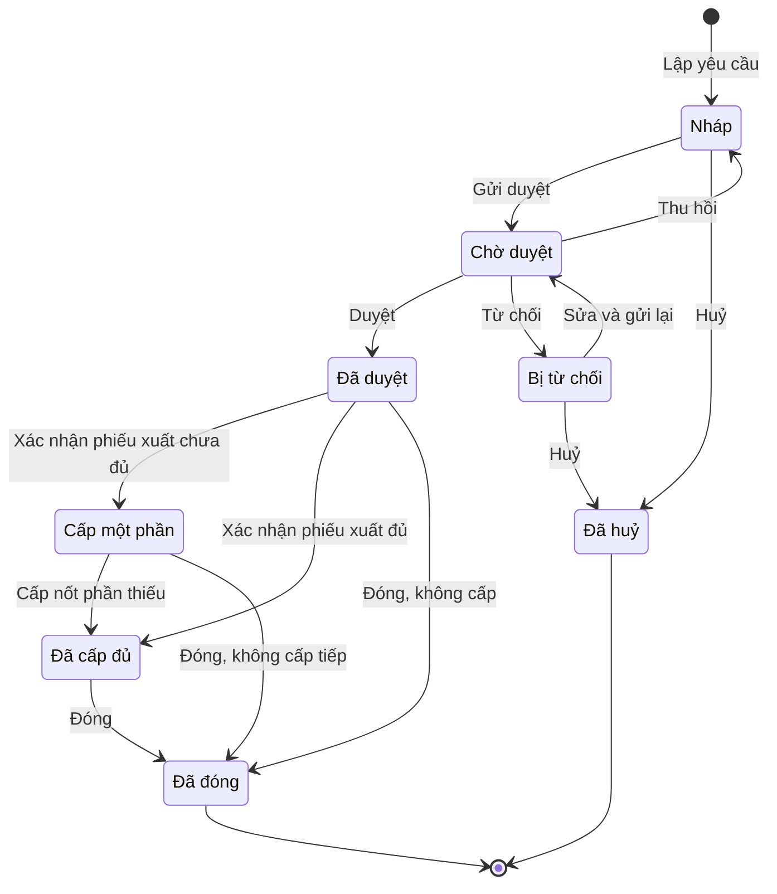
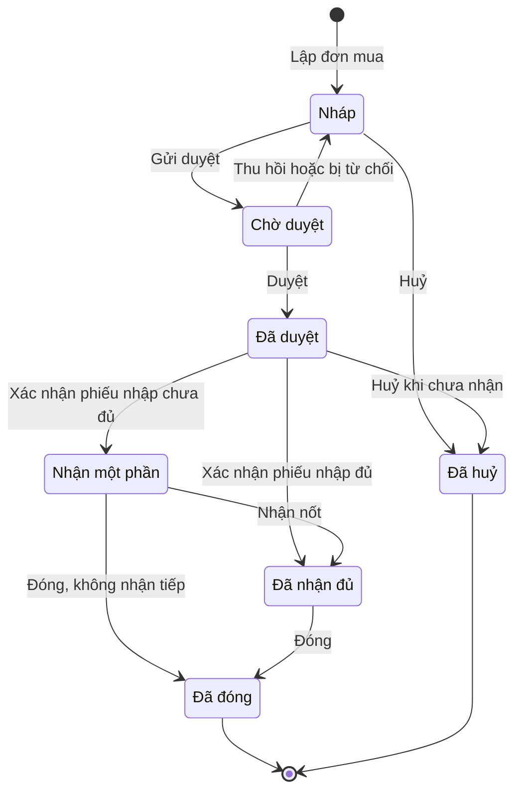
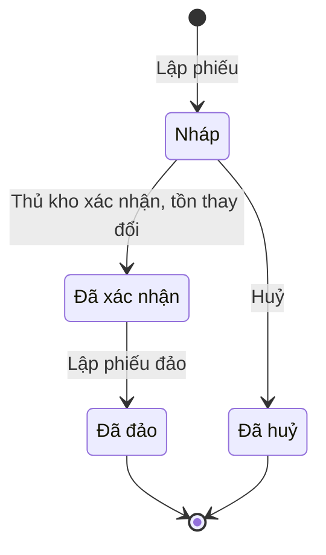
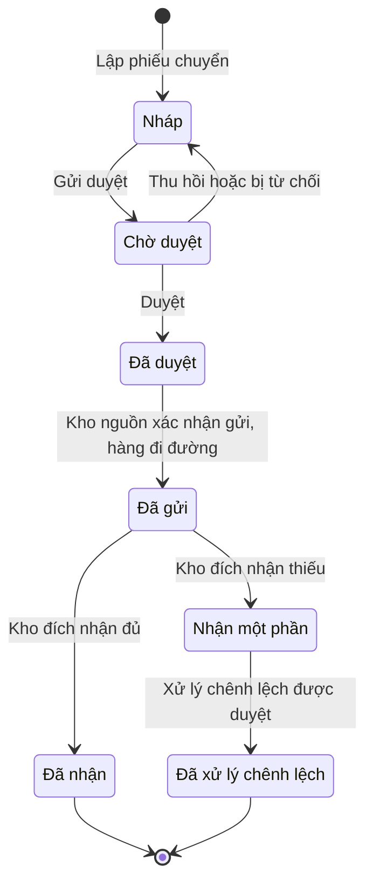
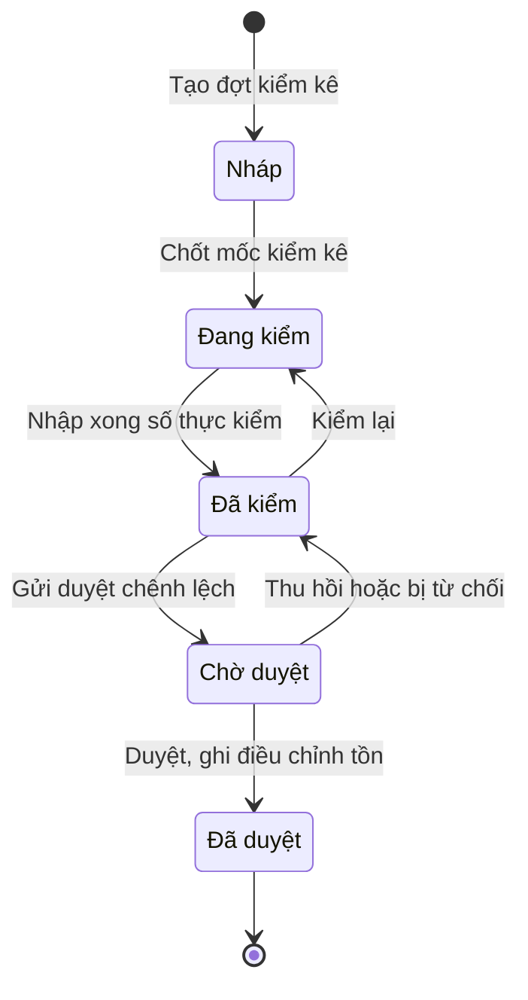
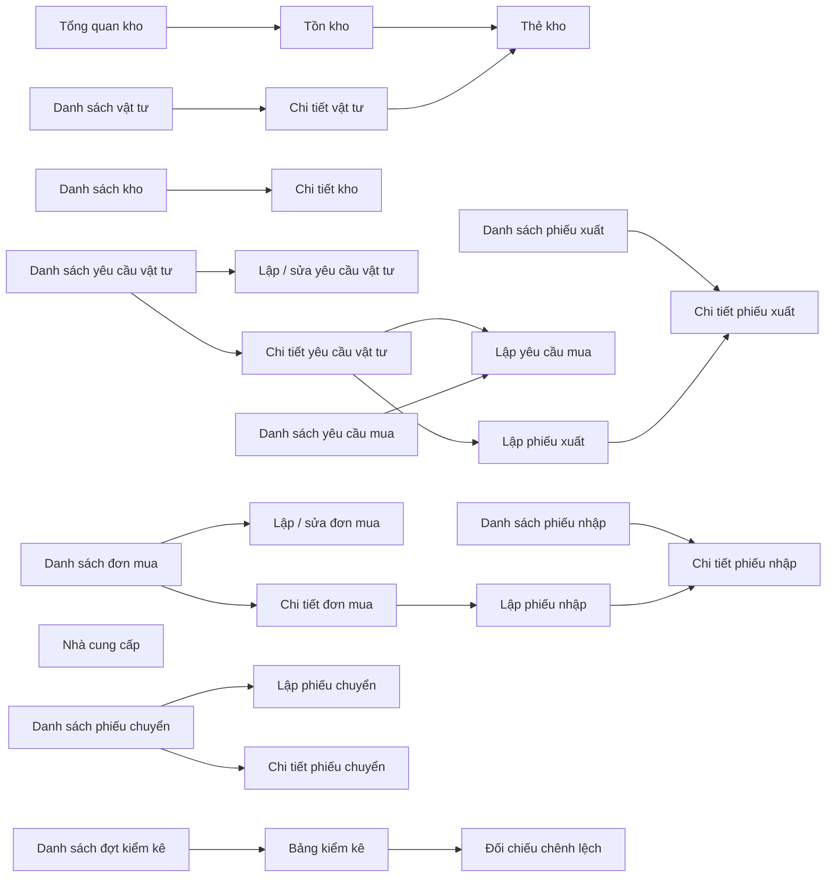

# EPIC OVERVIEW DOCUMENT (Level 1–2) — Quản lý kho

# 📑 Mục lục
- [Thông tin quản lý](#-thông-tin-quản-lý)
- [Level 1 – Product Overview](#level-1--product-overview)
- [Level 2 – Epic / Module](#level-2--epic--module)

---

## 📋 THÔNG TIN QUẢN LÝ
- **Epic ID & Name:** `EPIC_WH` - Quản lý kho
- **Module / Phân hệ:** Kho (`inventory`)
- **Author (BA):** doanpt-vci
- **PM / Owner:** (để trống, bổ sung sau)
- **Status:** 🏷️ Nháp
- **Target Release / Sprint:** (để trống, bổ sung sau)
- **Created:** 30/10/2026
- **Last Updated:** 30/10/2026
- **Phạm vi tài liệu:** Level 1–2 (tổng quan cấp Epic). Đặc tả chi tiết từng feature con nằm ở spec riêng do skill `ba-skill` (Đặc tả chức năng) sinh.

### 🔄 Lịch sử thay đổi (Changelog)
| Ngày | Người thay đổi | Nội dung cập nhật | Version |
|------|----------------|-------------------|---------|
| 30/10/2026 | doanpt-vci | Tạo mới Epic Overview | 1.0 |
| 30/10/2026 | doanpt-vci | Cập nhật theo trả lời của PO: không có cảnh báo tồn tối thiểu (bỏ TB_EPIC_WH_04); nhận vượt số đặt không giới hạn nhưng cảnh báo và đánh dấu đỏ; yêu cầu mua không bắt buộc lập từ yêu cầu vật tư; PM / Sprint để trống | 1.1 |
| 30/10/2026 | doanpt-vci | Làm rõ BR_EPIC_09: nhận thiếu so với số đặt cũng đánh dấu đỏ | 1.2 |
| 30/10/2026 | doanpt-vci | Chốt Q13 nhập Excel: áp dụng BR-GEN-11 (người dùng chọn ghi dòng hợp lệ hoặc huỷ, tải được chi tiết lỗi) | 1.3 |

### 📋 CHANGE REQUEST LOG
| CR # | Ngày | Nguồn | Mô tả thay đổi | Before → After | Impact | Status |
|------|------|-------|-----------------|----------------|--------|--------|
| (Trống nếu chưa có CR) | | | | | | |

### 📎 TÀI LIỆU THAM CHIẾU (Reference Documents)
| STT | Tên tài liệu | Nguồn | Link tài liệu |
|-----|--------------|-------|---------------|
| 1 | Feature Matrix | docs/analysis/ | [Mở tài liệu](../../analysis/01-feature-matrix.md) |
| 2 | Sitemap, menu, danh sách màn hình | docs/analysis/ | [Mở tài liệu](../../analysis/02-sitemap-menu-screens.md) |
| 3 | Data model cấp logic | docs/analysis/ | [Mở tài liệu](../../analysis/03-data-model.md) |
| 4 | Ma trận phân quyền sơ bộ | docs/analysis/ | [Mở tài liệu](../../analysis/04-permission-matrix.md) |
| 5 | Ma trận tích hợp giữa phân hệ | docs/analysis/ | [Mở tài liệu](../../analysis/05-integration-matrix.md) |
| 6 | Business rules quan trọng | docs/analysis/ | [Mở tài liệu](../../analysis/06-business-rules.md) |
| 7 | Câu hỏi mở và Decision Log | docs/analysis/ | [Mở tài liệu](../../analysis/07-open-questions.md) |
| 8 | ADR-0002 Nhiều công ty trong một khách hàng | docs/architecture/ | [Mở tài liệu](../../architecture/adr-0002-multi-company-within-tenant.md) |
| 9 | Epic Admin (quy trình duyệt, thông báo duyệt) | docs/features/admin/ | [Mở tài liệu](../admin/0_epic-overview.md) |
| 10 | Epic Tài chính – Kế toán | docs/features/accounting/ | [Mở tài liệu](../accounting/0_epic-overview.md) |
| 11 | Epic Quản lý dự án | docs/features/projects/ | [Mở tài liệu](../projects/0_epic-overview.md) |

### ❓ CÂU HỎI CÒN MỞ
| Mã | Câu hỏi | Ảnh hưởng tới | Người chốt |
|----|---------|---------------|------------|
| Q03 | Phương pháp tính giá xuất kho: bình quân gia quyền (cuối kỳ / sau mỗi lần nhập), nhập trước xuất trước, đích danh? Chưa chốt thì tồn kho chỉ theo số lượng (Q-WH-01) | WH-08, Module Tài chính – Kế toán | Khách hàng |
| Q04 | Có cho phép tồn âm không? Đề xuất: không, trừ khi khách hàng bật cấu hình (Q-WH-02) | BR_EPIC_05 | Khách hàng |
| Q05 | Có giữ chỗ tồn khi yêu cầu vật tư được duyệt không? (Q-WH-03) | BR_EPIC_06 | Khách hàng |
| Q06 | Thủ kho được giao theo từng kho hay theo dự án? (Q-WH-04) | 2.4 | Khách hàng |
| Q07 | Danh mục nhà cung cấp đặt ở Epic này (đề xuất) hay ở danh mục dùng chung của Admin? (Q-WH-05) | WH-04 | Khách hàng |
| Q08 | Có quản lý lô / số seri / hạn dùng không? (Q-WH-06) | WH-01, WH-05, WH-06 | Khách hàng |
| Q09 | Ván khuôn, đà giáo luân chuyển: xuất là tiêu hao hay cho mượn rồi thu hồi về kho? (Q-WH-07) | WH-06 | Khách hàng |
| Q14 | Nhắc đơn mua chậm giao: gửi lúc mấy giờ? | TB_EPIC_WH_03 | Khách hàng |

---

## LEVEL 1 – PRODUCT OVERVIEW

### 1.1. Overview (Mục tiêu)
* **Bài toán:** Vật tư xây dựng được yêu cầu, mua, nhập, xuất và chuyển giữa nhiều kho công trường; theo dõi bằng Excel nên không biết tồn thực, cấp phát vượt yêu cầu, và kế toán không đối chiếu được giá trị nhập / xuất theo dự án.
* **Giá trị mang lại:**
  * Một luồng liên tục yêu cầu → mua → nhập → xuất / chuyển → tồn → kiểm kê, mọi phiếu truy về chứng từ nguồn.
  * Tồn kho tính từ phiếu đã xác nhận, không nhập tay; biết được tồn khả dụng và hàng đang đi đường.
  * Số liệu nhập mua và xuất cho dự án chuyển sang Tài chính, đối chiếu được.
* **Scope:**
  * **IN scope:** Danh mục vật tư (đơn vị quy đổi); danh sách kho (gắn dự án, thủ kho); yêu cầu vật tư; yêu cầu mua, đơn mua, nhà cung cấp; nhập kho; xuất kho; chuyển kho giữa các kho cùng công ty; tồn kho, thẻ kho; kiểm kê.
  * **OUT of scope:** Hợp đồng mua hàng độc lập; quản lý thiết bị, bảo dưỡng; giá trị tồn khi chưa chốt phương pháp tính giá (Q03); tự sinh chứng từ đối ứng khi chuyển hàng giữa hai công ty (mỗi công ty tự lập phiếu xuất / nhập); hạch toán (thuộc Tài chính – Kế toán).

### 1.2. User Personas
| Role | Tên vai trò | Quyền hạn chính | Tần suất sử dụng |
|------|------------|-----------------|-------------------|
| `storekeeper` | Thủ kho | Lập và xác nhận phiếu nhập / xuất / chuyển, lập kiểm kê, xem tồn, thẻ kho | Hàng ngày |
| `purchaser` | Nhân viên mua hàng | Danh mục vật tư, nhà cung cấp; lập yêu cầu mua, đơn mua; theo dõi nhận hàng | Hàng ngày |
| `project_manager` | Ban điều hành dự án | Lập và duyệt yêu cầu vật tư, duyệt yêu cầu mua, chuyển kho, kiểm kê dự án | Hàng ngày |
| `dept_head` | Trưởng phòng / đơn vị | Lập, duyệt yêu cầu vật tư đơn vị mình | Hàng tuần |
| `accountant` | Kế toán viên | Xem phiếu, tồn để đối chiếu | Hàng tuần |
| `chief_accountant` | Kế toán trưởng | Duyệt đơn mua, duyệt điều chỉnh kiểm kê | Hàng tuần |
| `leadership` | Ban lãnh đạo | Xem toàn bộ, duyệt đơn mua và kiểm kê theo quy trình | Hàng tuần |
| `employee` | Nhân viên | Lập yêu cầu vật tư của mình | Thỉnh thoảng |

### 1.3. Product Context Model (Mô hình tổng quan Epic)

*Mô tả: Kho dùng danh mục và quy trình duyệt của Admin, nhân viên của Tổ chức – Nhân sự, dự án của Quản lý dự án. Đơn mua đã duyệt, phiếu nhập mua và phiếu xuất cho dự án đã xác nhận chuyển sang Tài chính. Không có hệ thống ngoài.*

* **Thực thể dữ liệu chính:** Vật tư (dùng chung tập đoàn, có đơn vị quy đổi) · Nhà cung cấp (dùng chung tập đoàn) · Kho (theo công ty, có thể gắn dự án) · Yêu cầu vật tư · Yêu cầu mua · Đơn mua · Phiếu nhập · Phiếu xuất · Phiếu chuyển kho · Sổ giao dịch kho · Giữ chỗ tồn · Đợt kiểm kê.

#### 1.3.1. Chú giải thành phần & luồng dữ liệu qua lại
| Tên thành phần | Loại | Ý nghĩa / Vai trò | Chiều dữ liệu | Dữ liệu trao đổi | Sự kiện kích hoạt | Mức phụ thuộc |
|----------------|------|-------------------|---------------|------------------|-------------------|---------------|
| Thủ kho | 👤 Đối tượng sử dụng | Người ghi nhận hàng vào / ra kho | Người dùng → Epic | Phiếu nhập, xuất, chuyển; số thực kiểm | Hàng ngày | — |
| Nhân viên mua hàng | 👤 Đối tượng sử dụng | Người mua vật tư | Người dùng → Epic | Vật tư, nhà cung cấp, yêu cầu mua, đơn mua | Khi có nhu cầu mua | — |
| Ban điều hành dự án | 👤 Đối tượng sử dụng | Người yêu cầu và duyệt vật tư cho dự án | Người dùng → Epic | Yêu cầu vật tư, quyết định duyệt | Hàng ngày | — |
| Trưởng phòng / đơn vị | 👤 Đối tượng sử dụng | Yêu cầu và duyệt vật tư cho đơn vị | Người dùng → Epic | Yêu cầu vật tư, quyết định duyệt | Khi cần | — |
| Kế toán viên | 👤 Đối tượng sử dụng | Đối chiếu số liệu kho với tài chính | Epic → Người dùng | Phiếu, tồn, thẻ kho | Hàng tuần | — |
| Kế toán trưởng | 👤 Đối tượng sử dụng | Người duyệt đơn mua, điều chỉnh kiểm kê | Người dùng → Epic | Quyết định duyệt | Khi có chứng từ | — |
| Ban lãnh đạo | 👤 Đối tượng sử dụng | Theo dõi, duyệt theo quy trình | Hai chiều | Quyết định duyệt; tồn, báo cáo | Khi cần | — |
| Nhân viên | 👤 Đối tượng sử dụng | Người yêu cầu vật tư | Người dùng → Epic | Yêu cầu vật tư | Khi cần | — |
| Module Admin | 🏢 Module cùng hệ thống | Danh mục dùng chung, quy trình duyệt, quyền | Hai chiều | → Epic: đơn vị tính, loại vật tư, kết quả duyệt. Epic →: chứng từ gửi duyệt | Khi lập phiếu; khi gửi duyệt / có kết quả | 🔴 Chặn |
| Module Tổ chức – Nhân sự | 🏢 Module cùng hệ thống | Nhân viên làm thủ kho, người nhận hàng | → Epic | Nhân viên đang làm việc của công ty | Khi khai báo kho, lập phiếu xuất | 🟡 Ảnh hưởng |
| Module Quản lý dự án | 🏢 Module cùng hệ thống | Dự án để gắn kho và phiếu; xem kho của dự án | Hai chiều | → Epic: dự án đang hoạt động. Epic →: danh sách kho của dự án | Khi khai báo kho, lập phiếu; khi xem chi tiết dự án | 🔴 Chặn |
| Module Tài chính – Kế toán | 🏢 Module cùng hệ thống | Nhận số liệu để ghi công nợ, chi phí, so ngân sách | Epic → | Đơn mua đã duyệt (cam kết chi); phiếu nhập mua đã xác nhận (phải trả nhà cung cấp — chờ Q-FIN-06); phiếu xuất cho dự án đã xác nhận (chi phí vật tư — chờ Q-FIN-03, Q03); tồn kho. Chỉ phiếu đã xác nhận, không gồm phiếu nháp | Khi duyệt / xác nhận; khi lập báo cáo | 🟡 Ảnh hưởng |

* **Ghi chú phụ thuộc:** Cần danh mục đơn vị tính, loại vật tư (Admin) và dự án (Quản lý dự án) trước khi vận hành. Giá trị chuyển sang Tài chính phụ thuộc Q03; trước đó chỉ chuyển số lượng và đơn giá trên chứng từ.

### 1.4. Glossary / Từ điển nghiệp vụ
| Thuật ngữ | Định nghĩa | Thuật ngữ EN |
|-----------|-----------|-------------|
| Vật tư | Hàng hoá xây dựng quản lý trong kho; danh mục dùng chung tập đoàn | Material |
| Đơn vị cơ sở / quy đổi | Đơn vị lưu sổ của vật tư / đơn vị khác có hệ số đổi về đơn vị cơ sở | Base / conversion UoM |
| Kho | Nơi chứa vật tư của một công ty; có thể gắn một dự án (kho công trường) | Warehouse |
| Yêu cầu vật tư | Đề nghị cấp vật tư cho đơn vị / dự án; được cấp nhiều lần | Material request |
| Yêu cầu mua / Đơn mua | Đề nghị mua / chứng từ đặt hàng nhà cung cấp | Purchase request / order |
| Phiếu nhập / xuất | Chứng từ ghi hàng vào / ra kho; chỉ làm đổi tồn khi đã xác nhận | Goods receipt / issue |
| Phiếu chuyển kho | Chuyển hàng giữa hai kho cùng công ty | Stock transfer |
| Hàng đi đường | Hàng đã gửi khỏi kho nguồn, chưa nhận ở kho đích | In-transit stock |
| Tồn khả dụng | Tồn thực trừ phần đang giữ chỗ | Available stock |
| Thẻ kho | Danh sách giao dịch vào / ra của một vật tư tại một kho | Stock card |
| Mốc kiểm kê | Thời điểm chốt số hệ thống để so với số thực kiểm | Stocktake cut-off |
| Đảo phiếu | Lập phiếu ngược để huỷ tác động của phiếu đã xác nhận | Reversal |

---

## LEVEL 2 – EPIC / MODULE

### 2.1. Quy trình nghiệp vụ End-to-End của Epic
* **Tên phân hệ:** Quản lý kho
* **Mô tả luồng:** Đơn vị / dự án lập yêu cầu vật tư và gửi duyệt. Yêu cầu được duyệt thì thủ kho kiểm tồn khả dụng: đủ thì xuất cấp phát (có thể nhiều lần); thiếu thì nhân viên mua hàng lập yêu cầu mua, đơn mua, gửi duyệt và đặt nhà cung cấp. Hàng về, thủ kho lập phiếu nhập từ đơn mua và xác nhận. Hàng giữa các kho cùng công ty đi bằng phiếu chuyển, có trạng thái đi đường. Định kỳ, kho kiểm kê theo mốc, duyệt chênh lệch rồi mới điều chỉnh tồn.

### 2.2. Feature Matrix (phạm vi, ảnh hưởng & trạng thái đặc tả)
| Feature ID | Tên feature | Mục đích | Actor chính | Dependencies | Risk | Spec chi tiết | Trạng thái spec |
|-----------|-------------|---------|-------------|-------------|------|---------------|-----------------|
| WH-01 | Danh mục vật tư | Vật tư dùng chung tập đoàn, đơn vị quy đổi, nhập / xuất Excel | `purchaser` | Module Admin | Thấp | — | ⬜ Chưa có |
| WH-02 | Quản lý kho | Danh sách kho theo công ty, gắn dự án, thủ kho | `project_manager` | Module Quản lý dự án, Module Tổ chức – Nhân sự | Thấp | — | ⬜ Chưa có |
| WH-03 | Yêu cầu vật tư | Lập nhiều dòng, duyệt, theo dõi cấp phát và phần thiếu | `project_manager`, `dept_head` | WH-01, WH-02, Module Admin | TB | — | ⬜ Chưa có |
| WH-04 | Mua hàng | Nhà cung cấp, yêu cầu mua, đơn mua, theo dõi nhận hàng | `purchaser` | WH-03, Module Admin, Module Tài chính – Kế toán | TB | — | ⬜ Chưa có |
| WH-05 | Nhập kho | Nhập mua / chuyển đến / hoàn trả / điều chỉnh; xác nhận mới tăng tồn | `storekeeper` | WH-04 | Cao | — | ⬜ Chưa có |
| WH-06 | Xuất kho | Xuất cấp phát / cho dự án / chuyển đi / trả / khác; kiểm tồn khả dụng | `storekeeper` | WH-03, WH-08 | Cao | — | ⬜ Chưa có |
| WH-07 | Chuyển kho | Chuyển giữa kho cùng công ty; hàng đi đường; xử lý chênh lệch | `storekeeper` | WH-05, WH-06, Module Admin | TB | — | ⬜ Chưa có |
| WH-08 | Tồn kho & thẻ kho | Tồn tổng hợp, theo kho, theo vật tư; tồn khả dụng; thẻ kho | `storekeeper` | WH-05, WH-06 | TB | — | ⬜ Chưa có |
| WH-09 | Kiểm kê | Đợt kiểm kê theo mốc, nhập số thực kiểm, duyệt chênh lệch, điều chỉnh tồn | `storekeeper` | WH-08, Module Admin | TB | — | ⬜ Chưa có |

### 2.3. State Machine — Vòng đời trạng thái thực thể chính

> Gửi duyệt, duyệt, từ chối, thu hồi đi theo vòng đời "Phiên duyệt chứng từ" của Epic Admin. Yêu cầu mua chỉ dùng vòng đời đó, không có trạng thái riêng.

#### Thực thể: Yêu cầu vật tư

| Trạng thái | Ý nghĩa nghiệp vụ | Feature tạo ra trạng thái này | Feature đưa trạng thái đi tiếp |
|-----------|-------------------|-------------------------------|--------------------------------|
| Nháp | Đang lập | WH-03 | WH-03 |
| Chờ duyệt | Trong phiên duyệt | WH-03 | WH-03 |
| Bị từ chối | Không được duyệt | WH-03 | WH-03 |
| Đã duyệt | Có số lượng được duyệt; chưa cấp | WH-03 | WH-06, WH-03 |
| Cấp một phần | Đã cấp một phần số được duyệt | WH-06 | WH-06, WH-03 |
| Đã cấp đủ | Tổng đã cấp bằng tổng được duyệt | WH-06 | WH-03 |
| Đã đóng | Kết thúc, không cấp tiếp | WH-03 | — (kết thúc) |
| Đã huỷ | Huỷ trước khi duyệt | WH-03 | — (kết thúc) |

#### Thực thể: Đơn mua

| Trạng thái | Ý nghĩa nghiệp vụ | Feature tạo ra trạng thái này | Feature đưa trạng thái đi tiếp |
|-----------|-------------------|-------------------------------|--------------------------------|
| Nháp | Đang lập | WH-04 | WH-04 |
| Chờ duyệt | Trong phiên duyệt | WH-04 | WH-04 |
| Đã duyệt | Đặt hàng được; Tài chính thấy như cam kết chi | WH-04 | WH-05, WH-04 |
| Nhận một phần | Đã nhận một phần | WH-05 | WH-05, WH-04 |
| Đã nhận đủ | Đã nhận đủ số đặt | WH-05 | WH-04 |
| Đã đóng | Kết thúc | WH-04 | — (kết thúc) |
| Đã huỷ | Huỷ trước khi nhận hàng | WH-04 | — (kết thúc) |

#### Thực thể: Phiếu nhập / Phiếu xuất

| Trạng thái | Ý nghĩa nghiệp vụ | Feature tạo ra trạng thái này | Feature đưa trạng thái đi tiếp |
|-----------|-------------------|-------------------------------|--------------------------------|
| Nháp | Chưa làm đổi tồn | WH-05 / WH-06 | WH-05 / WH-06 |
| Đã xác nhận | Đã ghi vào sổ kho; tồn đổi; được chuyển sang Tài chính nếu là nhập mua / xuất dự án | WH-05 / WH-06 | WH-05 / WH-06 (đảo) |
| Đã đảo | Tác động đã bị huỷ bằng phiếu ngược | WH-05 / WH-06 | — (kết thúc) |
| Đã huỷ | Huỷ khi còn nháp | WH-05 / WH-06 | — (kết thúc) |

#### Thực thể: Phiếu chuyển kho

| Trạng thái | Ý nghĩa nghiệp vụ | Feature tạo ra trạng thái này | Feature đưa trạng thái đi tiếp |
|-----------|-------------------|-------------------------------|--------------------------------|
| Nháp | Đang lập | WH-07 | WH-07 |
| Chờ duyệt | Trong phiên duyệt | WH-07 | WH-07 |
| Đã duyệt | Được phép gửi | WH-07 | WH-07 |
| Đã gửi | Đã trừ tồn kho nguồn; hàng đi đường | WH-07 | WH-07 |
| Nhận một phần | Kho đích nhận ít hơn số gửi; có chênh lệch chờ xử lý | WH-07 | WH-07 |
| Đã nhận | Kho đích nhận đủ | WH-07 | — (kết thúc) |
| Đã xử lý chênh lệch | Chênh lệch đã được ghi nhận theo quyết định duyệt | WH-07 | — (kết thúc) |

#### Thực thể: Đợt kiểm kê

| Trạng thái | Ý nghĩa nghiệp vụ | Feature tạo ra trạng thái này | Feature đưa trạng thái đi tiếp |
|-----------|-------------------|-------------------------------|--------------------------------|
| Nháp | Đã tạo, chưa chốt mốc | WH-09 | WH-09 |
| Đang kiểm | Đã chốt số hệ thống tại mốc; đang nhập số thực kiểm | WH-09 | WH-09 |
| Đã kiểm | Có chênh lệch và giải trình | WH-09 | WH-09 |
| Chờ duyệt | Trong phiên duyệt | WH-09 | WH-09 |
| Đã duyệt | Điều chỉnh tồn đã được ghi | WH-09 | — (kết thúc) |

### 2.4. Ma trận phân quyền Epic / Module
| Tên thao tác | Feature liên quan | `storekeeper` | `purchaser` | `project_manager` | `dept_head` | `accountant` | `chief_accountant` | `leadership` | `employee` |
|--------------|-------------------|---|---|---|---|---|---|---|---|
| Thêm, sửa vật tư, nhập / xuất Excel | WH-01 | ✅ (thêm, sửa) | ✅ | 👁️ | 👁️ | 👁️ | 👁️ | 👁️ | ❌ |
| Thêm, sửa kho; gán thủ kho, dự án | WH-02 | ✅ (sửa kho mình) | 👁️ | ✅ | ❌ | 👁️ | 👁️ | 👁️ | ❌ |
| Lập, gửi yêu cầu vật tư | WH-03 | 👁️ | 👁️ | ✅ (dự án được gán) | ✅ (đơn vị mình) | ❌ | ❌ | 👁️ | ✅ (của mình) |
| Duyệt / từ chối yêu cầu vật tư | WH-03 | ❌ | ❌ | ✅ (khi là người duyệt của bước) | ✅ (khi là người duyệt của bước) | ❌ | ❌ | ❌ | ❌ |
| Đóng yêu cầu vật tư | WH-03 | ❌ | ❌ | ✅ (dự án được gán) | ✅ (đơn vị mình) | ❌ | ❌ | ❌ | ❌ |
| Thêm, sửa nhà cung cấp | WH-04 | ✅ (sửa) | ✅ | 👁️ | ❌ | 👁️ | 👁️ | 👁️ | ❌ |
| Lập, gửi yêu cầu mua, đơn mua; xuất | WH-04 | ❌ | ✅ | ✅ (dự án được gán) | ❌ | 👁️ | 👁️ | 👁️ | ❌ |
| Duyệt / từ chối yêu cầu mua, đơn mua | WH-04 | ❌ | ❌ | ✅ (khi là người duyệt của bước) | ❌ | ❌ | ✅ (khi là người duyệt của bước) | ✅ (khi là người duyệt của bước) | ❌ |
| Lập, xác nhận, đảo phiếu nhập; xuất | WH-05 | ✅ (kho mình) | 👁️ | 👁️ | ❌ | 👁️ | 👁️ | 👁️ | ❌ |
| Lập, xác nhận, đảo phiếu xuất; xuất | WH-06 | ✅ (kho mình) | 👁️ | 👁️ | ❌ | 👁️ | 👁️ | 👁️ | ❌ |
| Lập, gửi phiếu chuyển; xác nhận gửi / nhận | WH-07 | ✅ (kho nguồn / kho đích của mình) | 👁️ | 👁️ | ❌ | ❌ | ❌ | 👁️ | ❌ |
| Duyệt / từ chối phiếu chuyển, xử lý chênh lệch | WH-07 | ❌ | ❌ | ✅ (khi là người duyệt của bước) | ❌ | ❌ | ❌ | ❌ | ❌ |
| Xem tồn, thẻ kho; xuất | WH-08 | ✅ | ✅ | ✅ | 👁️ | ✅ | ✅ | ✅ | ❌ |
| Tạo đợt, chốt mốc, nhập số thực kiểm, nhập Excel, gửi duyệt | WH-09 | ✅ (kho mình) | 👁️ | ❌ | ❌ | 👁️ | 👁️ | 👁️ | ❌ |
| Duyệt / từ chối chênh lệch kiểm kê | WH-09 | ❌ | ❌ | ✅ (khi là người duyệt của bước) | ❌ | ❌ | ✅ (khi là người duyệt của bước) | ✅ (khi là người duyệt của bước) | ❌ |

**Chú giải:** ✅ Được phép · ✅ (điều kiện) Được phép kèm giới hạn phạm vi · 👁️ Chỉ xem, không thay đổi dữ liệu · ❌ Không được phép

* **Quy tắc phạm vi dữ liệu:** Kho và mọi chứng từ kho thuộc công ty đang làm việc; vật tư, nhà cung cấp dùng chung tập đoàn. "Kho mình" của thủ kho xác định theo Q06. Ban điều hành dự án mặc định phạm vi "dự án được gán"; Trưởng phòng "phòng ban và đơn vị cấp dưới"; Nhân viên "của mình". Ban lãnh đạo ở chế độ Tất cả công ty xem gộp, chỉ đọc.

### 2.5. Screen Flow Diagram (toàn Epic)

| Màn hình | Feature sở hữu | Mục đích | Role truy cập |
|----------|----------------|---------|---------------|
| Tổng quan kho | WH-08 | Số liệu tồn, cảnh báo thiếu tồn | Theo 2.4 (xem tồn) |
| Tồn kho | WH-08 | Tồn tổng hợp / theo kho / theo vật tư | Theo 2.4 |
| Thẻ kho | WH-08 | Giao dịch của một vật tư tại một kho | Theo 2.4 |
| Danh sách vật tư | WH-01 | Tra cứu, nhập / xuất vật tư | Theo 2.4 |
| Chi tiết vật tư | WH-01 | Thông tin, đơn vị quy đổi, tồn theo kho | Theo 2.4 |
| Danh sách kho | WH-02 | Tra cứu, thêm kho | Theo 2.4 |
| Chi tiết kho | WH-02 | Thông tin kho, thủ kho, dự án | Theo 2.4 |
| Danh sách yêu cầu vật tư | WH-03 | Tra cứu yêu cầu | Theo 2.4 |
| Lập / sửa yêu cầu vật tư | WH-03 | Nhập nhiều dòng vật tư | `project_manager`, `dept_head`, `employee` |
| Chi tiết yêu cầu vật tư | WH-03 | Duyệt, theo dõi cấp phát và phần thiếu | Theo 2.4 |
| Danh sách yêu cầu mua | WH-04 | Tra cứu yêu cầu mua | Theo 2.4 |
| Lập yêu cầu mua | WH-04 | Lập yêu cầu mua độc lập hoặc từ yêu cầu vật tư (không bắt buộc) | `purchaser`, `project_manager` |
| Danh sách đơn mua | WH-04 | Tra cứu đơn mua | Theo 2.4 |
| Lập / sửa đơn mua | WH-04 | Chọn nhà cung cấp, vật tư, giá | `purchaser`, `project_manager` |
| Chi tiết đơn mua | WH-04 | Duyệt, theo dõi nhận hàng | Theo 2.4 |
| Nhà cung cấp | WH-04 | Danh sách và thông tin nhà cung cấp | `purchaser`, `storekeeper`; người khác xem |
| Danh sách phiếu nhập | WH-05 | Tra cứu phiếu nhập | Theo 2.4 |
| Lập phiếu nhập | WH-05 | Từ đơn mua hoặc nhập khác | `storekeeper` |
| Chi tiết phiếu nhập | WH-05 | Xác nhận, đảo | Theo 2.4 |
| Danh sách phiếu xuất | WH-06 | Tra cứu phiếu xuất | Theo 2.4 |
| Lập phiếu xuất | WH-06 | Từ yêu cầu vật tư hoặc xuất khác | `storekeeper` |
| Chi tiết phiếu xuất | WH-06 | Xác nhận, đảo | Theo 2.4 |
| Danh sách phiếu chuyển | WH-07 | Tra cứu phiếu chuyển | Theo 2.4 |
| Lập phiếu chuyển | WH-07 | Chọn kho nguồn, kho đích, vật tư | `storekeeper` |
| Chi tiết phiếu chuyển | WH-07 | Duyệt, xác nhận gửi / nhận, xử lý chênh lệch | Theo 2.4 |
| Danh sách đợt kiểm kê | WH-09 | Tra cứu đợt kiểm kê | Theo 2.4 |
| Bảng kiểm kê | WH-09 | Nhập số thực kiểm | `storekeeper` |
| Đối chiếu chênh lệch | WH-09 | Giải trình, duyệt điều chỉnh | Theo 2.4 |

### 2.6. Business Rules (mức tổng quan — toàn Epic)
| Rule ID | Tên Rule | Mô tả điều kiện (VI) | Feature áp dụng |
|---------|---------|---------------------|-----------------|
| BR_EPIC_01 | Dữ liệu theo công ty, danh mục dùng chung | Kho và mọi chứng từ kho thuộc công ty đang làm việc. Vật tư và nhà cung cấp dùng chung tập đoàn, mã không trùng trong khách hàng (ADR-0002, DEC-008). | Tất cả |
| BR_EPIC_02 | Chỉ phiếu đã xác nhận đổi tồn | Phiếu nháp không làm đổi tồn; chỉ khi thủ kho xác nhận, phiếu mới được ghi vào sổ kho (BR-WH-01). | WH-05, WH-06, WH-07, WH-09 |
| BR_EPIC_03 | Công thức tồn | Tồn cuối = Tồn đầu + Nhập đã xác nhận − Xuất đã xác nhận ± Điều chỉnh đã duyệt. Tồn tính từ sổ giao dịch, không nhập tay. Mọi số lượng lưu theo đơn vị cơ sở của vật tư (BR-WH-02, BR-WH-11, BR-GEN-10). | WH-08 |
| BR_EPIC_04 | Tồn khả dụng | Tồn khả dụng = Tồn thực − Phần đang giữ chỗ còn hiệu lực (BR-WH-03). | WH-06, WH-08 |
| BR_EPIC_05 | Không xuất vượt tồn | Không xác nhận phiếu xuất / gửi chuyển kho vượt tồn khả dụng, trừ khi khách hàng bật cấu hình cho phép tồn âm [⚠️ CẦN XÁC NHẬN] (BR-WH-04). | WH-06, WH-07 |
| BR_EPIC_06 | Giữ chỗ | Có giữ chỗ tồn khi yêu cầu vật tư được duyệt hay không [⚠️ CẦN XÁC NHẬN] (Q05). | WH-03, WH-08 |
| BR_EPIC_07 | Cấp phát nhiều lần | Một yêu cầu vật tư được cấp bằng nhiều phiếu xuất; tổng đã cấp của mỗi dòng không vượt số được duyệt (BR-WH-05). | WH-03, WH-06 |
| BR_EPIC_08 | Xuất không phải tiêu hao | Phiếu xuất ghi nhận hàng ra kho, không đồng nghĩa vật tư đã tiêu hao; ghi nhận chi phí do Tài chính quyết định (BR-FIN-09). | WH-06 |
| BR_EPIC_09 | Nhận theo đơn mua | Không giới hạn số nhận theo một đơn mua. Dòng vật tư có tổng nhận khác số đặt (vượt hoặc thiếu) được đánh dấu đỏ trên phiếu nhập và đơn mua; khi nhận vượt, hệ thống cảnh báo trước khi xác nhận (BR-WH-06). | WH-04, WH-05 |
| BR_EPIC_10 | Chuyển kho | Chỉ chuyển giữa hai kho khác nhau của cùng một công ty. Từ lúc kho nguồn gửi đến lúc kho đích nhận, hàng ở trạng thái đi đường, không tính vào tồn của kho nào; không cộng trùng. Nhận thiếu tạo chênh lệch phải xử lý có duyệt (BR-WH-07). | WH-07 |
| BR_EPIC_11 | Kho ngừng hoạt động | Kho ngừng hoạt động không nhận giao dịch mới; kho đã có giao dịch không xoá được (BR-WH-08). | WH-02 |
| BR_EPIC_12 | Kiểm kê | Kiểm kê không tự điều chỉnh tồn; điều chỉnh chỉ ghi khi đợt kiểm kê được duyệt, theo số hệ thống tại mốc kiểm kê. Giao dịch sau mốc không làm sai số hệ thống của đợt (BR-WH-09, BR-WH-10). | WH-09 |
| BR_EPIC_13 | Đảo phiếu | Phiếu đã xác nhận chỉ huỷ được bằng phiếu đảo; không đảo nếu làm tồn tại thời điểm đó bị âm (BR-WH-12, BR-GEN-06). | WH-05, WH-06 |
| BR_EPIC_14 | Chứng từ nguồn | Phiếu nhập mua ghi đơn mua nguồn; phiếu xuất cấp phát ghi yêu cầu vật tư nguồn. Gửi lại một yêu cầu xác nhận không làm ghi nhận hai lần (BR-GEN-09). | WH-05, WH-06 |
| BR_EPIC_15 | Chuyển hàng giữa hai công ty | Không có phiếu chuyển giữa hai công ty; mỗi công ty tự lập phiếu xuất và phiếu nhập của mình, hệ thống không tự sinh chứng từ đối ứng (ADR-0002). | WH-05, WH-06 |

### 2.7. Thông báo quả chuông (toàn Epic)

> Thông báo gửi duyệt, đã duyệt, bị từ chối, nhắc chờ duyệt cho yêu cầu vật tư, yêu cầu mua, đơn mua, phiếu chuyển kho, đợt kiểm kê dùng **TB_EPIC_ADM_01 → TB_EPIC_ADM_04** của Epic Admin. Bảng dưới chỉ gồm thông báo riêng của Epic này.

| Mã | Sự kiện / Lịch nhắc | Người nhận | Loại | Tiêu đề | Nội dung | Mở tới |
|----|---------------------|------------|------------|---------|----------|--------|
| TB_EPIC_WH_01 | Thủ kho xác nhận phiếu xuất cấp phát cho một yêu cầu vật tư | Người lập yêu cầu vật tư | Thông báo | Yêu cầu vật tư {mã} đã được cấp phát | {Thủ kho} đã xuất vật tư theo phiếu {mã phiếu}, còn thiếu {n} dòng | Chi tiết yêu cầu vật tư |
| TB_EPIC_WH_02 | Thủ kho kho nguồn xác nhận gửi hàng chuyển kho | `storekeeper` của kho đích | Thông báo | Phiếu chuyển {mã} cần bạn nhận hàng | {Thủ kho} đã gửi hàng từ {kho nguồn} tới {kho đích} | Chi tiết phiếu chuyển |
| TB_EPIC_WH_03 | Đơn mua quá ngày giao dự kiến mà chưa nhận đủ · {giờ} hằng ngày [⚠️ CẦN XÁC NHẬN] · dừng khi nhận đủ / đóng / huỷ | `purchaser` lập đơn mua | Nhắc nhở | Đơn mua {mã} chậm giao {n} ngày | Hạn giao {dd/MM/yyyy}, đã nhận {x}% | Chi tiết đơn mua |

> Đặc tả chi tiết từng feature con — xem spec riêng của feature (skill `ba-skill` (Đặc tả chức năng)).
