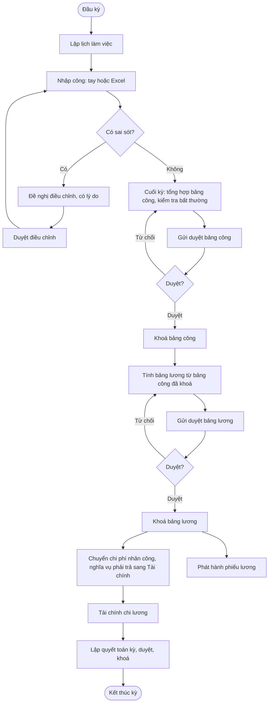
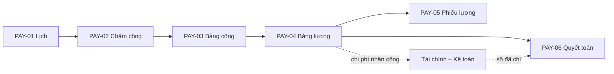
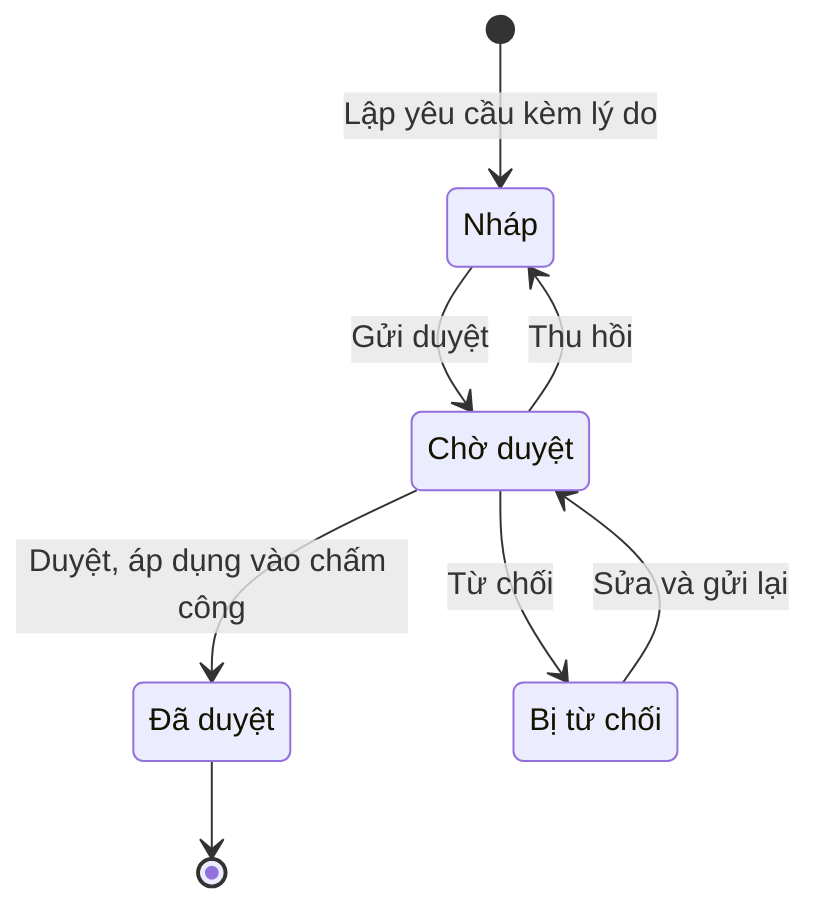
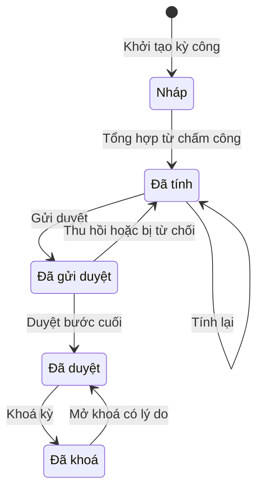
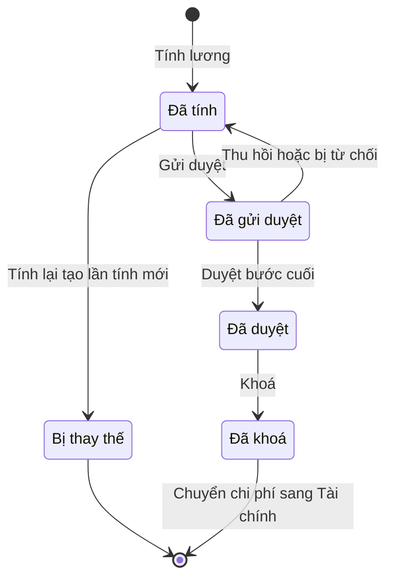
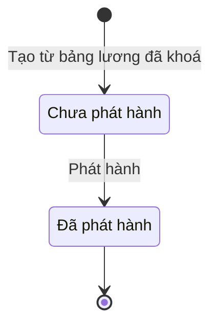
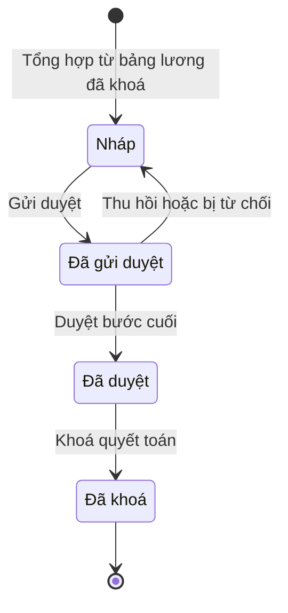
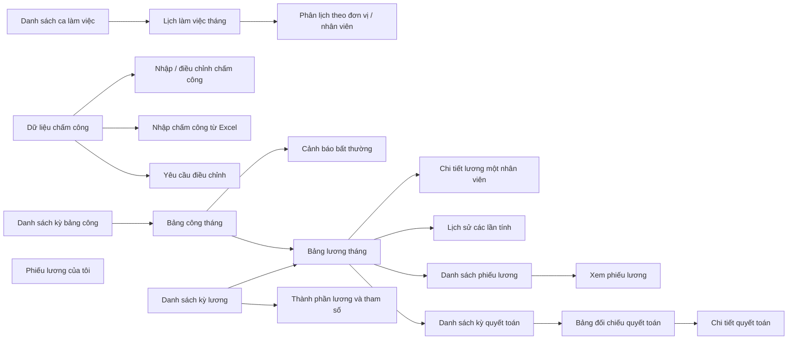

# EPIC OVERVIEW DOCUMENT (Level 1–2) — Chấm công – Tính lương

# 📑 Mục lục
- [Thông tin quản lý](#-thông-tin-quản-lý)
- [Level 1 – Product Overview](#level-1--product-overview)
- [Level 2 – Epic / Module](#level-2--epic--module)

---

## 📋 THÔNG TIN QUẢN LÝ
- **Epic ID & Name:** `EPIC_PAY` - Chấm công – Tính lương
- **Module / Phân hệ:** Chấm công – Tính lương (`payroll`)
- **Author (BA):** doanpt-vci
- **PM / Owner:** (để trống, bổ sung sau)
- **Status:** 🏷️ Nháp
- **Target Release / Sprint:** (để trống, bổ sung sau)
- **Created:** 30/10/2026
- **Last Updated:** 30/10/2026
- **Phạm vi tài liệu:** Level 1–2 (tổng quan cấp Epic). Đặc tả chi tiết từng feature con nằm ở spec riêng do skill `ba-skill` (Đặc tả chức năng) sinh.

### 🔄 Lịch sử thay đổi (Changelog)
| Ngày | Người thay đổi | Nội dung cập nhật | Version |
|------|----------------|-------------------|---------|
| 30/10/2026 | doanpt-vci | Tạo mới Epic Overview | 1.0 |
| 30/10/2026 | doanpt-vci | Cập nhật theo trả lời của PO: PM / Sprint để trống, bổ sung sau | 1.1 |

### 📋 CHANGE REQUEST LOG
| CR # | Ngày | Nguồn | Mô tả thay đổi | Before → After | Impact | Status |
|------|------|-------|-----------------|----------------|--------|--------|
| (Trống nếu chưa có CR) | | | | | | |

### 📎 TÀI LIỆU THAM CHIẾU (Reference Documents)
| STT | Tên tài liệu | Nguồn | Link tài liệu |
|-----|--------------|-------|---------------|
| 1 | Feature Matrix | docs/analysis/ | [Mở tài liệu](../../analysis/01-feature-matrix.md) |
| 2 | Sitemap, menu, danh sách màn hình | docs/analysis/ | [Mở tài liệu](../../analysis/02-sitemap-menu-screens.md) |
| 3 | Data model cấp logic | docs/analysis/ | [Mở tài liệu](../../analysis/03-data-model.md) |
| 4 | Ma trận phân quyền sơ bộ | docs/analysis/ | [Mở tài liệu](../../analysis/04-permission-matrix.md) |
| 5 | Ma trận tích hợp giữa phân hệ | docs/analysis/ | [Mở tài liệu](../../analysis/05-integration-matrix.md) |
| 6 | Business rules quan trọng | docs/analysis/ | [Mở tài liệu](../../analysis/06-business-rules.md) |
| 7 | Câu hỏi mở và Decision Log | docs/analysis/ | [Mở tài liệu](../../analysis/07-open-questions.md) |
| 8 | Kế hoạch prototype (tham số mẫu cho lương) | docs/analysis/ | [Mở tài liệu](../../analysis/08-prototype-plan.md) |
| 9 | ADR-0002 Nhiều công ty trong một khách hàng | docs/architecture/ | [Mở tài liệu](../../architecture/adr-0002-multi-company-within-tenant.md) |
| 10 | Epic Admin (quy trình duyệt, thông báo duyệt) | docs/features/admin/ | [Mở tài liệu](../admin/0_epic-overview.md) |
| 11 | Epic Tổ chức – Nhân sự | docs/features/hrm/ | [Mở tài liệu](../hrm/0_epic-overview.md) |
| 12 | Epic Tài chính – Kế toán | docs/features/accounting/ | [Mở tài liệu](../accounting/0_epic-overview.md) |

### ❓ CÂU HỎI CÒN MỞ
| Mã | Câu hỏi | Ảnh hưởng tới | Người chốt |
|----|---------|---------------|------------|
| Q03 | Nguồn chấm công: nhập tay, Excel, máy chấm công (hãng, cách lấy dữ liệu), ứng dụng di động có định vị? Giai đoạn đầu làm nhập tay + Excel (Q-PAY-01) | 1.3 Máy chấm công, PAY-02 | Khách hàng |
| Q04 | Ca qua ngày (vd. 22:00 – 06:00) tính công cho ngày bắt đầu hay ngày kết thúc ca? Đề xuất: ngày bắt đầu (Q-PAY-02) | BR_EPIC_04 | Khách hàng |
| Q05 | Danh sách thành phần lương (lương cơ bản, lương đóng bảo hiểm, phụ cấp chức vụ / công trường / xăng xe / điện thoại, thưởng, khoán…) (Q-PAY-03) | PAY-04 | Khách hàng |
| Q06 | Hệ số tăng ca ngày thường / nghỉ tuần / lễ / ca đêm; trần giờ tăng ca (Q-PAY-04) | PAY-03, PAY-04 | Khách hàng |
| Q07 | Công tiêu chuẩn tháng cố định (vd. 26) hay theo lịch thực tế? (Q-PAY-05) | PAY-04 | Khách hàng |
| Q08 | Cách tính bảo hiểm xã hội / y tế / thất nghiệp (mức đóng, trần, tỷ lệ người lao động / doanh nghiệp); ai cập nhật khi văn bản thay đổi? (Q-PAY-06) | PAY-04 | Khách hàng |
| Q09 | Thuế thu nhập cá nhân: lũy tiến, giảm trừ gia cảnh, người phụ thuộc lấy từ đâu; khấu trừ 10% với lao động thời vụ? (Q-PAY-07) | PAY-04 | Khách hàng |
| Q10 | Lương chuyển sang Tài chính dưới dạng một đề nghị chi lương tổng hay công nợ phải trả từng nhân viên? (Q-PAY-08) | PAY-04, PAY-06, 1.3.1 | Khách hàng |
| Q11 | Sai sót phát hiện sau khi khoá: mở lại kỳ hay truy lĩnh / truy thu ở kỳ sau? Đề xuất: truy lĩnh / truy thu kỳ sau (Q-PAY-09) | BR_EPIC_10 | Khách hàng |
| Q12 | Ngày chốt công và chốt lương hằng tháng; nhắc trước bao nhiêu ngày, lúc mấy giờ? (Q-PAY-10) | TB_EPIC_PAY_03 | Khách hàng |
| Q13 | Có ghi ngày công theo dự án để phân bổ chi phí nhân công theo dự án không? (Q-HRM-03) | PAY-02, PAY-03 | Khách hàng |
| Q14 | Quyết toán khi nhân viên nghỉ việc có thuộc Epic này không? Đề xuất: không, chỉ quyết toán theo kỳ | 1.1 OUT scope | Khách hàng |
| Q15 | Nhân viên tạm nghỉ có được lập lịch, chấm công trong thời gian tạm nghỉ không? | PAY-01, PAY-02 | Khách hàng |

---

## LEVEL 1 – PRODUCT OVERVIEW

### 1.1. Overview (Mục tiêu)
* **Bài toán:** Chấm công và tính lương đang làm bằng Excel ở từng công ty, nhiều bước chép tay giữa bảng công, bảng lương và chứng từ chi. Số liệu dễ sai, khó biết bảng nào là bản chốt, và kế toán không nhận được chi phí nhân công đúng kỳ.
* **Giá trị mang lại:**
  * Một luồng liền mạch: lịch làm việc → chấm công → bảng công → bảng lương → phiếu lương → quyết toán; số liệu không chép tay giữa các bước.
  * Mỗi bảng có trạng thái duyệt và khoá rõ ràng; tính lại có lịch sử từng lần tính.
  * Chi phí nhân công tự chuyển sang Tài chính khi khoá bảng lương, không ghi trùng.
* **Scope:**
  * **IN scope:**
    * Ca và lịch làm việc theo đơn vị / nhân viên; sao chép lịch giữa các kỳ.
    * Dữ liệu chấm công nhập tay, nhập Excel; điều chỉnh có lý do và có duyệt.
    * Bảng công tháng, kiểm tra dữ liệu bất thường, duyệt, khoá kỳ.
    * Bảng lương: thành phần lương cấu hình được, tính thử, tính lại, diễn giải cách tính, duyệt, khoá, chuyển chi phí sang Tài chính.
    * Phiếu lương: phát hành, xem, tải; nhân viên xem phiếu của mình.
    * Quyết toán lương theo kỳ: đối chiếu phải trả / đã trả / tạm ứng đã khấu trừ, điều chỉnh có duyệt.
    * Prototype: bảng lương chạy với **tham số mẫu** ghi rõ "chưa duyệt" cho đến khi có công thức được xác nhận (DEC-004).
  * **OUT of scope:**
    * Hợp đồng lao động, nghỉ phép độc lập (ngoài phạm vi dự án).
    * Quyết toán khi nhân viên nghỉ việc (chờ Q14).
    * Lấy dữ liệu tự động từ máy chấm công (chờ Q03).
    * Chi tiền lương — thuộc Tài chính – Kế toán.

### 1.2. User Personas
| Role | Tên vai trò | Quyền hạn chính | Tần suất sử dụng |
|------|------------|-----------------|-------------------|
| `payroll_officer` | Chuyên viên tiền lương | Lập lịch, nhập / nhập Excel chấm công, lập bảng công, tính lương, phát hành phiếu lương, lập quyết toán; khoá bảng công | Hàng ngày |
| `dept_head` | Trưởng phòng / đơn vị | Lập lịch đơn vị mình, nhập công, duyệt điều chỉnh công, gửi và duyệt bảng công đơn vị | Hàng tuần |
| `project_manager` | Ban điều hành dự án | Lập lịch, nhập công, gửi bảng công cho nhân viên dự án | Hàng tuần |
| `hr_officer` | Chuyên viên nhân sự | Xem lịch, chấm công, bảng công | Hàng tháng |
| `leadership` | Ban lãnh đạo | Duyệt bảng công, bảng lương, quyết toán; xem số tiền lương | Hàng tháng |
| `chief_accountant` | Kế toán trưởng | Duyệt bảng lương, duyệt và khoá quyết toán | Hàng tháng |
| `accountant` | Kế toán viên | Xem bảng lương, quyết toán để đối chiếu | Hàng tháng |
| `employee` | Nhân viên | Xem công, phiếu lương của mình; đề nghị điều chỉnh công | Hàng tháng |

### 1.3. Product Context Model (Mô hình tổng quan Epic)

```mermaid
graph TB
    subgraph Actors["👤 Đối tượng sử dụng"]
        U1["Chuyên viên tiền lương"]
        U2["Trưởng phòng / đơn vị"]
        U3["Ban điều hành dự án"]
        U4["Chuyên viên nhân sự"]
        U5["Ban lãnh đạo"]
        U6["Kế toán trưởng"]
        U7["Kế toán viên"]
        U8["Nhân viên"]
    end

    subgraph HeThong["🏢 Construction ERP (nội bộ)"]
        EPIC["📦 Epic: Chấm công – Tính lương<br/>(lịch, công, bảng công, bảng lương, phiếu lương, quyết toán)"]
        ADM["⚙️ Module Admin"]
        HRM["👥 Module Tổ chức – Nhân sự"]
        PRJ["🏗️ Module Quản lý dự án"]
        FIN["💰 Module Tài chính – Kế toán"]
    end

    subgraph External["🔗 Hệ thống & dịch vụ tích hợp"]
        DEV["Máy chấm công<br/>(chưa xác nhận)"]
    end

    U1 -->|"Lập lịch, nhập công, tính lương, phát hành phiếu"| EPIC
    U2 -->|"Nhập công, duyệt điều chỉnh, duyệt bảng công"| EPIC
    U3 -->|"Nhập công nhân viên dự án"| EPIC
    U4 -->|"Xem bảng công"| EPIC
    U5 -->|"Duyệt bảng công, bảng lương, quyết toán"| EPIC
    U6 -->|"Duyệt bảng lương, khoá quyết toán"| EPIC
    U7 -->|"Đối chiếu bảng lương"| EPIC
    U8 -->|"Xem công, phiếu lương; đề nghị điều chỉnh"| EPIC

    HRM -->|"Nhân viên, đơn vị, chức danh, phân công theo ngày, trạng thái<br/>(khi tạo kỳ công / kỳ lương)"| EPIC
    PRJ -->|"Dự án đang hoạt động<br/>(khi chấm công theo dự án)"| EPIC
    ADM -->|"Quy trình duyệt, kết quả duyệt, quyền<br/>(khi gửi duyệt, khi có kết quả)"| EPIC
    EPIC -->|"Chứng từ gửi duyệt<br/>(khi gửi bảng công, bảng lương, quyết toán, điều chỉnh)"| ADM
    EPIC -->|"Chi phí nhân công, nghĩa vụ phải trả lương<br/>(khi bảng lương được khoá)"| FIN
    FIN -->|"Số đã chi lương, tạm ứng cần khấu trừ<br/>(khi lập quyết toán)"| EPIC
    DEV -.->|"Giờ vào / ra<br/>(chưa xác nhận cách lấy)"| EPIC
```

*Mô tả: Nhân viên và phân công lấy từ Tổ chức – Nhân sự; bảng công, bảng lương, quyết toán đi qua quy trình duyệt dùng chung của Admin; bảng lương khoá thì chi phí nhân công và nghĩa vụ phải trả chuyển sang Tài chính; quyết toán đọc lại số đã chi. Máy chấm công là hệ thống ngoài chưa xác nhận (Q03).*

* **Thực thể dữ liệu chính:** Ca làm việc · Lịch làm việc · Bản ghi chấm công · Yêu cầu điều chỉnh chấm công · Kỳ công / kỳ lương · Bảng công (dòng theo nhân viên, giá trị ngày 01–31) · Thành phần lương · Mức lương / phụ cấp của nhân viên · Bảng lương (các lần tính) · Phiếu lương · Quyết toán lương kỳ.

#### 1.3.1. Chú giải thành phần & luồng dữ liệu qua lại
| Tên thành phần | Loại | Ý nghĩa / Vai trò | Chiều dữ liệu | Dữ liệu trao đổi | Sự kiện kích hoạt | Mức phụ thuộc |
|----------------|------|-------------------|---------------|------------------|-------------------|---------------|
| Chuyên viên tiền lương | 👤 Đối tượng sử dụng | Người vận hành chính của Epic | Người dùng → Epic | Ca, lịch, dữ liệu công, tham số lương, quyết định tính / phát hành | Hàng ngày, cuối kỳ | — |
| Trưởng phòng / đơn vị | 👤 Đối tượng sử dụng | Nhập công và duyệt cho đơn vị mình | Người dùng → Epic | Lịch đơn vị, dữ liệu công, quyết định duyệt | Hàng tuần, cuối kỳ | — |
| Ban điều hành dự án | 👤 Đối tượng sử dụng | Nhập công cho nhân viên dự án | Người dùng → Epic | Lịch, dữ liệu công | Hàng ngày | — |
| Chuyên viên nhân sự | 👤 Đối tượng sử dụng | Xem để đối chiếu nhân sự | Epic → Người dùng | Lịch, chấm công, bảng công | Cuối kỳ | — |
| Ban lãnh đạo | 👤 Đối tượng sử dụng | Người duyệt cấp cao | Người dùng → Epic | Quyết định duyệt | Cuối kỳ | — |
| Kế toán trưởng | 👤 Đối tượng sử dụng | Duyệt bảng lương, khoá quyết toán | Người dùng → Epic | Quyết định duyệt, khoá | Cuối kỳ | — |
| Kế toán viên | 👤 Đối tượng sử dụng | Đối chiếu lương với chi phí, công nợ | Epic → Người dùng | Bảng lương, quyết toán | Cuối kỳ | — |
| Nhân viên | 👤 Đối tượng sử dụng | Xem công, phiếu lương của mình | Hai chiều | → Epic: đề nghị điều chỉnh công. Epic →: công, phiếu lương | Khi cần; khi phiếu được phát hành | — |
| Module Admin | 🏢 Module cùng hệ thống | Quy trình duyệt dùng chung, quyền, công ty đang làm việc | Hai chiều | Epic →: chứng từ gửi duyệt. → Epic: kết quả duyệt | Khi gửi duyệt; khi bước cuối duyệt / từ chối | 🔴 Chặn |
| Module Tổ chức – Nhân sự | 🏢 Module cùng hệ thống | Nguồn duy nhất của nhân viên | → Epic | Nhân viên, đơn vị, chức danh, phân công theo ngày hiệu lực, trạng thái làm việc (chỉ nhân viên của công ty đang làm việc) | Khi tạo kỳ công / kỳ lương; khi nhân viên nghỉ việc | 🔴 Chặn |
| Module Quản lý dự án | 🏢 Module cùng hệ thống | Cấp dự án để gắn ngày công | → Epic | Dự án đang hoạt động | Khi chấm công theo dự án (Q13) | 🟡 Ảnh hưởng |
| Module Tài chính – Kế toán | 🏢 Module cùng hệ thống | Nhận chi phí nhân công và nghĩa vụ phải trả; cấp số đã chi | Hai chiều | Epic →: chi phí nhân công theo đơn vị / dự án / thành phần, nghĩa vụ phải trả lương (hình thức chờ Q10) — chỉ bảng lương đã khoá. → Epic: số đã chi lương, tạm ứng cần khấu trừ | Khi bảng lương được khoá; khi lập quyết toán | 🔴 Chặn |
| Máy chấm công | 🔗 Hệ thống ngoài / đối tác | Nguồn giờ vào / ra tự động [⚠️ CẦN XÁC NHẬN] (loại tích hợp chưa biết) | → Epic | Giờ vào / ra theo nhân viên | Chưa xác định (Q03) | 🟢 Tham khảo |

* **Ghi chú phụ thuộc:** Cần nhân viên và phân công (Tổ chức – Nhân sự) và quy trình duyệt (Admin) trước khi vận hành. Bảng lương thật cần công thức được xác nhận (Q05–Q09); trước đó chỉ chạy tham số mẫu. Đổi hình thức chuyển lương sang Tài chính (Q10) ảnh hưởng Epic Tài chính – Kế toán.

### 1.4. Glossary / Từ điển nghiệp vụ
| Thuật ngữ | Định nghĩa | Thuật ngữ EN |
|-----------|-----------|-------------|
| Ca làm việc | Khung giờ làm (giờ bắt đầu, kết thúc, thời gian nghỉ); có thể qua ngày | Shift |
| Lịch làm việc | Ca áp dụng cho đơn vị / nhân viên theo ngày | Work schedule |
| Bản ghi chấm công | Giờ vào / ra của một nhân viên trong một ngày, kèm nguồn (nhập tay, Excel) | Attendance record |
| Công | Đơn vị đo thời gian làm việc hợp lệ được tính lương; phân loại công thường, tăng ca, ngày nghỉ / lễ | Workday |
| Kỳ công / kỳ lương | Một tháng của một công ty (hoặc phạm vi đơn vị), dùng để lập bảng công và bảng lương | Payroll period |
| Bảng công | Tổng hợp công theo ngày 01–31 và theo loại cho từng nhân viên trong kỳ | Timesheet |
| Thành phần lương | Một khoản thu nhập hoặc khấu trừ (phụ cấp, thưởng, bảo hiểm, thuế…) | Pay component |
| Lần tính | Một lần tính bảng lương; tính lại tạo lần tính mới, giữ lần cũ để đối chiếu | Payroll run |
| Thực lĩnh | Tổng thu nhập trừ tổng khấu trừ | Net pay |
| Khoá kỳ | Chốt dữ liệu, không sửa trực tiếp được nữa | Period lock |
| Quyết toán lương kỳ | Đối chiếu lương phải trả, đã trả, tạm ứng đã khấu trừ, điều chỉnh, còn phải trả | Payroll settlement |
| Tham số mẫu | Bộ tham số lương dùng cho prototype, chưa được duyệt, hiển thị rõ "chưa duyệt" | Sample parameters |

---

## LEVEL 2 – EPIC / MODULE

### 2.1. Quy trình nghiệp vụ End-to-End của Epic
* **Tên phân hệ:** Chấm công – Tính lương
* **Mô tả luồng:** Đầu kỳ, chuyên viên tiền lương và trưởng đơn vị lập lịch làm việc. Trong kỳ, dữ liệu chấm công được nhập tay hoặc nhập Excel; sai sót được điều chỉnh có lý do và có duyệt. Cuối kỳ, hệ thống tổng hợp bảng công, kiểm tra bất thường; bảng công được gửi duyệt và khoá. Bảng lương lấy bảng công đã khoá, tính và gửi duyệt; khoá bảng lương thì chi phí nhân công chuyển sang Tài chính và phiếu lương được phát hành. Sau khi Tài chính chi lương, chuyên viên tiền lương lập quyết toán kỳ.

### 2.2. Feature Matrix (phạm vi, ảnh hưởng & trạng thái đặc tả)
| Feature ID | Tên feature | Mục đích | Actor chính | Dependencies | Risk | Spec chi tiết | Trạng thái spec |
|-----------|-------------|---------|-------------|-------------|------|---------------|-----------------|
| PAY-01 | Lịch làm việc | Ca, lịch theo đơn vị / nhân viên, sửa hàng loạt, sao chép kỳ | `payroll_officer` | Module Tổ chức – Nhân sự | TB | — | ⬜ Chưa có |
| PAY-02 | Chấm công | Nhập tay, nhập Excel, kiểm tra thiếu / trùng, điều chỉnh có duyệt | `payroll_officer`, `dept_head` | PAY-01, Module Admin | TB | — | ⬜ Chưa có |
| PAY-03 | Bảng công | Tổng hợp tháng, kiểm tra bất thường, tính lại, duyệt, khoá, xuất | `payroll_officer` | PAY-02, Module Admin, Module Quản lý dự án | Cao | — | ⬜ Chưa có |
| PAY-04 | Bảng lương | Thành phần lương, tính thử / tính lại, diễn giải, duyệt, khoá, chuyển Tài chính | `payroll_officer` | PAY-03, Module Tài chính – Kế toán, Q05–Q10 | Cao | — | ⬜ Chưa có |
| PAY-05 | Phiếu lương | Phát hành, xem, tải phiếu; nhân viên xem phiếu của mình | `payroll_officer`, `employee` | PAY-04 | TB | — | ⬜ Chưa có |
| PAY-06 | Quyết toán lương kỳ | Đối chiếu phải trả / đã trả / tạm ứng, điều chỉnh, duyệt, khoá | `payroll_officer`, `chief_accountant` | PAY-04, Module Tài chính – Kế toán | Cao | — | ⬜ Chưa có |

### 2.3. State Machine — Vòng đời trạng thái thực thể chính

> Gửi duyệt, duyệt, từ chối, thu hồi đi theo vòng đời "Phiên duyệt chứng từ" của Epic Admin; bảng dưới chỉ ghi trạng thái của chính chứng từ trong Epic này.

#### Thực thể: Yêu cầu điều chỉnh chấm công

| Trạng thái | Ý nghĩa nghiệp vụ | Feature tạo ra trạng thái này | Feature đưa trạng thái đi tiếp |
|-----------|-------------------|-------------------------------|--------------------------------|
| Nháp | Yêu cầu vừa lập, chưa gửi | PAY-02 | PAY-02 |
| Chờ duyệt | Đang trong phiên duyệt (Đã gửi / Đang duyệt) | PAY-02 | PAY-02 (qua quy trình duyệt của Admin) |
| Đã duyệt | Giá trị mới được áp dụng vào bản ghi chấm công; giá trị cũ được lưu | PAY-02 | — (kết thúc) |
| Bị từ chối | Không áp dụng; người lập sửa và gửi lại | PAY-02 | PAY-02 |

#### Thực thể: Bảng công

| Trạng thái | Ý nghĩa nghiệp vụ | Feature tạo ra trạng thái này | Feature đưa trạng thái đi tiếp |
|-----------|-------------------|-------------------------------|--------------------------------|
| Nháp | Kỳ công đã tạo, chưa có số liệu | PAY-03 | PAY-03 |
| Đã tính | Đã tổng hợp từ chấm công hợp lệ; được sửa ô theo quyền, tính lại | PAY-03 | PAY-03 |
| Đã gửi duyệt | Đang trong phiên duyệt; không sửa được | PAY-03 | PAY-03 |
| Đã duyệt | Duyệt xong, chưa khoá | PAY-03 | PAY-03 |
| Đã khoá | Dùng được để tính lương; không sửa trực tiếp | PAY-03 | PAY-03 (mở khoá), PAY-04 (dùng) |

#### Thực thể: Bảng lương (một lần tính)

| Trạng thái | Ý nghĩa nghiệp vụ | Feature tạo ra trạng thái này | Feature đưa trạng thái đi tiếp |
|-----------|-------------------|-------------------------------|--------------------------------|
| Đã tính | Kết quả một lần tính; xem được diễn giải từng nhân viên | PAY-04 | PAY-04 |
| Bị thay thế | Lần tính cũ, giữ để đối chiếu, không dùng tiếp | PAY-04 | — (kết thúc) |
| Đã gửi duyệt | Đang trong phiên duyệt | PAY-04 | PAY-04 |
| Đã duyệt | Duyệt xong, chưa khoá | PAY-04 | PAY-04 |
| Đã khoá | Bản chốt của kỳ; chi phí chuyển sang Tài chính; được phát hành phiếu lương | PAY-04 | PAY-05, PAY-06 |

#### Thực thể: Phiếu lương

| Trạng thái | Ý nghĩa nghiệp vụ | Feature tạo ra trạng thái này | Feature đưa trạng thái đi tiếp |
|-----------|-------------------|-------------------------------|--------------------------------|
| Chưa phát hành | Chỉ chuyên viên tiền lương xem trước | PAY-05 | PAY-05 |
| Đã phát hành | Nhân viên xem và tải được phiếu của mình | PAY-05 | — (kết thúc) |

#### Thực thể: Quyết toán lương kỳ

| Trạng thái | Ý nghĩa nghiệp vụ | Feature tạo ra trạng thái này | Feature đưa trạng thái đi tiếp |
|-----------|-------------------|-------------------------------|--------------------------------|
| Nháp | Đã đối chiếu phải trả / đã trả / tạm ứng; có thể thêm điều chỉnh | PAY-06 | PAY-06 |
| Đã gửi duyệt | Đang trong phiên duyệt | PAY-06 | PAY-06 |
| Đã duyệt | Duyệt xong, chưa khoá | PAY-06 | PAY-06 |
| Đã khoá | Kết thúc kỳ lương | PAY-06 | — (kết thúc) |

### 2.4. Ma trận phân quyền Epic / Module
| Tên thao tác | Feature liên quan | `payroll_officer` | `dept_head` | `project_manager` | `hr_officer` | `leadership` | `chief_accountant` | `accountant` | `employee` |
|--------------|-------------------|---|---|---|---|---|---|---|---|
| Khai báo ca; lập, sửa, sao chép lịch | PAY-01 | ✅ | ✅ (đơn vị mình) | ✅ (dự án được gán) | 👁️ | 👁️ | ❌ | ❌ | ❌ |
| Nhập công tay, nhập Excel | PAY-02 | ✅ | ✅ (đơn vị mình) | ✅ (dự án được gán) | 👁️ | 👁️ | ❌ | ❌ | 👁️ (của mình) |
| Lập, gửi yêu cầu điều chỉnh chấm công | PAY-02 | ✅ | ✅ (đơn vị mình) | ✅ (dự án được gán) | ❌ | ❌ | ❌ | ❌ | ✅ (của mình) |
| Duyệt / từ chối điều chỉnh chấm công | PAY-02 | ❌ | ✅ (khi là người duyệt của bước) | ❌ | ❌ | ❌ | ❌ | ❌ | ❌ |
| Khởi tạo, tổng hợp, tính lại, sửa ô bảng công | PAY-03 | ✅ | ✅ (đơn vị mình, sửa ô) | ✅ (dự án được gán, sửa ô) | 👁️ | 👁️ | ❌ | ❌ | 👁️ (của mình) |
| Gửi duyệt bảng công | PAY-03 | ✅ | ✅ (đơn vị mình) | ✅ (dự án được gán) | ❌ | ❌ | ❌ | ❌ | ❌ |
| Duyệt / từ chối bảng công | PAY-03 | ❌ | ✅ (khi là người duyệt của bước) | ❌ | ❌ | ✅ (khi là người duyệt của bước) | ❌ | ❌ | ❌ |
| Khoá / mở khoá bảng công; xuất bảng công | PAY-03 | ✅ | ❌ | ❌ | ❌ | ❌ | ❌ | ❌ | ❌ |
| Cấu hình thành phần lương, mức lương nhân viên | PAY-04 | ✅ | ❌ | ❌ | ❌ | ❌ | ❌ | ❌ | ❌ |
| Tính thử, tính lại, gửi duyệt bảng lương; xem diễn giải | PAY-04 | ✅ | ❌ | ❌ | ❌ | ❌ | ❌ | ❌ | ❌ |
| Xem bảng lương kèm số tiền | PAY-04 | ✅ | ❌ | ❌ | ❌ | ✅ | ✅ | 👁️ | ❌ |
| Xem bảng lương không kèm số tiền | PAY-04 | ✅ | 👁️ (đơn vị mình) | ❌ | ❌ | ✅ | ✅ | 👁️ | ❌ |
| Duyệt / từ chối bảng lương | PAY-04 | ❌ | ❌ | ❌ | ❌ | ✅ (khi là người duyệt của bước) | ✅ (khi là người duyệt của bước) | ❌ | ❌ |
| Khoá bảng lương; xuất bảng lương | PAY-04 | ✅ | ❌ | ❌ | ❌ | ❌ | ❌ | ❌ | ❌ |
| Tạo, phát hành, xuất phiếu lương | PAY-05 | ✅ | ❌ | ❌ | ❌ | ❌ | ❌ | ❌ | ❌ |
| Xem, tải phiếu lương của mình | PAY-05 | ✅ | ✅ | ✅ | ✅ | ✅ | ✅ | ✅ | ✅ |
| Lập, gửi duyệt quyết toán; xuất | PAY-06 | ✅ | ❌ | ❌ | ❌ | ❌ | ❌ | 👁️ | ❌ |
| Duyệt / từ chối quyết toán | PAY-06 | ❌ | ❌ | ❌ | ❌ | ✅ (khi là người duyệt của bước) | ✅ (khi là người duyệt của bước) | ❌ | ❌ |
| Khoá quyết toán | PAY-06 | ❌ | ❌ | ❌ | ❌ | ❌ | ✅ | ❌ | ❌ |

**Chú giải:** ✅ Được phép · ✅ (điều kiện) Được phép kèm giới hạn phạm vi · 👁️ Chỉ xem, không thay đổi dữ liệu · ❌ Không được phép

* **Quy tắc phạm vi dữ liệu:** Mọi dữ liệu thuộc công ty đang làm việc. Trưởng phòng mặc định phạm vi "phòng ban và đơn vị cấp dưới"; Ban điều hành dự án phạm vi "dự án được gán"; Nhân viên phạm vi "của mình". Số tiền lương là thông tin nhạy cảm: chỉ người có quyền xem thông tin nhạy cảm mới thấy, kể cả khi xuất file. Ban lãnh đạo ở chế độ Tất cả công ty xem gộp, chỉ đọc.

### 2.5. Screen Flow Diagram (toàn Epic)

| Màn hình | Feature sở hữu | Mục đích | Role truy cập |
|----------|----------------|---------|---------------|
| Danh sách ca làm việc | PAY-01 | Khai báo ca | `payroll_officer`; người khác xem |
| Lịch làm việc tháng | PAY-01 | Xem lịch dạng lịch tháng | Theo 2.4 |
| Phân lịch theo đơn vị / nhân viên | PAY-01 | Sửa hàng loạt, sao chép kỳ | `payroll_officer`, `dept_head`, `project_manager` |
| Dữ liệu chấm công | PAY-02 | Xem công theo ngày / tháng | Theo 2.4 |
| Nhập / điều chỉnh chấm công | PAY-02 | Nhập tay, lập yêu cầu điều chỉnh | Theo 2.4 |
| Nhập chấm công từ Excel | PAY-02 | Tải mẫu, kiểm tra, ghi | `payroll_officer`, `dept_head`, `project_manager` |
| Yêu cầu điều chỉnh | PAY-02 | Danh sách yêu cầu, duyệt | Theo 2.4 |
| Danh sách kỳ bảng công | PAY-03 | Các kỳ và trạng thái | Theo 2.4 |
| Bảng công tháng | PAY-03 | Lưới dạng bảng tính 01–31 và tổng | Theo 2.4 |
| Cảnh báo bất thường | PAY-03 | Thiếu giờ, trùng, ngoài lịch | `payroll_officer`, `dept_head`, `project_manager` |
| Danh sách kỳ lương | PAY-04 | Các kỳ lương và trạng thái | `payroll_officer`, `leadership`, `chief_accountant`, `accountant` |
| Bảng lương tháng | PAY-04 | Lưới bảng lương | Theo 2.4 |
| Chi tiết lương một nhân viên | PAY-04 | Diễn giải từng thành phần | `payroll_officer`, `leadership`, `chief_accountant` |
| Lịch sử các lần tính | PAY-04 | So các lần tính | `payroll_officer` |
| Thành phần lương và tham số | PAY-04 | Cấu hình thành phần, đánh dấu tham số mẫu | `payroll_officer` |
| Danh sách phiếu lương | PAY-05 | Tạo, phát hành, xuất | `payroll_officer` |
| Xem phiếu lương | PAY-05 | Xem, tải một phiếu | `payroll_officer` |
| Phiếu lương của tôi | PAY-05 | Nhân viên xem phiếu của mình | Mọi role |
| Danh sách kỳ quyết toán | PAY-06 | Các kỳ quyết toán | `payroll_officer`, `leadership`, `chief_accountant`, `accountant` |
| Bảng đối chiếu quyết toán | PAY-06 | Phải trả / đã trả / tạm ứng / còn phải trả | Như trên |
| Chi tiết quyết toán | PAY-06 | Điều chỉnh, duyệt, khoá | Như trên |

### 2.6. Business Rules (mức tổng quan — toàn Epic)
| Rule ID | Tên Rule | Mô tả điều kiện (VI) | Feature áp dụng |
|---------|---------|---------------------|-----------------|
| BR_EPIC_01 | Dữ liệu theo công ty | Ca, lịch, chấm công, kỳ công, kỳ lương, bảng lương, phiếu lương, quyết toán thuộc công ty đang làm việc; chỉ nhân viên của công ty đó (ADR-0002). | Tất cả |
| BR_EPIC_02 | Nhân viên lấy từ Nhân sự | Epic không tạo nhân viên; chỉ dùng nhân viên của Tổ chức – Nhân sự. Bảng công, bảng lương lưu lại đơn vị, chức danh của nhân viên theo phân công có hiệu lực trong kỳ. | PAY-01, PAY-03, PAY-04 |
| BR_EPIC_03 | Lịch không sửa hồi tố | Lịch thuộc kỳ đã khoá không sửa trực tiếp; lịch có xung đột (trùng ca cùng thời gian) không lưu được. | PAY-01 |
| BR_EPIC_04 | Ca qua ngày | Ca qua ngày tính công cho ngày bắt đầu ca [⚠️ CẦN XÁC NHẬN] (BR-PAY-01). | PAY-01, PAY-03 |
| BR_EPIC_05 | Công hợp lệ | Giờ vào / ra thô không tự là công; công chỉ tính sau khi đối chiếu với ca và các điều chỉnh đã duyệt. Mỗi nhân viên, mỗi ngày, mỗi loại công chỉ có một giá trị; nhiều bản ghi vào / ra không làm tính trùng (BR-PAY-02, BR-PAY-03). | PAY-02, PAY-03 |
| BR_EPIC_06 | Điều chỉnh có lý do | Điều chỉnh chấm công bắt buộc có lý do; lưu giá trị cũ và mới; chỉ áp dụng khi đã duyệt (BR-PAY-04). | PAY-02 |
| BR_EPIC_07 | Một kỳ cho một phạm vi | Mỗi công ty (hoặc phạm vi đơn vị) mỗi tháng chỉ có một kỳ bảng công và một kỳ lương (BR-PAY-05). | PAY-03, PAY-04 |
| BR_EPIC_08 | Bảng lương từ bảng công đã khoá | Bảng lương chỉ lấy công từ bảng công đã khoá của cùng kỳ (BR-PAY-07). | PAY-04 |
| BR_EPIC_09 | Công thức cấu hình, không cố định | Thực lĩnh = Tổng thu nhập − Tổng khấu trừ. Thành phần và cách tính từng khoản là cấu hình được duyệt, không cố định trong hệ thống. Khi tham số chưa được duyệt, mọi màn hình và tệp xuất của bảng lương ghi rõ "chưa duyệt" (BR-PAY-08, DEC-004). | PAY-04, PAY-05 |
| BR_EPIC_10 | Lần tính và khoá | Tính lại tạo lần tính mới, lần cũ giữ để đối chiếu. Chỉ lần tính đã duyệt mới được khoá. Dữ liệu đã khoá không sửa trực tiếp; sai sót sau khoá xử lý theo Q11 (BR-PAY-06, BR-PAY-10, BR-GEN-07). | PAY-03, PAY-04, PAY-06 |
| BR_EPIC_11 | Chuyển sang Tài chính một lần | Khi bảng lương được khoá, chi phí nhân công và nghĩa vụ phải trả được chuyển sang Tài chính đúng một lần cho mỗi lần tính; mở khoá và tính lại thì Tài chính ghi bút đảo và ghi mới, không sửa đè (INT-03). | PAY-04 |
| BR_EPIC_12 | Phiếu lương | Phiếu lương chỉ tạo từ bảng lương đã khoá; nhân viên chỉ xem phiếu của mình (BR-PAY-09). | PAY-05 |
| BR_EPIC_13 | Số tiền lương là thông tin nhạy cảm | Số tiền trên bảng lương, phiếu lương, quyết toán chỉ hiện với người có quyền xem thông tin nhạy cảm (và chính nhân viên với phiếu của mình), kể cả khi xuất file (BR-SEC-04). | PAY-04, PAY-05, PAY-06 |
| BR_EPIC_14 | Quyết toán đối chiếu, không tự sửa | Quyết toán so lương phải trả với số đã chi do Tài chính ghi nhận; chênh lệch được hiển thị và xử lý bằng khoản điều chỉnh có duyệt, hệ thống không tự sửa số (REC-01). | PAY-06 |

### 2.7. Thông báo quả chuông (toàn Epic)

> Thông báo gửi duyệt, đã duyệt, bị từ chối, nhắc chờ duyệt cho yêu cầu điều chỉnh chấm công, bảng công, bảng lương, quyết toán dùng **TB_EPIC_ADM_01 → TB_EPIC_ADM_04** của Epic Admin. Bảng dưới chỉ gồm thông báo riêng của Epic này.

| Mã | Sự kiện / Lịch nhắc | Người nhận | Loại | Tiêu đề | Nội dung | Mở tới |
|----|---------------------|------------|------------|---------|----------|--------|
| TB_EPIC_PAY_01 | Chuyên viên tiền lương khoá bảng lương | `accountant`, `chief_accountant` của công ty | Thông báo | Bảng lương tháng {MM/yyyy} đã khoá | {Người khoá} đã khoá bảng lương tháng {MM/yyyy}, chi phí đã chuyển sang Tài chính | Bảng lương tháng |
| TB_EPIC_PAY_02 | Chuyên viên tiền lương phát hành phiếu lương | `employee` có phiếu lương trong đợt phát hành | Thông báo | Phiếu lương tháng {MM/yyyy} đã có | {Tên công ty} đã phát hành phiếu lương tháng {MM/yyyy} của bạn | Phiếu lương của tôi |
| TB_EPIC_PAY_03 | Bảng công của kỳ chưa khoá và còn ≤ {n} ngày tới ngày chốt công [⚠️ CẦN XÁC NHẬN] · {giờ} hằng ngày [⚠️ CẦN XÁC NHẬN] · dừng khi bảng công đã khoá | `payroll_officer`; `dept_head` có đơn vị trong bảng công | Nhắc nhở | Bảng công tháng {MM/yyyy} sắp đến hạn chốt | Hạn {dd/MM/yyyy}, còn {n} ngày | Bảng công tháng |

> Đặc tả chi tiết từng feature con — xem spec riêng của feature (skill `ba-skill` (Đặc tả chức năng)).
