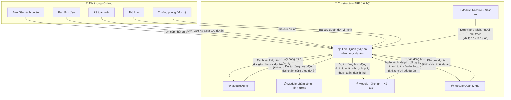
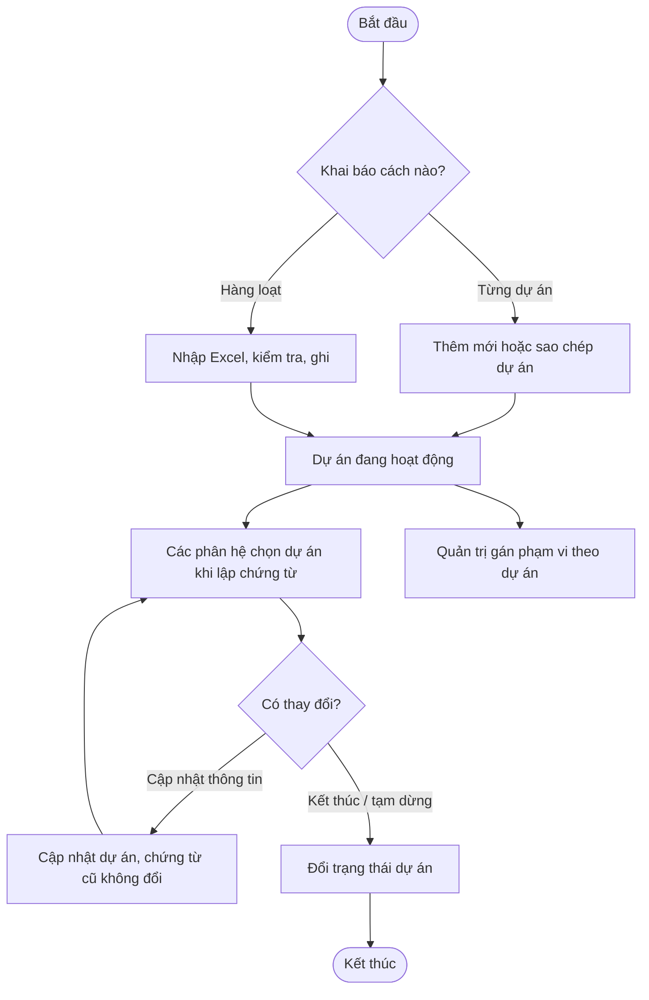
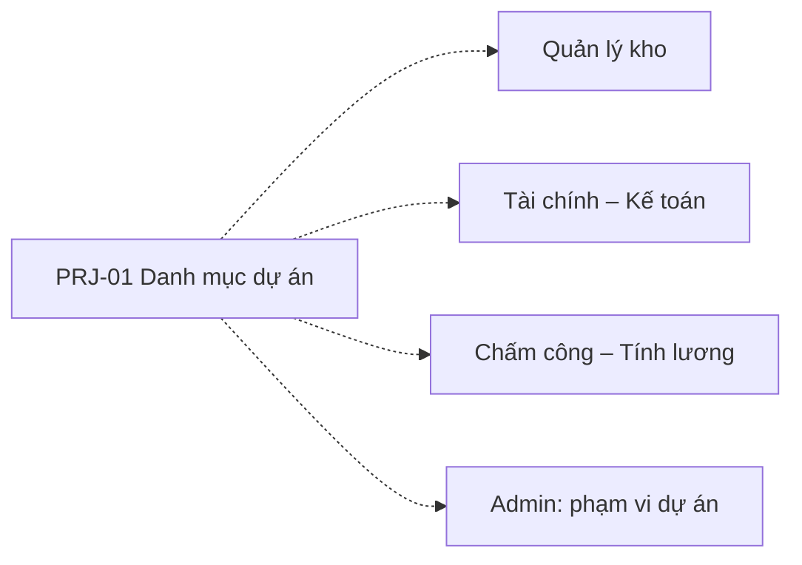
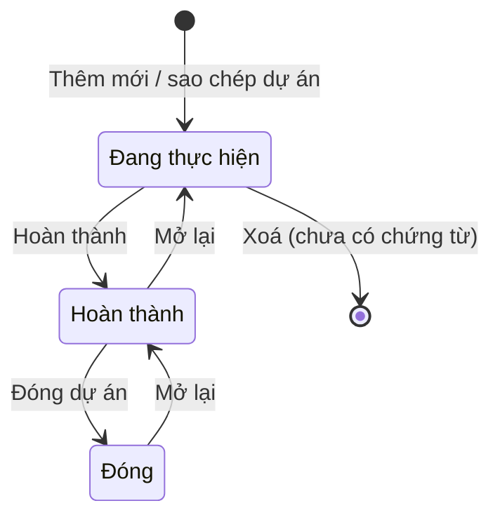
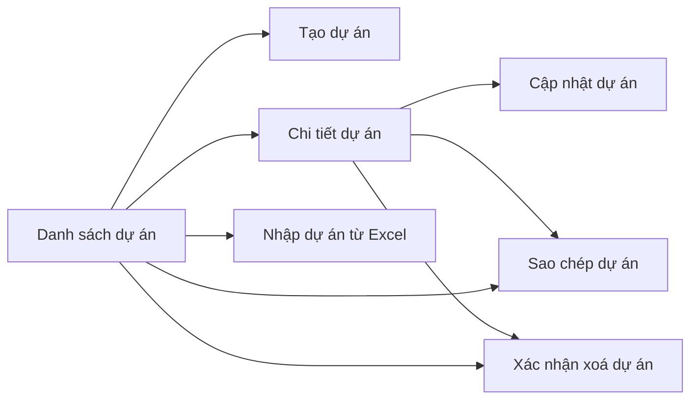

# EPIC OVERVIEW DOCUMENT (Level 1–2) — Quản lý dự án

# 📑 Mục lục
- [Thông tin quản lý](#-thông-tin-quản-lý)
- [Level 1 – Product Overview](#level-1--product-overview)
- [Level 2 – Epic / Module](#level-2--epic--module)

---

## 📋 THÔNG TIN QUẢN LÝ
- **Epic ID & Name:** `EPIC_PRJ` - Quản lý dự án (danh mục dự án)
- **Module / Phân hệ:** Quản lý dự án (`projects`)
- **Author (BA):** doanpt-vci
- **PM / Owner:** (để trống, bổ sung sau)
- **Status:** 🏷️ Nháp
- **Target Release / Sprint:** (để trống, bổ sung sau)
- **Created:** 30/10/2026
- **Last Updated:** 30/10/2026
- **Phạm vi tài liệu:** Level 1–2 (tổng quan cấp Epic). Đặc tả chi tiết từng feature con nằm ở spec riêng do skill `ba-skill` (Đặc tả chức năng) sinh.

### 🔄 Lịch sử thay đổi (Changelog)
| Ngày | Người thay đổi | Nội dung cập nhật | Version |
|------|----------------|-------------------|---------|
| 30/10/2026 | doanpt-vci | Tạo mới Epic Overview | 1.0 |
| 30/10/2026 | doanpt-vci | Cập nhật theo trả lời của PO: dự án Hoàn thành không chọn được khi lập chứng từ mới; PM / Sprint để trống | 1.1 |
| 30/10/2026 | doanpt-vci | Chốt Q03: trạng thái dự án là danh mục thêm / sửa / xoá được (ADM-05), có thuộc tính Nhận chứng từ mới; chuyển trạng thái tự do | 1.2 |
| 30/10/2026 | doanpt-vci | Huỷ thay đổi của bản 1.2 (hiểu nhầm): trạng thái dự án quay về 5 trạng thái cố định, Q03 mở lại. Thêm chức năng xoá, sao chép dự án (BR_EPIC_03, BR_EPIC_09, Q07) | 1.3 |
| 30/10/2026 | doanpt-vci | Chốt Q03 (3 trạng thái: Đang thực hiện, Hoàn thành, Đóng), Q04 (có thể có dự án con / gói thầu), Q06 (nhập Excel: người dùng chọn ghi dòng hợp lệ, tải được chi tiết lỗi), Q07 (sao chép toàn bộ trừ mã). Thêm Q08, Q09 | 1.4 |

### 📋 CHANGE REQUEST LOG
| CR # | Ngày | Nguồn | Mô tả thay đổi | Before → After | Impact | Status |
|------|------|-------|-----------------|----------------|--------|--------|
| (Trống nếu chưa có CR) | | | | | | |

### 📎 TÀI LIỆU THAM CHIẾU (Reference Documents)
| STT | Tên tài liệu | Nguồn | Link tài liệu |
|-----|--------------|-------|---------------|
| 1 | Feature Matrix | docs/analysis/ | [Mở tài liệu](../../analysis/01-feature-matrix.md) |
| 2 | Sitemap, menu, danh sách màn hình | docs/analysis/ | [Mở tài liệu](../../analysis/02-sitemap-menu-screens.md) |
| 3 | Ma trận tích hợp giữa phân hệ | docs/analysis/ | [Mở tài liệu](../../analysis/05-integration-matrix.md) |
| 4 | Business rules quan trọng | docs/analysis/ | [Mở tài liệu](../../analysis/06-business-rules.md) |
| 5 | Câu hỏi mở và Decision Log | docs/analysis/ | [Mở tài liệu](../../analysis/07-open-questions.md) |
| 6 | ADR-0002 Nhiều công ty trong một khách hàng | docs/architecture/ | [Mở tài liệu](../../architecture/adr-0002-multi-company-within-tenant.md) |
| 7 | Epic Tổ chức – Nhân sự | docs/features/hrm/ | [Mở tài liệu](../hrm/0_epic-overview.md) |
| 8 | Epic Admin | docs/features/admin/ | [Mở tài liệu](../admin/0_epic-overview.md) |

### ❓ CÂU HỎI CÒN MỞ
| Mã | Câu hỏi | Ảnh hưởng tới | Người chốt |
|----|---------|---------------|------------|
| Q08 | Dự án con: được lồng mấy cấp (đề xuất 1 cấp: dự án → dự án con / gói thầu)? Người được gán phạm vi dự án cha có tự thấy dữ liệu của dự án con không (đề xuất: có)? Dự án cha Hoàn thành / Đóng thì dự án con có bị chặn theo không (đề xuất: có)? | BR_EPIC_10 | Khách hàng |
| Q09 | Dự án Hoàn thành / Đóng có được mở lại không? Đề xuất: có, ghi lịch sử | 2.3 | Khách hàng |

---

## LEVEL 1 – PRODUCT OVERVIEW

### 1.1. Overview (Mục tiêu)
* **Bài toán:** Mọi phân hệ (kho, chi phí, ngân sách, thanh toán, tạm ứng, doanh thu, phân quyền) đều cần gắn dữ liệu với dự án. Không có một danh mục dự án chung thì mỗi bộ phận gõ tên dự án một kiểu, không tổng hợp được chi phí và quyền theo dự án.
* **Giá trị mang lại:** Một danh mục dự án duy nhất cho mỗi công ty; mọi chứng từ tham chiếu cùng một dự án, nên tổng hợp và phân quyền theo dự án chính xác.
* **Scope:**
  * **IN scope:** Danh sách, thêm mới, sửa, xoá, sao chép, xem chi tiết dự án; dự án con / gói thầu (không bắt buộc); đổi trạng thái; nhập / xuất Excel; tab xem dữ liệu liên kết (kho, ngân sách, chi phí, đề nghị thanh toán) chỉ đọc.
  * **OUT of scope:** Hợp đồng xây dựng, BOQ / WBS, tiến độ thi công, sản lượng, nghiệm thu, thanh toán hợp đồng xây dựng, BIM, quản lý thiết bị — ngoài phạm vi dự án ERP này.

### 1.2. User Personas
| Role | Tên vai trò | Quyền hạn chính | Tần suất sử dụng |
|------|------------|-----------------|-------------------|
| `project_manager` | Ban điều hành dự án | Tạo, cập nhật, nhập / xuất dự án được giao | Hàng tuần |
| `leadership` | Ban lãnh đạo | Xem, xuất mọi dự án | Hàng tuần |
| `accountant` | Kế toán viên | Xem dự án để gắn chứng từ | Hàng ngày |
| `storekeeper` | Thủ kho | Xem dự án để gắn kho, phiếu kho | Hàng ngày |
| `dept_head` | Trưởng phòng / đơn vị | Xem dự án đơn vị mình phụ trách | Hàng tuần |

### 1.3. Product Context Model (Mô hình tổng quan Epic)

*Mô tả: Dự án là danh mục gốc được mọi phân hệ tham chiếu. Màn chi tiết dự án đọc ngược dữ liệu liên kết từ Kho và Tài chính để xem, không sửa. Không có hệ thống ngoài.*

* **Thực thể dữ liệu chính:** Dự án (thuộc một công ty quản lý; có loại dự án, loại công trình, địa điểm, đơn vị phụ trách, người phụ trách, ngày bắt đầu, ngày kết thúc dự kiến, trạng thái; có thể thuộc một dự án cha nếu là dự án con / gói thầu).

#### 1.3.1. Chú giải thành phần & luồng dữ liệu qua lại
| Tên thành phần | Loại | Ý nghĩa / Vai trò | Chiều dữ liệu | Dữ liệu trao đổi | Sự kiện kích hoạt | Mức phụ thuộc |
|----------------|------|-------------------|---------------|------------------|-------------------|---------------|
| Ban điều hành dự án | 👤 Đối tượng sử dụng | Người khai báo và duy trì thông tin dự án | Người dùng → Epic | Thông tin dự án, tệp nhập Excel | Khi có dự án mới hoặc thay đổi | — |
| Ban lãnh đạo | 👤 Đối tượng sử dụng | Theo dõi danh mục dự án | Epic → Người dùng | Danh sách, chi tiết, tệp xuất | Khi cần | — |
| Kế toán viên | 👤 Đối tượng sử dụng | Chọn dự án khi lập chứng từ | Epic → Người dùng | Danh sách dự án | Khi lập chứng từ | — |
| Thủ kho | 👤 Đối tượng sử dụng | Chọn dự án khi khai báo kho, lập phiếu | Epic → Người dùng | Danh sách dự án | Khi lập phiếu | — |
| Trưởng phòng / đơn vị | 👤 Đối tượng sử dụng | Xem dự án đơn vị mình phụ trách | Epic → Người dùng | Danh sách dự án | Khi cần | — |
| Module Admin | 🏢 Module cùng hệ thống | Cấp danh mục, công ty; dùng dự án để gán phạm vi | Hai chiều | → Epic: loại dự án, loại công trình, công ty đang làm việc. Epic →: danh sách dự án | Khi tạo / sửa dự án; khi gán phạm vi | 🔴 Chặn |
| Module Tổ chức – Nhân sự | 🏢 Module cùng hệ thống | Cấp đơn vị và nhân viên phụ trách | → Epic | Đơn vị đang hoạt động, nhân viên đang làm việc | Khi tạo / sửa dự án | 🔴 Chặn |
| Module Chấm công – Tính lương | 🏢 Module cùng hệ thống | Gắn ngày công / chi phí lương với dự án | Epic → | Dự án đang hoạt động | Khi chấm công theo dự án (chờ Q-HRM-03) | 🟡 Ảnh hưởng |
| Module Tài chính – Kế toán | 🏢 Module cùng hệ thống | Gắn ngân sách, chi phí, thanh toán, tạm ứng, doanh thu với dự án; cấp số liệu cho tab dữ liệu liên kết | Hai chiều | Epic →: dự án đang hoạt động. → Epic: ngân sách, chi phí, đề nghị thanh toán của dự án | Khi lập chứng từ; khi xem chi tiết dự án | 🔴 Chặn |
| Module Quản lý kho | 🏢 Module cùng hệ thống | Kho dự án, phiếu kho theo dự án; cấp danh sách kho cho tab dữ liệu liên kết | Hai chiều | Epic →: dự án đang hoạt động. → Epic: kho của dự án | Khi khai báo kho, lập phiếu; khi xem chi tiết dự án | 🔴 Chặn |

* **Ghi chú phụ thuộc:** Cần danh mục loại dự án (Admin) và đơn vị, nhân viên (Tổ chức – Nhân sự) trước khi tạo dự án. Kho, Tài chính, phân quyền theo dự án đều cần Epic này có dữ liệu trước.

### 1.4. Glossary / Từ điển nghiệp vụ
| Thuật ngữ | Định nghĩa | Thuật ngữ EN |
|-----------|-----------|-------------|
| Dự án | Một công trình / gói việc mà công ty quản lý; mọi chứng từ liên quan tham chiếu tới | Project |
| Công ty quản lý | Pháp nhân sở hữu dự án; dự án và chứng từ của dự án thuộc công ty này | Managing company |
| Đơn vị phụ trách | Đơn vị trong cơ cấu tổ chức chịu trách nhiệm dự án | Responsible unit |
| Người phụ trách | Nhân viên chịu trách nhiệm dự án | Project manager |
| Dữ liệu liên kết | Số liệu các phân hệ khác gắn với dự án, chỉ xem tại màn chi tiết dự án | Linked data |

---

## LEVEL 2 – EPIC / MODULE

### 2.1. Quy trình nghiệp vụ End-to-End của Epic
* **Tên phân hệ:** Quản lý dự án
* **Mô tả luồng:** Ban điều hành dự án khai báo dự án (thêm mới, sao chép từ dự án có sẵn, hoặc nhập Excel), chọn loại dự án, đơn vị và người phụ trách. Dự án đang hoạt động được các phân hệ chọn khi lập chứng từ, và Quản trị dùng để gán phạm vi theo dự án. Trong quá trình thực hiện, thông tin dự án được cập nhật mà không làm đổi chứng từ đã ghi. Khi dự án kết thúc, dự án được chuyển trạng thái để không nhận giao dịch mới.

### 2.2. Feature Matrix (phạm vi, ảnh hưởng & trạng thái đặc tả)
| Feature ID | Tên feature | Mục đích | Actor chính | Dependencies | Risk | Spec chi tiết | Trạng thái spec |
|-----------|-------------|---------|-------------|-------------|------|---------------|-----------------|
| PRJ-01 | Danh mục dự án | Danh sách, thêm mới, sửa, xoá, sao chép, chi tiết, đổi trạng thái, nhập / xuất, xem dữ liệu liên kết | `project_manager` | Module Admin, Module Tổ chức – Nhân sự | TB | — | ⬜ Chưa có |

### 2.3. State Machine — Vòng đời trạng thái thực thể chính

#### Thực thể: Dự án

| Trạng thái | Ý nghĩa nghiệp vụ | Feature tạo ra trạng thái này | Feature đưa trạng thái đi tiếp |
|-----------|-------------------|-------------------------------|--------------------------------|
| Đang thực hiện | Chọn được khi lập chứng từ mới ở mọi phân hệ | PRJ-01 | PRJ-01 |
| Hoàn thành | Không chọn được khi lập chứng từ mới; chứng từ đã có giữ nguyên | PRJ-01 | PRJ-01 |
| Đóng | Không chọn được khi lập chứng từ mới; chứng từ đã có giữ nguyên | PRJ-01 | PRJ-01 |

> Xoá được ở mọi trạng thái nếu dự án chưa có chứng từ nào (BR_EPIC_03); sơ đồ chỉ vẽ trường hợp thường gặp. Các bước "Mở lại" là đề xuất [⚠️ CẦN XÁC NHẬN] (Q09).

### 2.4. Ma trận phân quyền Epic / Module
| Tên thao tác | Feature liên quan | `project_manager` | `leadership` | `accountant` | `storekeeper` | `dept_head` |
|--------------|-------------------|---|---|---|---|---|
| Xem danh sách, chi tiết dự án | PRJ-01 | ✅ (dự án được gán) | 👁️ | 👁️ | 👁️ | 👁️ (đơn vị mình phụ trách) |
| Thêm mới, sao chép dự án | PRJ-01 | ✅ | ❌ | ❌ | ❌ | ❌ |
| Sửa thông tin, đổi trạng thái dự án | PRJ-01 | ✅ (dự án được gán) | ❌ | ❌ | ❌ | ❌ |
| Xoá dự án chưa có chứng từ | PRJ-01 | ✅ (dự án được gán) | ❌ | ❌ | ❌ | ❌ |
| Nhập dự án từ Excel | PRJ-01 | ✅ | ❌ | ❌ | ❌ | ❌ |
| Xuất danh sách dự án | PRJ-01 | ✅ | ✅ | ❌ | ❌ | ❌ |
| Xem dữ liệu liên kết của dự án | PRJ-01 | 👁️ | 👁️ | 👁️ | 👁️ | 👁️ |

**Chú giải:** ✅ Được phép · ✅ (điều kiện) Được phép kèm giới hạn phạm vi · 👁️ Chỉ xem, không thay đổi dữ liệu · ❌ Không được phép

* **Quy tắc phạm vi dữ liệu:** Dự án thuộc công ty đang làm việc. Ban điều hành dự án mặc định phạm vi "dự án được gán"; Trưởng phòng thấy dự án mà đơn vị mình (và đơn vị cấp dưới) phụ trách. Tab dữ liệu liên kết chỉ hiện phần dữ liệu mà người xem có quyền xem ở phân hệ tương ứng.

### 2.5. Screen Flow Diagram (toàn Epic)

| Màn hình | Feature sở hữu | Mục đích | Role truy cập |
|----------|----------------|---------|---------------|
| Danh sách dự án | PRJ-01 | Tìm, lọc, xuất dự án | Mọi role ở 2.4 |
| Tạo dự án | PRJ-01 | Khai báo dự án mới | `project_manager` |
| Cập nhật dự án | PRJ-01 | Sửa thông tin, đổi trạng thái | `project_manager` |
| Sao chép dự án | PRJ-01 | Tạo dự án mới từ thông tin của một dự án có sẵn | `project_manager` |
| Xác nhận xoá dự án | PRJ-01 | Xác nhận trước khi xoá dự án chưa có chứng từ | `project_manager` |
| Chi tiết dự án | PRJ-01 | Thông tin dự án và dữ liệu liên kết chỉ đọc | Mọi role ở 2.4 |
| Nhập dự án từ Excel | PRJ-01 | Tải mẫu, kiểm tra, xem lỗi, ghi | `project_manager` |

### 2.6. Business Rules (mức tổng quan — toàn Epic)
| Rule ID | Tên Rule | Mô tả điều kiện (VI) | Feature áp dụng |
|---------|---------|---------------------|-----------------|
| BR_EPIC_01 | Mã dự án | Mã dự án không trùng trong công ty (BR-PRJ-01, ADR-0002). | PRJ-01 |
| BR_EPIC_02 | Công ty quản lý | Dự án thuộc công ty đang làm việc lúc tạo; không chuyển dự án sang công ty khác (BR-PRJ-02). | PRJ-01 |
| BR_EPIC_03 | Xoá dự án | Chỉ xoá được dự án chưa có chứng từ ở bất kỳ phân hệ nào và chưa được gán làm phạm vi cho người dùng; phải xác nhận trước khi xoá. Dự án đã có chứng từ thì không xoá, chỉ đổi trạng thái (BR-PRJ-03). | PRJ-01 |
| BR_EPIC_04 | Dự án ngừng nhận giao dịch | Dự án ở trạng thái Hoàn thành hoặc Đóng không chọn được khi lập chứng từ mới ở mọi phân hệ, không có ngoại lệ; chứng từ đã lập trước đó giữ nguyên (BR-PRJ-04). | PRJ-01, Tất cả phân hệ |
| BR_EPIC_05 | Sửa không đổi chứng từ cũ | Cập nhật tên, đơn vị phụ trách, người phụ trách… không làm thay đổi thông tin trên chứng từ đã ghi (BR-PRJ-05, BR-GEN-05). | PRJ-01 |
| BR_EPIC_06 | Ngày dự án | Ngày kết thúc dự kiến không được trước ngày bắt đầu (BR-PRJ-06). | PRJ-01 |
| BR_EPIC_07 | Nhập Excel | Kiểm tra toàn bộ tệp trước khi ghi. Nếu có dòng lỗi, hệ thống báo số dòng hợp lệ / lỗi và để người dùng chọn: ghi các dòng hợp lệ, hoặc huỷ không ghi dòng nào. Người dùng tải được tệp chi tiết lỗi (từng dòng, từng lỗi) về máy (BR-GEN-11). | PRJ-01 |
| BR_EPIC_08 | Dữ liệu liên kết chỉ đọc | Màn chi tiết dự án chỉ hiển thị dữ liệu của phân hệ khác, không sửa; số liệu lấy từ phân hệ chủ quản, theo quyền của người xem. | PRJ-01 |
| BR_EPIC_09 | Sao chép dự án | Sao chép tạo một dự án mới thuộc công ty đang làm việc, mang theo toàn bộ thông tin của dự án nguồn trừ mã dự án; người dùng phải nhập mã mới không trùng và sửa được mọi trường trước khi lưu. Dự án mới ở trạng thái Đang thực hiện. Chứng từ, ngân sách, chi phí ở các phân hệ khác và dự án con không thuộc thông tin dự án nên không được sao chép. | PRJ-01 |
| BR_EPIC_10 | Dự án con / gói thầu | Một dự án có thể có hoặc không có dự án con / gói thầu. Dự án con là một dự án đầy đủ (mã, trạng thái, chứng từ riêng) có chọn dự án cha cùng công ty; dự án cha tổng hợp được số liệu của các dự án con. Không xoá dự án cha khi còn dự án con. Số cấp lồng, kế thừa phạm vi và chặn theo trạng thái cha [⚠️ CẦN XÁC NHẬN] (Q08). | PRJ-01 |

### 2.7. Thông báo quả chuông (toàn Epic)

Epic không gửi thông báo quả chuông.

> Đặc tả chi tiết từng feature con — xem spec riêng của feature (skill `ba-skill` (Đặc tả chức năng)).
